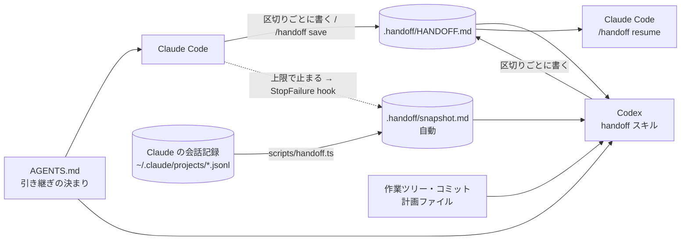

# Claude Code → Codex 引き継ぎの設計案

- 対象環境：Windows 11 ＋ WSL2（Ubuntu）、Claude Code 2.1.326（Pro）、Codex CLI 0.169.0（ChatGPT Plus。`sandbox_mode = "workspace-write"`、`approval_policy = "on-request"`）
- ステータス：ドラフト（未検証の項目は「8. 実機で確かめること」）
- 元の案（Claude がリードで Codex に TDD の Green を任せる協同の案）からの変更：目的を **Claude Code が止まったときに、Codex で同じ作業を続けること** に絞った。TDD の委任（`/delegate-green`）とレビューの委任は外した（「10. 外したもの」）。

## 1. 目的と方針

| 項目 | 方針 |
|---|---|
| 目的 | Claude Code が 5時間の上限などで止まっても、同じ worktree・同じブランチで Codex が作業を続けられる。Claude が戻ったら、Codex がした分を確かめてから続ける（双方向） |
| 引き継ぎの開始 | **人が Codex を起動して頼んだときだけ**（自動で Codex を動かさない） |
| 中断の前提 | 上限は**ターンの途中で突然**来る。止まった Claude は何も書けないので、「止まる前に書く」だけに頼らない（3段で残す。4章） |
| 状態の正 | 既存の成果物（ブランチ・コミット・**作業ツリー**・実装計画 `.claude/PRPs/plans/*.plan.md`・`docs/development-plan.md` の状態・YAML の `status`）。引き継ぎのファイルには、そこに無いことだけを書く |
| WIP コミット | **しない**。Codex は同じディスクの作業ツリーをそのまま使う（コミットしなくても渡る）。WIP コミットは PR の履歴に残り、`commit` の前の hook にも止められる |
| 置き場所 | worktree ごとの `.handoff/`（Git の対象外）。県ごとの worktree（`../vivastack-build-maps.wt/<県>`）が並行して動くため、リポジトリに1つでは足りない |

## 2. 今のリポジトリの前提

| 前提 | 中身 | 引き継ぎへの影響 |
|---|---|---|
| 共通の指示 | `AGENTS.md`（23.8KB）を両方が読む。`CLAUDE.md` は `@AGENTS.md` | 引き継ぎの決まりは `AGENTS.md` に短く書く（32KiB の上限まで約 8KB） |
| ブランチ | データ整備の間（T5-05）は `develop` から切り、PR は `develop` 向け。`develop` 向けの PR では CI もレビューも動かない | Codex は `--base develop` で PR を出せる。merge はオーナーだけ |
| 並行作業 | 県ごとに worktree（`vivastack-build-maps.wt/hiroshima` など）。メインのセッションが背景のエージェントに任せる | 止まると全部の worktree が同時に止まる。worktree ごとに引き継ぐ |
| スキル | `next-task` は `.claude/skills/` と `.agents/skills/` の両方にある。`gotouchi-content` は Claude だけ（D22） | Codex は `.claude/skills/gotouchi-content/SKILL.md` を読んで手順に従う（5章） |
| Claude 専用のエージェント | `gotouchi-source-checker`（②）、`gotouchi-derivative-checker`（④）、`security-reviewer`、`code-reviewer` | `security-reviewer` は、Codex 側にも同じ役割のものを用意する前提（別のタスク。9章）。用意できるまでと、ほかのエージェントは、Codex では動かないので「Claude に戻ったらやること」に積む |
| Codex の hooks | `.codex/hooks.json` → `run.js`。`--no-verify`・force push の拒否、gitleaks、設定ファイルの保護 | **security-trigger は今は無い**。Codex 側にも足す前提（別のタスク。9章）。足すまでは、Codex のコミットはセキュリティのレビューを通らない（6.3） |
| セッションの記録 | Claude：`~/.claude/vivastack-cc-workflows/sessions/`、会話は `~/.claude/projects/<パス>/*.jsonl`（各行に `cwd`・`gitBranch`）。Codex：`.codex/hooks/state/sessions/` | お互いの記録を読まない。これが今の引き継ぎの穴 |
| 既存のコマンド | `save-session`・`resume-session`（保存先が `~/.claude/`）。`checkpoint.md`（git stash と `.claude/checkpoints.log`。使った記録なし）は、`/handoff` と役割が重なるので削除した | 新しいコマンドは `/handoff` にする |

## 3. 全体構成



```text
<worktree>/
├── AGENTS.md                         # 「引き継ぎ」の節を足す（7章）
├── .gitignore                        # .handoff/ を足す
├── .handoff/                         # Git の対象外。worktree ごと
│   ├── HANDOFF.md                    # 台帳。Claude と Codex が書く
│   └── snapshot.md                   # 自動で作る写し（scripts/handoff.ts）。手で直さない
├── .claude/
│   ├── commands/handoff.md           # /handoff save | resume
│   └── settings.json                 # StopFailure の hook を足す（Phase 2）
├── .agents/skills/handoff/SKILL.md   # Codex で引き継ぐ手順
└── scripts/
    ├── handoff.ts                    # snapshot を作る（入口）
    └── lib/handoff.ts                # 会話記録・git の読み取り（テストつき）
```

## 4. 中断に備えて残すもの（3段）

| 段 | いつ | だれが | 何を | 突然止まったとき |
|---|---|---|---|---|
| 1. 区切りの更新 | スキルの手順の区切り（`next-task` の各手順、`gotouchi-content` の①〜④の後） | Claude（スキルの手順に1行足す） | `HANDOFF.md` の「今の手順」「次の一手」 | 最後の区切りまでは残る |
| 2. 自動の写し | 上限・API のエラーでターンが終わったとき（`StopFailure` の hook） | `scripts/handoff.ts snapshot` | `snapshot.md`：ブランチ・HEAD・`git status`・最後のユーザーの依頼・最後の作業リスト・最後の Claude の文 | 止まった時点のものが残る（hook が動けば） |
| 3. あとからの再構成 | Codex が引き継ぐとき、写しが古い・無いとき | Codex が `node scripts/handoff.ts snapshot` を実行 | 2 と同じ。会話記録は `cwd` か `gitBranch` が一致する最新の `.jsonl` から取る | hook が動かなくても取れる |

- 手動の `/handoff save` は、使用率が高くなったときなど、止まる前に気づいたときに使う（1 と同じ内容をその場で書く）。
- `snapshot.md` は `HANDOFF.md` を上書きしない（人・エージェントが書いた判断を消さないため）。
- 会話記録には秘密が混ざることがある。`snapshot.md` は Git の対象外に置き、gitleaks と同じ規則で伏せてから書く。

## 5. 台帳（`.handoff/HANDOFF.md`）

```markdown
# HANDOFF
更新：<ISO8601> ／ 更新者：claude | codex | human ／ ブランチ：<name> ／ worktree：<path> ／ 直近のコミット：<sha>
タスク：<T5-05 など> ／ 計画：<.claude/PRPs/plans/….plan.md> ／ スキルと手順：<gotouchi-content ③ など>

## ゴール
<一文。PR を出すまで、など>

## 次の一手（1つ目が再開点）
- [ ] …

## 終わったこと
- [x] …

## 決めたこと
- <決めたこと> — 理由：<理由>

## Claude に戻ったらやること
- [ ] <② の照合（specialties/xxx）> ← Codex では動かせないもの
- [ ] <Codex のコミット abc123 を security-reviewer で見る>

## Codex がしたコミット
- <sha> <件名>

## 未解決・気になること
- …
```

## 6. 手順

### 6.1 Claude：`/handoff save`（`.claude/commands/handoff.md`）

1. `git status`・`git log -1` を見る。
2. `HANDOFF.md` を更新する（無ければ 5章の形で作る）。会話にしか無いこと（決めたこととその理由、次の一手、試してうまくいかなかったこと）を必ず書く。
3. コミットはしない。最後に再開点を1〜2行で報告する。

### 6.2 Codex：`handoff` スキル（`.agents/skills/handoff/SKILL.md`）

1. `.handoff/HANDOFF.md` と `snapshot.md` を読む。`snapshot.md` が無いか、`HANDOFF.md` より古ければ、`node scripts/handoff.ts snapshot` で作り直す。
2. `git status`・`git log` と照らす。HEAD が台帳の「直近のコミット」と違えば、その差分を先に読む。作業ツリーの変更は、Claude が途中まで書いたものとして扱う（消さない・戻さない）。
3. タスクの定義（`docs/tasks/`）と計画ファイルを読む。「スキルと手順」のスキルの `SKILL.md`（`.claude/skills/` か `.agents/skills/`）を読み、その手順の続きから従う。
4. エージェントを呼ぶ手順は、Codex 側に同じ役割のもの（`security-reviewer` に当たるもの。9章の前提のタスク）があればそれを使う。無いもの（`gotouchi-content` の②・④、`next-task` のコードレビューなど）は**飛ばして**、「Claude に戻ったらやること」に書く。済ませたことにしない。
5. 区切りごとに `HANDOFF.md` を更新する（更新者 `codex`）。コミットしたら「Codex がしたコミット」に足す。
6. Codex がしないこと：merge、`main`・`develop` への直接の push、YAML の `status` を `verified`・`reviewed` に上げること（②・④ を通っていないため）、`git reset --hard`・`git clean`。

### 6.3 Claude：`/handoff resume`

1. `HANDOFF.md` を読み、「Codex がしたコミット」の差分を読む（テストを弱めていないか、触る範囲の外を変えていないか）。
2. Codex 側に security-trigger が入るまでの間は、Codex のコミットに security-trigger の対象の語があれば、`security-reviewer` で見る（入った後は、Codex がコミットの前にレビューを済ませているので要らない）。
3. 「Claude に戻ったらやること」を片付けてから、「次の一手」から続ける。

### 6.4 並行の worktree が同時に止まったとき

- メインのセッション（リポジトリの直下）の `HANDOFF.md` に、どの worktree が何をしていたか・merge の順番を書く（段1）。
- Codex は worktree ごとに起動する（`cd ../vivastack-build-maps.wt/<県> && codex`）。同じ worktree で Claude と Codex を同時に動かさない。

## 7. `AGENTS.md` に足す節（両方が読む。約 0.8KB）

```markdown
## 引き継ぎ（Claude Code ⇄ Codex）

- 作業の前に `.handoff/HANDOFF.md` があれば読み、「次の一手」から続ける。Codex で引き継ぐときは `handoff` スキルに従う。
- スキルの手順の区切りごとに `HANDOFF.md` を更新する（形と書くことは `docs/claude-codex-collab-design.md` 5章）。引き継ぎのための WIP コミットはしない。
- Codex は、Codex 側に同じ役割のものが無いエージェント（`gotouchi-*-checker`・`code-reviewer` など）を使う手順を飛ばし、「Claude に戻ったらやること」に書く。YAML の `status` を上げない。merge しない。
```

## 8. 実機で確かめること（導入の前）

| # | 確かめること | 方法 | 期待 | だめなとき |
|---|---|---|---|---|
| 1 | 上限で `StopFailure` が動き、何が入るか | hook で入力を `.handoff/stopfailure.json` に書き、上限に当たるまで使う | エラーの種類（上限か）・`session_id`・`transcript_path` が取れる | 段2をやめ、段3（Codex 側の再構成）だけにする |
| 2 | 会話記録の形 | `*.jsonl` の `cwd`・`gitBranch`・作業リストの行を見る | 2.1.326 では `cwd`・`gitBranch` があることを確認済み。作業リストの形は要確認 | 最後のユーザーの依頼と Claude の文だけにする |
| 3 | worktree での Codex のコミット | worktree で Codex に `git commit` させる | 通る | worktree の `.git` は本体の `.git/worktrees/` を指し、workspace の外になる。`[sandbox_workspace_write] writable_roots` に本体の `.git` を足す |
| 4 | worktree でのプロジェクト・hooks の信頼 | worktree で `codex` を起動し、`/hooks` を見る | 信頼済み | worktree のパスごとに信頼する（`~/.codex/config.toml` の `projects`） |
| 5 | Codex の push・`gh pr create` | ネットワークを使う操作をさせる | 承認を求められ、許せば通る | push・PR は Claude に戻ってからにする |
| 6 | Codex で出典のページを開けるか | `gotouchi-content` の①で、出典の URL を読ませる | 本文を読める | ①（下書き）も「Claude に戻ったらやること」に回し、Codex は③（派生版）と機械的な直しだけにする |

## 9. 段階導入

1. **Phase 1（手動で引き継げるようにする）**：`.handoff/` と `.gitignore`、`AGENTS.md` の節、`/handoff save | resume`、Codex の `handoff` スキル、`next-task`・`gotouchi-content` の区切りに「`HANDOFF.md` を更新する」を足す。8章の 3〜6 を確かめる。
2. **Phase 2（突然止まっても残す）**：`scripts/handoff.ts`（テストつき）、`StopFailure` の hook。8章の 1・2 を確かめる。
3. **Phase 3（任意）**：ステータスラインに 5時間の使用率を出し、高くなったら `/handoff save` を促す（`rate_limits` が取れるかは要確認）。

前提のタスク（引き継ぎとは別に、Codex 側のセキュリティを Claude と揃える。Phase 1 と並行してよい）：

- Codex の hooks（`.codex/hooks.json`・`run.js`）に security-trigger を足す。`commit` の前に止め、レビューの後に解除する流れを Claude と同じにする。
- Codex 側に `security-reviewer` と同じ役割のもの（スキルかエージェント）を用意する。security-trigger の解除はこれを通した後にする。

導入は、開発概要書に決定事項（D 番号）として書き、`docs/development-plan.md` にタスクとして足して、Phase ごとに 1PR で入れる。

## 10. 外したもの

| 元の案 | 外した理由 |
|---|---|
| `/delegate-green`（Codex に Green を任せる） | 目的（中断からの引き継ぎ）と別。今はデータ整備でコードのタスクが少ない。必要になったら別に設計する |
| WIP コミット | 作業ツリーは同じディスクにあり、コミットしなくても渡る。PR の履歴に残り、hook にも止められる |
| リポジトリの直下の `HANDOFF.md`（Git で管理） | worktree が並行するため1つでは足りない。`develop` 向けの PR に混ざる |
| `.codex-handoff/last-result.md` | `HANDOFF.md` の「Codex がしたコミット」で足りる |
| `/checkpoint` の新設 | 既存の `.claude/commands/checkpoint.md`（git stash を使う別の動き）と名前がぶつかっていた。既存のものは使った記録がなく、`/handoff` と役割が重なるので削除した |
| 公式プラグイン（codex-plugin-cc） | Claude から Codex を呼ぶためのもの。Claude が止まった後には使えない |

## 11. リスクと対策

| リスク | 対策 |
|---|---|
| 止まった時点の文脈が残らない | 3段で残す（4章）。それでも足りない分は、作業ツリーと計画ファイルから Codex が読み取る |
| Codex が検証を済ませたことにする | `status` を上げることを禁じる。「Claude に戻ったらやること」に書かせ、`/handoff resume` で片付ける |
| Codex のコミットがセキュリティのレビューを通らない | Codex 側に security-trigger と `security-reviewer` に当たるものを足す（9章の前提のタスク）。足すまでは、`/handoff resume` で Codex のコミットを見て、対象の語があれば `security-reviewer` |
| Claude と Codex が同じ worktree を同時に触る | 同時に動かさない。台帳の「更新者」で今の持ち主を示す |
| 会話記録の秘密が写しに入る | `.handoff/` は Git の対象外。書く前に伏せる |
| `AGENTS.md` が 32KiB を超える | 足すのは約 0.8KB。詳しいことはこのファイルに置く |
