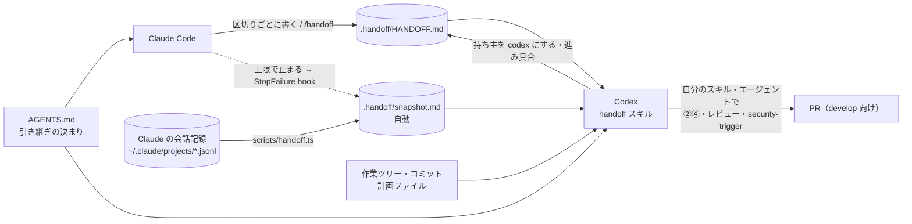

# Claude Code → Codex 引き継ぎの設計案

- 対象環境：Windows 11 ＋ WSL2（Ubuntu）、Claude Code 2.1.326（Pro）、Codex CLI 0.169.0（ChatGPT Plus。`sandbox_mode = "workspace-write"`、`approval_policy = "on-request"`）
- ステータス：ドラフト（未検証の項目は「8. 実機で確かめること」）
- 元の案（Claude がリードで Codex に TDD の Green を任せる協同の案）からの変更：
  - 目的を **Claude Code が止まったときに、Codex で同じ作業を続けること** に絞った。TDD の委任（`/delegate-green`）とレビューの委任は外した（「10. 外したもの」）。
  - 引き継ぎは **Claude Code → Codex の一方通行** にする。引き継いだタスクは Codex が PR まで仕上げ、Claude には戻さない。
  - Codex は、引き継ぎがなくても、**自分のスキル・エージェント・ルールだけでタスクを消化できる** ようにする（`next-task`・`gotouchi-content`・検証とレビューのエージェント・security-trigger を Codex 側にも持つ）。

## 1. 目的と方針

| 項目 | 方針 |
|---|---|
| 目的 | (1) Codex が単独でタスクを着手から PR まで進められる。(2) Claude Code が 5時間の上限などで止まったら、同じ worktree・同じブランチで Codex が続きを引き継ぎ、PR まで仕上げる |
| 向き | **Claude → Codex だけ**。Codex が止まっても Claude には引き継がない（Codex のセッションの再開〔`codex resume`〕か、Codex の `save-session`・`resume-session` スキルで続ける）。Claude が戻ったら、Codex が持っているタスクには触らず、別のタスクに進む |
| 引き継ぎの開始 | **人が Codex を起動して頼んだときだけ**（自動で Codex を動かさない） |
| 中断の前提 | 上限は**ターンの途中で突然**来る。止まった Claude は何も書けないので、「止まる前に書く」だけに頼らない（3段で残す。4章） |
| 状態の正 | 既存の成果物（ブランチ・コミット・**作業ツリー**・実装計画・`docs/development-plan.md` の状態・YAML の `status`）。引き継ぎのファイルには、そこに無いことだけを書く |
| 持ち主 | 1つの worktree（＝1タスク）を動かすのは、つねにどちらか一方。台帳の「持ち主」で示し、引き継いだら `codex` に変わる。`codex` の worktree に Claude は書き込まない |
| WIP コミット | **しない**。Codex は同じディスクの作業ツリーをそのまま使う（コミットしなくても渡る）。WIP コミットは PR の履歴に残り、`commit` の前の hook にも止められる |
| 置き場所 | worktree ごとの `.handoff/`（Git の対象外）。県ごとの worktree（`../vivastack-build-maps.wt/<県>`）が並行して動くため、リポジトリに1つでは足りない |

## 2. 今のリポジトリの前提

| 前提 | 中身 | 引き継ぎ・単独作業への影響 |
|---|---|---|
| 共通の指示 | `AGENTS.md` を両方が読む。`CLAUDE.md` は `@AGENTS.md` | 引き継ぎの決まりは `AGENTS.md` に短く書く（32KiB の上限に注意） |
| ブランチ | データ整備の間（T5-05）は `develop` から切り、PR は `develop` 向け。`develop` 向けの PR では CI もレビューも動かない | Codex は `--base develop` で PR を出す。merge はオーナーだけ |
| 並行作業 | 県ごとに worktree（`vivastack-build-maps.wt/hiroshima` など）。メインのセッションが背景のエージェントに任せる | Claude が止まると全部の worktree が同時に止まる。worktree ごとに引き継ぐ |
| スキル | `next-task`・`gotouchi-content` は `.claude/skills/` と `.agents/skills/` の両方にある（D22） | Codex は引き継いだ後も `.agents/skills/` の手順に従う（Claude のスキルは参照だけ） |
| エージェント | Claude：`.claude/agents/`。Codex：`.codex/agents/` に `gotouchi-source-checker`・`gotouchi-derivative-checker`・`code-reviewer`・`security-reviewer`・`task-implementer`・`general-purpose` | 引き継いだ側が②④・レビューを自分のエージェントで行う。「Claude に戻ってからやること」は作らない |
| 実装計画 | Claude：`.claude/PRPs/plans/`。Codex：`.codex/plans/`（Codex の `next-task`・`prp-plan`・`prp-implement` は Claude 側に書き込まない。引き継いだタスクだけは例外で、`next-task`・`prp-implement`・`prp-pr` に書いてある） | 引き継いだタスクの計画は、元の場所のまま Codex が更新する（6.2 の4） |
| Codex の hooks | `.codex/hooks.json` → `run.js`（`.claude/hooks/scripts/` を再利用）。`--no-verify`・force push の拒否、gitleaks、**security-trigger**（`project:pre:bash:security-trigger`）、設定ファイルの保護 | security-trigger は `chore/codex-hook-parity`（421781d）で入った。解除は `node .codex/hooks/mark-security-reviewed.js`。記録は `git rev-parse --git-path security-reviewed`（worktree では本体の `.git/worktrees/<名前>/`）に置き、Claude と共通 |
| セッションの記録 | Claude：`~/.claude/vivastack-cc-workflows/sessions/`、会話は `~/.claude/projects/<パス>/*.jsonl`（各行に `cwd`・`gitBranch`）。Codex：hooks の記録は `.codex/hooks/state/sessions/`、`save-session` の記録は worktree ごとの `.codex/sessions/`（Git の対象外） | Codex は Claude の記録を読まない。これが今の引き継ぎの穴（逆向きは要らない） |
| 既存のコマンド・スキル | Claude：`save-session`・`resume-session`（保存先が `~/.claude/`。Claude 同士の再開用）。Codex：同じ名前のスキル（`.agents/skills/`。保存先は `.codex/sessions/`。Claude の記録は明示したパスなら読めるが、自動では探さない）と `prp-commit`・`prp-pr` など（`docs/reports/codex-command-migration.md`） | 新しいコマンドは `/handoff` にする。Codex 同士の再開は `save-session`・`resume-session` を使い、引き継ぎ用の仕組みは作らない |

## 3. 全体構成



```text
<worktree>/
├── AGENTS.md                         # 「引き継ぎ」の節を足す（7章）
├── .gitignore                        # .handoff/ を足す
├── .handoff/                         # Git の対象外。worktree ごと
│   ├── HANDOFF.md                    # 台帳。Claude が書き、Codex が引き継いだ後に更新する
│   └── snapshot.md                   # 自動で作る写し（scripts/handoff.ts）。手で直さない
├── .claude/
│   ├── commands/handoff.md           # /handoff（台帳をその場で更新する）
│   └── settings.json                 # StopFailure の hook を足す（Phase 2）
├── .agents/skills/handoff/SKILL.md   # Codex で引き継ぐ手順
└── scripts/
    ├── handoff.ts                    # snapshot を作る（入口）
    └── lib/handoff.ts                # 会話記録・git の読み取り（テストつき）
```

## 4. 中断に備えて残すもの（3段）

| 段 | いつ | だれが | 何を | 突然止まったとき |
|---|---|---|---|---|
| 1. 区切りの更新 | スキルの手順の区切り（`next-task` の各手順、`gotouchi-content` の①〜④の後） | Claude（スキルの手順に1行足す） | `HANDOFF.md` の「今の手順」「次の一手」「検証の記録」 | 最後の区切りまでは残る |
| 2. 自動の写し | 上限・API のエラーでターンが終わったとき（`StopFailure` の hook） | `scripts/handoff.ts snapshot` | `snapshot.md`：ブランチ・HEAD・`git status`・最後のユーザーの依頼・最後の作業リスト・最後の Claude の文 | 止まった時点のものが残る（hook が動けば。プロセスが落ちたときは動かない） |
| 3. あとからの再構成 | Codex が引き継ぐとき、写しが古い・無いとき | Codex が `node scripts/handoff.ts snapshot` を実行 | 2 と同じ。会話記録は `cwd` か `gitBranch` が一致する最新の `.jsonl` から取る | hook が動かなくても取れる |

- 手動の `/handoff` は、使用率が高くなったときなど、止まる前に気づいたときに使う（1 と同じ内容をその場で書く）。
- `snapshot.md` は `HANDOFF.md` を上書きしない（人・エージェントが書いた判断を消さないため）。
- 会話記録には秘密が混ざることがある。`snapshot.md` は Git の対象外に置き、gitleaks と同じ規則で伏せてから書く。

## 5. 台帳（`.handoff/HANDOFF.md`）

```markdown
# HANDOFF
更新：<ISO8601> ／ 更新者：claude | codex | human ／ 持ち主：claude | codex
ブランチ：<name> ／ worktree：<path> ／ 引き継いだ時点のコミット：<sha>
タスク：<T5-05 など> ／ 計画：<.claude/PRPs/plans/….plan.md> ／ スキルと手順：<gotouchi-content ③ など>

## ゴール
<一文。develop 向けの PR を出すまで、など>

## 次の一手（1つ目が再開点）
- [ ] …

## 終わったこと
- [x] …

## 検証の記録
- ② specialties/xxx：通過（指摘なし） ／ ④ spots/yyy：再検証待ち（指摘：…）

## 決めたこと
- <決めたこと> — 理由：<理由>

## 未解決・気になること
- …
```

- 「検証の記録」は、②④やレビューの結果を会話の外に残すための節。Codex の `gotouchi-content` は、②を通った記録が無いと③④だけの再実行で `verified` にできない（`draft` のまま）。記録が無ければ、Codex は自分の検証役で②からやり直す。

## 6. 手順

### 6.1 Claude：`/handoff`（`.claude/commands/handoff.md`）

1. `git status`・`git log -1` を見る。
2. `HANDOFF.md` を更新する（無ければ 5章の形で作る。持ち主は `claude`）。会話にしか無いこと（決めたこととその理由、次の一手、試してうまくいかなかったこと、②④・レビューの結果）を必ず書く。
3. コミットはしない。最後に再開点を1〜2行で報告する。

### 6.2 Codex：`handoff` スキル（`.agents/skills/handoff/SKILL.md`）

1. `.handoff/HANDOFF.md` と `snapshot.md` を読む。`snapshot.md` が無いか、`HANDOFF.md` より古ければ、`node scripts/handoff.ts snapshot` で作り直す。
2. Claude のセッションがその worktree で動いていないことを人に確かめてから、台帳の持ち主を `codex` にし、「引き継いだ時点のコミット」を書く。
3. `git status`・`git log` と照らす。HEAD が台帳と違えば、その差分を先に読む。作業ツリーの変更は、Claude が途中まで書いたものとして扱う（消さない・戻さない）。
4. タスクの定義（`docs/tasks/`）と計画ファイルを読む。Claude が作った計画（`.claude/PRPs/plans/`）は、**引き継いだタスクに限り、その場所のまま Codex が更新する**（`.codex/plans/` に写すと、1つのタスクの計画が2つになり、「計画ファイルを実際の内容に合わせる」手順でずれるため）。新しく着手するタスクの計画は、これまでどおり `.codex/plans/` に書く。
5. 「スキルと手順」に当たる **Codex のスキル**（`.agents/skills/next-task`・`gotouchi-content`）を読み、その手順の続きから従う。エージェントを呼ぶ手順は `.codex/agents/` の同じ役割のもので行う（②④、コードレビュー、セキュリティのレビュー）。飛ばさない。
6. 区切りごとに `HANDOFF.md` を更新する（更新者 `codex`）。
7. ②④を通った項目は、Codex の `gotouchi-content` の決まりどおり `verified` にしてよい。`reviewed` にはしない。
8. コミットは security-trigger を通す（止められたら `.codex/agents/security-reviewer` でレビューし、`node .codex/hooks/mark-security-reviewed.js` の後に `git commit`。`git add` と `git commit` は分ける）。push と `gh pr create --base develop` まで行い（Codex の `prp-commit`・`prp-pr` を使ってよい）、PR の本文に「Claude Code から引き継いだ」ことと引き継いだ時点のコミットを書く。
9. Codex がしないこと：merge、`main`・`develop` への直接の push、`reviewed` への変更、`git reset --hard`・`git clean`。

### 6.3 Claude が戻ったとき

- 作業を始める前に、各 worktree の `.handoff/HANDOFF.md` の持ち主を見る。`codex` の worktree とそのブランチには書き込まない（引き継ぎは一方通行）。
- Codex が出した PR に Claude を使って何かするのは、オーナーがそう頼んだときだけ（そのときは、その PR を新しい作業として扱う）。

### 6.4 並行の worktree が同時に止まったとき

- メインのセッション（リポジトリの直下）の `HANDOFF.md` に、どの worktree が何をしていたか・merge の順番を書く（段1）。
- Codex は worktree ごとに起動する（`cd ../vivastack-build-maps.wt/<県> && codex`）。同じ worktree で Claude と Codex を同時に動かさない。

### 6.5 Codex が単独でタスクに着手するとき

- 引き継ぎがなくても、Codex は `.agents/skills/next-task`・`gotouchi-content` でタスクを着手から PR まで進める。
- Claude と同じタスクを選ばないように、両方の `next-task` で、タスクを選ぶ前に `git worktree list` とローカル・リモートのブランチを見て、そのタスクID（T5-05 は県）のブランチが既にあれば飛ばす。

## 7. `AGENTS.md` に足す節（両方が読む。約 0.8KB）

```markdown
## 引き継ぎ（Claude Code → Codex）

- 引き継ぎは Claude Code から Codex への一方通行。詳しいことは `docs/claude-codex-collab-design.md`。
- 作業の前に `.handoff/HANDOFF.md` を見る。持ち主が `codex` の worktree・ブランチに Claude は書き込まない。
- Claude はスキルの手順の区切りごとに `HANDOFF.md` を更新する（②④・レビューの結果も書く）。引き継ぎのための WIP コミットはしない。
- Codex で引き継ぐときは `handoff` スキルに従い、`.agents/skills/` と `.codex/agents/` で PR まで仕上げる。`reviewed` にしない。merge しない。
```

## 8. 実機で確かめること（導入の前）

| # | 確かめること | 方法 | 期待 | だめなとき |
|---|---|---|---|---|
| 1 | 上限で `StopFailure` が動き、何が入るか | hook で入力を `.handoff/stopfailure.json` に書き、上限に当たるまで使う | エラーの種類（上限か）・`session_id`・`transcript_path` が取れる | 段2をやめ、段3（Codex 側の再構成）だけにする |
| 2 | 会話記録の形 | `*.jsonl` の `cwd`・`gitBranch`・作業リストの行を見る | 2.1.326 では `cwd`・`gitBranch` があることを確認済み。作業リストの形は要確認 | 最後のユーザーの依頼と Claude の文だけにする |
| 3 | worktree での Codex のコミット | worktree で Codex に `git commit` と `node .codex/hooks/mark-security-reviewed.js` をさせる | 通る | worktree の `.git` は本体の `.git/worktrees/` を指し、workspace の外になる（security-trigger の記録も同じ場所）。`[sandbox_workspace_write] writable_roots` に本体の `.git` を足す |
| 4 | worktree でのプロジェクト・hooks の信頼 | worktree で `codex` を起動し、`/hooks` を見る | 信頼済み | worktree のパスごとに信頼する（`~/.codex/config.toml` の `projects`） |
| 5 | Codex の push・`gh pr create` | ネットワークを使う操作をさせる | 承認を求められ、許せば通る | 単独で PR まで進められないので、導入を止めて設定を見直す（一方通行のため Claude には回せない） |
| 6 | Codex で出典のページを開けるか | `gotouchi-content` の①②で、出典の URL を読ませる | 本文を読める | ①②を Codex で行えないので、Codex の `gotouchi-content` の決まり（①②を止めて報告）に従い、人が判断する |
| 7 | Codex の検証役・レビュー役を呼べるか | `.codex/agents/` の `gotouchi-source-checker`・`code-reviewer`・`security-reviewer` に頼む | 決まった形の報告が返る | メインが同じ手順を自分で行い、その旨を PR に書く |
| 8 | Codex の security-trigger | security-trigger の対象の語を含む変更を `git commit` させる（`run.test.js` の結合テストは通っている。実機の Codex で確かめる） | 止まり、`node .codex/hooks/mark-security-reviewed.js` の後でだけ通る | 導入を止める（9章の前提を満たさない） |

## 9. 段階導入

前提（引き継ぎより先に入れる。Codex が単独でコミットするための条件）：

- ~~Codex の hooks（`.codex/hooks.json`・`run.js`）に security-trigger を足す~~：済み（`chore/codex-hook-parity` の 421781d。merge の前。実機の確認は8章の8）。
- 両方の `next-task` に、既にあるブランチ・worktree のタスクを飛ばす手順を足す（6.5）。
- ~~Codex の `prp-implement`・`prp-pr` に、`next-task` と同じ例外を足す~~：済み（引き継いだタスクの計画は `.claude/PRPs/plans/` のまま更新し、`.codex/plans/` に写さない。6.2 の4）。

引き継ぎ：

1. **Phase 1（手動で引き継げるようにする）**：`.handoff/` と `.gitignore`、`AGENTS.md` の節、`/handoff`、Codex の `handoff` スキル、Claude の `next-task`・`gotouchi-content` の区切りに「`HANDOFF.md` を更新する」を足す。8章の 3〜8 を確かめる。
2. **Phase 2（突然止まっても残す）**：`scripts/handoff.ts`（テストつき）、`StopFailure` の hook。8章の 1・2 を確かめる。
3. **Phase 3（任意）**：ステータスラインに 5時間の使用率を出し、高くなったら `/handoff` を促す（`rate_limits` が取れるかは要確認）。

導入は、開発概要書に決定事項（D 番号）として書き、`docs/development-plan.md` にタスクとして足して、前提と Phase ごとに 1PR で入れる。

## 10. 外したもの

| 元の案 | 外した理由 |
|---|---|
| `/delegate-green`（Codex に Green を任せる） | 目的（中断からの引き継ぎ）と別。今はデータ整備でコードのタスクが少ない。必要になったら別に設計する |
| Codex → Claude の引き継ぎ（`/handoff resume`） | Codex が自分のスキル・エージェントで PR まで仕上げられるので、戻す必要がない。向きを1つにすると、持ち主の切り替えと台帳の書き手が単純になる。Codex が止まったら `codex resume` か `resume-session` で続ける |
| 「Claude に戻ったらやること」 | Codex 側に検証・レビューのエージェントと security-trigger を揃えるので、Codex で済ませる |
| WIP コミット | 作業ツリーは同じディスクにあり、コミットしなくても渡る。PR の履歴に残り、hook にも止められる |
| リポジトリの直下の `HANDOFF.md`（Git で管理） | worktree が並行するため1つでは足りない。`develop` 向けの PR に混ざる |
| `.codex-handoff/last-result.md` | Codex が PR まで出すので、結果は PR に残る |
| `/checkpoint` の新設 | 既存の `.claude/commands/checkpoint.md`（git stash を使う別の動き）と名前がぶつかっていた。既存のものは使った記録がなく、`/handoff` と役割が重なるので削除した |
| 公式プラグイン（codex-plugin-cc） | Claude から Codex を呼ぶためのもの。Claude が止まった後には使えない |

## 11. リスクと対策

| リスク | 対策 |
|---|---|
| 止まった時点の文脈が残らない | 3段で残す（4章）。それでも足りない分は、作業ツリーと計画ファイルから Codex が読み取る。②④の結果が残っていなければ、Codex の検証役でやり直す |
| Codex の検証・レビューが Claude と食い違う | どちらの検証も `verified` までで、`reviewed` は人のレビュー（⑦）とオーナーの判断（⑧）を通す。揃えるため、片方のエージェント・スキル・ルールを変えたら、もう片方も見直す |
| Codex のコミットがセキュリティのレビューを通らない | Codex の hooks に security-trigger を入れた（421781d）。実機で止まることを確かめてから導入する（8章の8） |
| 引き継いだタスクの計画が2つになる | Codex の `next-task`・`prp-implement`・`prp-pr` に、引き継いだタスクの計画は元の場所で更新する例外を書いた |
| Claude と Codex が同じ worktree・同じタスクを触る | 台帳の持ち主で示し、`codex` の worktree に Claude は書き込まない。同時に動かさない。タスクの選択で既にあるブランチを飛ばす（6.5） |
| 会話記録の秘密が写しに入る | `.handoff/` は Git の対象外。書く前に伏せる |
| `AGENTS.md` が 32KiB を超える | 足すのは約 0.8KB。詳しいことはこのファイルに置く |
