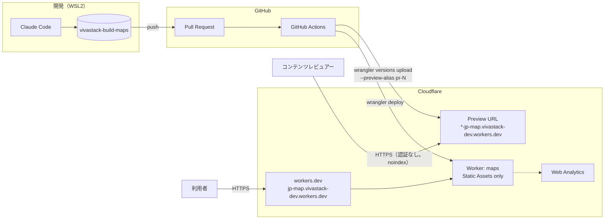
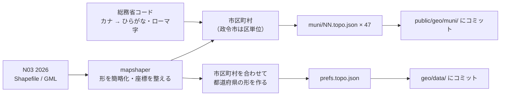
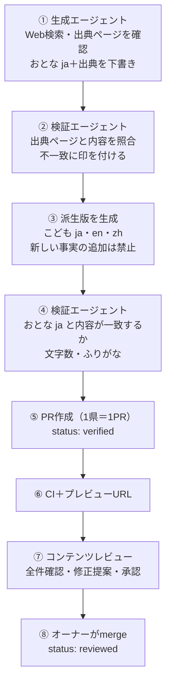
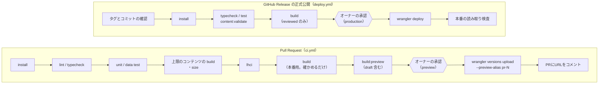
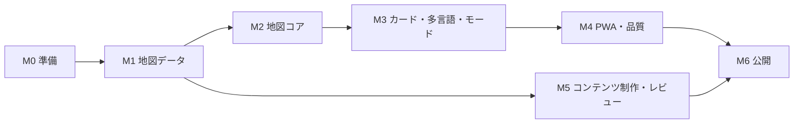

# 「ご当地めいぶつ日本地図」開発概要書

| 項目 | 内容 |
|---|---|
| ドキュメント | docs/development-overview.md |
| 版 | 0.24（ドラフト） |
| 作成日 | 2026-11-11 |
| 更新日 | 2026-11-21（0.2：リポジトリ構成を `vivastack-labs/vivastack-build-maps` 単独リポジトリに合わせて修正。0.3：操作仕様（4.11）とページの組み立て（6.6、D23・D24）を追加。0.4：対応環境（5.3、D25）とスタイルの方式（6.2、D26）、フォントとUI文言の多言語化（6.2、D27・D28）を確定。0.5：タスク分解を [development-plan.md](development-plan.md) と `docs/tasks/` に分け、未決事項 U12・U13 を追加。0.6：Node.js 26 で corepack が同梱されなくなったことに合わせて、pnpm の入れ方（11.6）を修正。0.7：配信先を workers.dev の専用のドメインに変え、`/maps` のプレフィックスをやめた（D35）。0.8：小笠原村など `viewBox` の外に出る島の表示を決めた（U16、D36）。0.9：最初の読み込みのサイズを基準値に収めるため、カードの内容を県ごとの JSON にした（5.1・5.3、6.6 (2)、F-MODE-04、D24・D38）。0.10：CSP の置き場所と `style-src`（5.5、6.6 (4)、D39）。0.11：PWA のオフラインで使える範囲と Service Worker のツールを決めた（5.4、U3・U13、D40・D41）。0.12：アクセシビリティの検査（axe・コントラストの単体テスト）と、ふりがなの読み上げの対処を 5.2 に書いた。0.13：Lighthouse CI の測り方と TBT の基準を 5.1 に書き、ハッシュつきのずれの直し方を決めた〔D42〕。0.14：執筆ルールとレビュー基準を `content/guidelines/` に書き（T5-01）、9.2・9.3 に参照を足した。`status` を `reviewed` にするのは、承認の後にオーナー。0.15：ふりがなの自動付与のツール（`pnpm content:furigana`、`lindera-wasm-nodejs-ipadic`）と、①〜④のスキル・エージェント（`gotouchi-content`・`gotouchi-source-checker`・`gotouchi-derivative-checker`）を決めた〔T5-02〕。0.16：出典のリンク切れチェック（`pnpm content:links`、`link-check.yml`）の上限・分類・終了コード・安全の方針を 12.4 に決めた〔T5-03〕。0.17：リポジトリを public にし、`main` をルールセット2つで守り、GitHub の設定を `pnpm github:setup` で反映するようにした。Cloudflare API Token の最小権限を決め、Access の手順を公式ドキュメントで書いた（11.1〜11.5、13、U5・U14、D44・D45。U7 は T0-06 に移した）〔T0-05〕。0.18：プレビューURLを Cloudflare Access で守るのをやめた（D20 → D46。リポジトリを public にしたので、下書きはすでに公開されている。U7 は不要になった）。PR のプレビューと `main` の本番へのデプロイ（12.1〜12.3。Token の job は `main` の道具と PR の `dist/` だけを扱う。11.2）〔T0-06〕。0.19：`README.md` を書き直し（6.5）、ローカル開発環境（11.6）に yamllint・`pnpm lint`・`pnpm typecheck`・Playwright の入れ方・デプロイは CI だけで行うこと〔障害時の切り戻しだけ手元〕を足し、コードブロックを README・AGENTS.md への参照に置き換えた。10.1 に CHANGELOG を書くタイミングを足した）〔T0-07〕。0.20：運営者と問い合わせ窓口の方針を決めた（5.6、D47）。トップページのフッターは説明ページへのリンクに絞った（4.11.7、D48）。0.21：本番のアクセス解析とデプロイ後の確認を追加し、初回公開の連絡先を確定した（T6-02、D47・D49）。0.22：本番デプロイを GitHub Release の正式公開に切り替えた（D50）。0.23：東京都を最大化したときは23区に寄るようにした（6.6 (1)、D51）。0.24：本番の URL を `https://jp-map.vivastack-dev.workers.dev/` に変えた（Worker 名 `maps` → `jp-map`、D52）） |
| リポジトリ | vivastack-labs/vivastack-build-maps（リポジトリ直下がアプリ本体） |
| 公開URL | `https://jp-map.vivastack-dev.workers.dev/{ja,en,zh}/` |
| ステータス | 検討フェーズの決定事項を反映。「要検証」とした項目は実装時に確定する |

---

## 1. 概要

### 1.1 目的

47都道府県の名物と名所を、日本地図から直感的に探せるWebアプリを作り、無料で一般公開する。子どもの学習にも、大人の旅行の下調べにも使えることを目指す。

### 1.2 背景

別のLLMで作った単一HTMLのプロトタイプ（`Japanese_Local_Specialties_Map.html`、約926KB）で、操作感と機能の方向性は確認できた。ただし、データ構造、表示速度、コンテンツの正確性、スマホ操作、多言語対応の面で、正式なアプリとして公開するには作り直しが必要である。

### 1.3 プロトタイプからの主な変更点

| 観点 | プロトタイプ | 正式版 |
|---|---|---|
| 構成 | 単一HTML・素のJavaScript | Next.js（静的出力）＋TypeScript |
| 地図データ | 座標変換済みのSVGパスを埋め込み（約800KB）。市区町村は2016年のデータ | 国土数値情報 N03 **2026年版**から作るTopoJSON。市区町村は県ごとに分けて必要なときに読み込む |
| 県のデータ | 番号参照の配列、`<ruby>` HTMLを直書き | スキーマ付きのYAML。ふりがなは独自の記法で書く |
| 言語 | 日本語のみ | 日本語・英語・中国語（簡体字） |
| 利用者 | 子ども向けの文体だけ | こども向け／おとな向けの2系統。ふりがなON/OFF |
| 政令指定都市 | 市を1つの区域として表示 | 区まで分けて表示 |
| 東京からの距離 | 固定値 | 緯度経度から計算 |
| コンテンツの正確性 | 確認していない | AIで作成し、検証エージェントとチームのレビュアーが確認する。出典を明記する |
| スマホ | ホバー前提。ダブルタップは動作未確認 | タップで選択、下から出るパネル、ピンチで拡大 |
| 配信 | なし | Cloudflare Workers（Static Assets）、GitHub Actionsで自動デプロイ |

---

## 2. 対象ユーザーと利用シーン

| ユーザー | 利用シーン | モード |
|---|---|---|
| 小学生（中学年以上） | 社会科で都道府県を覚える、家庭学習 | こども（ふりがなON） |
| 保護者・教員 | 子どもと一緒に見る、授業の補助 | こども／おとな |
| 一般の大人・旅行者 | 旅行先の名物・名所を下調べする | おとな |
| 訪日客 | 英語・中国語で日本の地域の特色を知る | おとな（en / zh） |

- **言語**：`ja` / `en` / `zh`（簡体字。言語指定は `zh-Hans`）
- **モード**：`kids` / `adult`。すべての言語で両方を用意する
- **ふりがな**：日本語では、こども向け・おとな向けのどちらでもON/OFFを切り替えられる

---

## 3. スコープ

### 3.1 MVP

- プロトタイプの全機能（第4章）
- 第1章 1.3 で挙げた変更点
- 3言語 × 2モード × ふりがなON/OFF
- 出典の表示（出典がないものは「出典なし」と明記）
- PWA（ホーム画面への追加、オフライン表示。範囲は第5章）

### 3.2 PHASE 2

- 検索（県名、名物、名所）
- お気に入り
- クイズ・学習モード
- 名物のカテゴリ絞り込み（食べ物・工芸・祭りなど）

### 3.3 対象外

- ユーザー投稿やコメント機能
- ログイン・アカウント機能
- 実際の地図（道路・地形）を重ねること
- 乗換案内とのリアルタイム連携（所要時間は「目安」として静的に持つ）
- 県ごとの個別ページ（SEO目的の詳細ページは PHASE 2 以降で検討）

---

## 4. 機能要件

> 【MVP】と書いたものは MVP の必須機能。プロトタイプにあった機能は原則すべて引き継ぐ。

### 4.1 地図表示

| ID | 要件 |
|---|---|
| F-MAP-01 | 47都道府県を8地方ごとに色分けし、県名ラベルを表示する。画面が狭いとき（目安：幅820px以下）は県名ラベルを出さない |
| F-MAP-02 | 沖縄県は左上の点線枠の中に移して表示する |
| F-MAP-03 | 地図の下に8地方の色見本（凡例）を表示する |
| F-MAP-04 | 閲覧環境の設定（`prefers-color-scheme`）に合わせてライト／ダークを切り替える |
| F-MAP-05 | 画面が狭いときは、地図とカードを縦に並べる。スマホではカードを下から出るパネルにする（幅の区切りは 4.11.7） |
| F-MAP-06 | 「日本海」「太平洋」の海域名を表示する |

### 4.2 県の情報カード

| ID | 要件 |
|---|---|
| F-CARD-01 | 県にマウスをのせる（ホバー）と、その県の情報をカードに表示する（ホバーできる環境のみ） |
| F-CARD-02 | 基本情報として、地方名、県名、県庁所在地を表示する |
| F-CARD-03 | 東京都庁から県庁所在地までの直線距離（km、概算）を表示する。値は緯度経度から計算する（第7章） |
| F-CARD-04 | おすすめの行き方を表示する（交通手段、経路、所要時間の目安）。「目安」であることを明記する |
| F-CARD-05 | 名物を3つ表示する（絵文字、名前、ひとこと解説） |
| F-CARD-06 | 名所を3つ表示する（名前、ひとこと解説） |
| F-CARD-07 | 県をクリック（スマホではタップ）すると、その県をカードに固定表示する |
| F-CARD-08 | 「大きくして市区町村を見る」「元の大きさにもどす」ボタンを置く |

### 4.3 ツールチップ

| ID | 要件 |
|---|---|
| F-TIP-01 | 県のツールチップに、県名と名物3つの名前を表示する（マウス操作のときのみ） |
| F-TIP-02 | 県を最大化しているときは、市区町村のツールチップに名前と読みがなを表示する。政令指定都市の区は「市名＋区名」で表示する |

### 4.4 拡大・縮小・移動

| ID | 要件 |
|---|---|
| F-ZOOM-01 | 地図全体を拡大・縮小できる。方法は「＋」「−」ボタン、キーボードの `+` `-`、マウスホイール、スマホのピンチ |
| F-ZOOM-02 | 「全体」ボタンまたは `0` キーで、全体表示に戻す |
| F-ZOOM-03 | 拡大しているときは、ドラッグ（スマホは1本指のスワイプ）で地図を動かせる |
| F-ZOOM-04 | 県をダブルクリックすると最大化し、もう一度ダブルクリックすると元に戻す。最大化した県は固定表示にする。スマホではカード内のボタンで操作する（4.11） |
| F-ZOOM-05 | 動きを減らす設定（`prefers-reduced-motion`）がされている環境では、アニメーションしない |

### 4.5 市区町村の表示（県の最大化中）

| ID | 要件 |
|---|---|
| F-MUNI-01 | その県の市区町村の境界を、濃淡をつけて表示する。**政令指定都市（20市）は区まで分けて表示する** |
| F-MUNI-02 | 名前ラベルは入りきる所だけ表示し、さらに拡大するとラベルが増える |
| F-MUNI-03 | マウスをのせた市区町村を強調する |
| F-MUNI-04 | ほかの県は薄く表示する。別の県をダブルクリックすると、その県の表示に切り替える |
| F-MUNI-05 | 市区町村データは、県を最大化したときに初めて読み込む（第7章 7.4） |

### 4.6 県名さくいん

| ID | 要件 |
|---|---|
| F-IDX-01 | 47都道府県を8地方に分けて、県名ボタンの一覧を表示する |
| F-IDX-02 | 地図と同じ操作ができる（ホバーで表示、クリックで固定、ダブルクリックで最大化） |
| F-IDX-03 | 地図を見られない利用者のために、地図の代わりに使える操作手段として作る（第5章 5.2） |

### 4.7 キーボード操作

| ID | 要件 |
|---|---|
| F-KB-01 | Tabキーで地図に入り、矢印キーで県を移動すると、カードを表示する（地図全体をTabの停止位置1つにする。4.11.6） |
| F-KB-02 | Enter または Space で固定表示にする |
| F-KB-03 | Shift + Enter で最大化する |
| F-KB-04 | `+` `-` `0` で拡大・縮小・全体表示にする |
| F-KB-05 | Esc で最大化を解除する。最大化していないときは固定表示を解除する（新規） |

### 4.8 モード・ふりがなの切替

| ID | 要件 |
|---|---|
| F-MODE-01 | 「こども」「おとな」のモードを切り替えられる。切り替わるのは解説文と表現 |
| F-MODE-02 | 日本語では、どちらのモードでもふりがなをON/OFFできる |
| F-MODE-03 | 選んだモードとふりがなの設定は、ブラウザ（localStorage）に保存する。保存できない環境でも既定値で正しく表示する |
| F-MODE-04 | 両方のモードの文を、HTML（案内文など）とカードの内容のJSON（6.6 (2)、D38）に含めておき、表示はCSSで切り替える（既定のモードで読める。カードの内容はJSONなので、JavaScriptがないときは読めず、代わりの文を出す） |

### 4.9 言語の切替

| ID | 要件 |
|---|---|
| F-I18N-01 | URLは `/ja/`、`/en/`、`/zh/` とする |
| F-I18N-02 | `/` へのアクセスは `/ja/` へリダイレクト（301）する。**ブラウザの言語設定による自動の振り分けはしない** |
| F-I18N-03 | 各ページに言語切替ボタンと `hreflang`（`ja` / `en` / `zh-Hans` / `x-default`）を設定する。`<link rel="canonical">` はそのページの URL。URL はサイトの絶対 URL（D8・D35。プレビュー用のビルドも本番の URL。`noindex` が付く）。切替の名前はその言語で書く（日本語・English・中文） |
| F-I18N-04 | 画面の文言（UI）も3言語に対応する |
| F-I18N-05 | 市区町村名は、英語はローマ字（ヘボン式）、中国語は日本語の漢字表記をそのまま使う（MVP） |

### 4.10 出典の表示

| ID | 要件 |
|---|---|
| F-SRC-01 | カードの下に、折りたたみ式（`<details>`）の「出典」欄を置く |
| F-SRC-02 | 名物・名所・行き方の項目ごとに、出典（タイトル、URL、確認日）を表示する |
| F-SRC-03 | 出典がない項目には「出典なし」と表示する |
| F-SRC-04 | 地図データの出典と、AI で作成し人が確認していることを「このサイトについて」に明記する。トップページのフッターから同ページに移動できる（D48） |

### 4.11 操作仕様

4.1〜4.7 の要件を組み合わせたときの動きを定める。E2Eテストと、操作の状態遷移の単体テストは、この節を元に書く。

#### 4.11.1 操作の状態

| 状態 | 内容 |
|---|---|
| `hovered` | マウスをのせている（またはフォーカスしている）県。なければ空 |
| `pinned` | 固定表示している県。なければ空 |
| `maximized` | 最大化している県。なければ空 |
| `viewport` | 拡大率と表示位置 |

- カードには、`pinned` があればその県を、なければ最後に `hovered` になった県を表示する。
  - マウスが県から離れても、最後に表示したカードは残す（県と県の間の海を通るたびにカードがちらつかないようにするため）。
  - どちらもないときは「県にマウスをのせるか、タップしてください」と案内を表示する。768px未満でパネルが閉じている間は、パネルの中の案内文は見えないので、同じ案内文を地図のすぐ下に出す（4.11.7）。
- **最大化した県は必ず固定表示にする**（`maximized` が空でなければ、`pinned` は同じ県）。
- 状態の変化は純粋関数（`mapReducer(state, event)`）で実装し、4.11.2 の表の1行ごとに単体テストを書く。

#### 4.11.2 状態遷移

| 操作 | 通常 | 固定中 | 最大化中 |
|---|---|---|---|
| ホバー（県） | カードに表示する | カードは変えない（ツールチップだけ） | 市区町村のツールチップだけ |
| クリック（県） | 固定する | 同じ県なら解除、別の県なら固定を移す | 何もしない |
| ダブルクリック（県） | 最大化＋固定 | 最大化＋固定 | 同じ県なら元に戻す（固定は残す）、別の県ならその県に切り替える |
| 海・余白をクリック | — | 固定を解除する | 何もしない |
| Esc | — | 固定を解除する | 最大化を解除する（固定は残す） |
| パネルの「とじる」（768px未満。4.11.3） | — | 固定を解除する | 最大化と固定を解除する（`closeCard`） |
| `0`／「全体」 | 全体表示 | 全体表示（固定は残す） | 最大化を解除して全体表示（固定は残す） |
| `+` `-` | 拡大・縮小 | 拡大・縮小 | 拡大・縮小（縮小は県全体が収まる倍率まで） |

- ダブルクリックの前には、クリックが2回起きる（固定 → 解除）。この表のとおりにすると最後は必ず「最大化＋固定」になるので、クリックの処理を遅らせるタイマーは使わない（反応が遅くなり、INPも悪くなるため）。
- 最大化中のシングルクリックで何もしないのは、元に戻すダブルクリックで固定が外れないようにするため。
- キーボードは、フォーカス＝ホバー、Enter／Space＝クリック、Shift + Enter＝ダブルクリックとして扱う。
- 下から出るパネル（4.11.3）の中で Esc を押したときも、この表の Esc と同じ（最大化中は最大化だけを解き、そうでなければ固定を解除してパネルを閉じる）。
- 県名さくいんのボタンも、この表に従う（F-IDX-02）。ただし、1024px未満（1列の配置。4.11.7）では、さくいんのホバー（マウス・キーボードのフォーカス）ではカードを変えない。カードがさくいんの上にあり、カードの高さが変わるとさくいんがずれて、クリックが別の項目に当たるため（T3-06）。クリック・Enter・Space・Shift + Enter は同じ。
- 言語を切り替えるときは、固定している県をURLのハッシュ（例：`/en/#pref-13`）で引き継ぐ。ページを開いたときにハッシュがあれば、その県を固定する（T3-07）。
  - ハッシュを書くのは `history.replaceState`（履歴を増やさない。戻るボタンで固定をたどらない）。固定を外すとハッシュも消す。言語切替のリンクの `href` にも、固定している県のハッシュを付ける。
  - 引き継ぐのは固定だけ（最大化は引き継がない）。正しくないハッシュ（`#pref-99`・`#pref-1`・`#foo`）は無視する（固定せず、ハッシュも消さない）。
  - 768px未満（4.11.3）でハッシュから復元したとき（利用者の操作の前）は、パネルを全部見える状態で開く（ハイドレーションの前の見た目〔`:target`・`data-hash-pref`〕と同じで、読み込みの途中でパネルが縮まない。CLS）。フォーカスは動かさない（読み込み直後にフォーカスが動くと、読み上げ・キーボードの利用者には予想外のため。WCAG 3.2.1）。利用者が操作してから固定したときは、一部だけ見える状態で開く（4.11.3）。
  - 言語切替のリンクはふつうの `<a>`（全体の読み込み）にする。ソフトナビゲーションでは、保存したモード・ふりがな（`<html data-mode data-ruby>`）が言語の既定値に書き戻される（T3-05）。JavaScriptがないときは、ハッシュなしの `/{lang}/` に移る。

#### 4.11.3 スマホ（タッチ操作）

- マウスとタッチは、Pointer Events の `pointerType` で区別する。
- タップはクリックとして扱う（固定する）。固定と同時に、下から出るパネルを開く。**パネルの開閉は、固定の有無に合わせる**。
  - パネルは3つの状態を持つ。閉じている（固定がない）／一部だけ見える（固定したとき）／全部見える（パネルの「くわしく」を押したとき。「たたむ」で一部だけに戻る）。固定を外す（海のタップ・同じ県のタップ・Esc）とパネルは閉じ、次に開くときは一部だけ見える状態から始まる。固定したまま別の県に切り替えても、状態は変わらない。
  - パネルの上端のバーに、「くわしく／たたむ」と「とじる」のボタンを置く。「とじる」は固定を解除する。最大化中なら最大化も解除する（最大化は固定している県だけなので。`closeCard`）。ドラッグでの開閉はない。
  - マウスのホバー（固定なし）では開かない。
- ダブルタップは使わない（ブラウザのダブルタップ拡大と衝突するため）。最大化はカード内のボタンで行う（F-ZOOM-04）。
- 地図のSVGには `touch-action: none` を付け、ピンチとスワイプは d3-zoom で処理する。d3-zoom のダブルクリックでの拡大は無効にする。
- ツールチップは表示しない（F-TIP-01）。

#### 4.11.4 本番で `reviewed` になっていない県

7.1 のとおり、`reviewed` でない項目がある県は、名物・名所・行き方を本番に出さない。その県は次のように表示する。

- 地図：形は描く。地方の色ではなく、灰色の斜線で塗る。凡例に「準備中」を加える。
- カード：県名、県庁所在地、東京からの距離と、「名物・名所は準備中です」を表示する。
- ツールチップ：県名だけを表示する。
- さくいん：ボタンに「（準備中）」を付ける。
- 固定・最大化などの操作は、ほかの県と同じようにできる。

M6 の完了条件は「全項目が `reviewed`」なので、この表示は公開前の途中経過でだけ使う。プレビュービルドでは使わない（すべて表示し「下書き」と付ける。7.1）。

#### 4.11.5 異常系

| 状況 | 動き |
|---|---|
| 市区町村データの読み込み中 | 最大化はすぐに行い、県の形だけを先に表示する。300msを超えたら「読み込み中」を表示し、`aria-live="polite"` で伝える（短いときにちらつかないようにするため） |
| 読み込みに失敗した（通信エラー、404、データの形が不正） | 県の形だけで最大化したままにし、「市区町村を読み込めませんでした」と再試行ボタンを表示する。自動での再試行は繰り返さない。読み込んだデータは、使う前に形を簡単に検証する。応答が15秒を超えたら失敗とみなす |
| オフラインで、まだ見ていない県を最大化した | 上と同じ表示にし、文言を「オフラインのため表示できません」にする |
| カードの内容（JSON。D38）の読み込み中 | カードの見出しはHTMLにあるので、すぐに表示する。内容の差し込み先は、300msを超えたら「読み込み中」を表示し、`aria-live="polite"` で伝える（領域は読み込み中から置いておく）。短いときは何も出さない |
| カードの内容の読み込みに失敗した（通信エラー、404、データの形が不正。記法でない `{` `}` を含む文もデータの形の不正） | 見出しだけを表示し、内容の差し込み先に「くわしい内容を読み込めませんでした」と再試行ボタンを表示する。再試行の読み込み中は、ボタンを残して押せない状態にする（フォーカスを保つ）。成功してボタンが消えたら、押したときにフォーカスがボタンにあった場合だけ、県名の見出しへフォーカスを戻す |
| オフラインで、まだ見ていない県のカードを出した | 上と同じ表示にし、文言を「オフラインのため表示できません」にする |
| localStorage が使えない | 既定値で表示する。切替はそのページを開いている間は効く。エラーは表示しない |

#### 4.11.6 フォーカスとキーボード

- 地図全体をTabの停止位置1つにする（roving tabindex）。Tabで地図に入ると、固定している県に、なければ北海道にフォーカスする。
- ←↑ で前の県、→↓ で次の県に移る（県コード順。おおむね北から南）。Home で北海道、End で沖縄県に移る。端（北海道の ←↑、沖縄県の →↓）では止まる（回り込まない）。最大化中も移れる。
- 県名をボタンとして1つずつTabでたどりたい利用者は、県名さくいんを使う（F-IDX-03）。
- 市区町村にはフォーカスを当てない。代わりに、最大化中はカードに折りたたみ式（`<details>`）の「市区町村の一覧」を表示する。ホバーでしか分からない情報を、キーボードでも得られるようにするため（WCAG 2.1.1）。
- 下から出るパネル（768px未満。4.11.7）を開いたら、フォーカスをパネルの県名の見出しに移す。閉じたら、フォーカスを元の県に戻す（開く前にフォーカスがあった県の要素。地図の県・さくいんの項目。なければ地図の県）。パネルの中にフォーカスがあったときだけ戻す（海のタップで閉じたときは、フォーカスを奪わない）。
- パネルはモーダルにしない（`role="dialog"` やフォーカスの閉じ込めはない）。一部だけ見える状態でも、地図を操作し続けられるようにするため。閉じているパネルは、読み上げ・Tab の対象から外す。

#### 4.11.7 画面構成

| 画面の幅 | 配置 |
|---|---|
| 1024px以上 | 2列。左に地図（約2/3）とその下に県名さくいん、右にカード（地図とさくいんの2行ぶんの高さの列に置き、スクロールしても見える位置に固定） |
| 768〜1023px | 縦に並べる（地図 → カード） |
| 768px未満 | 地図を全幅で表示し、カードは下から出るパネルにする |

```text
PC（1024px以上）                          スマホ（768px未満）
+--------------------------------------+  +------------------+
| Header                               |  | Header           |
+-------------------------+------------+  +------------------+
|                         |            |  |                  |
|  Map                    |  Card      |  |  Map             |
|  (+ - 全体, Legend)     |  (sticky)  |  |                  |
|                         |            |  +------------------+
+-------------------------+            |  | Index            |
| Index                   |            |  | Footer           |
+-------------------------+------------+  +------------------+
| Footer                               |  | Sheet (peek)     |
+--------------------------------------+  +------------------+
```

| 部分 | 内容 |
|---|---|
| Header | タイトル、言語切替、モード切替、ふりがな切替（日本語のページだけ）。トップではタイトルが h1。「このサイトについて」・プライバシーポリシーのページ（`/{lang}/about/`・`/{lang}/privacy/`。T4-05）では、タイトルはトップへのリンクで、ページの題名が `<main>` の中の h1。言語切替は同じページのほかの言語を指す（固定中の県のハッシュはトップだけ） |
| Map | 地図、「＋」「−」「全体」ボタン、凡例（F-MAP-03） |
| Card | 上から順に、見出し（地方名・県名・県庁所在地）→ 東京からの距離・行き方 → 名物3つ → 名所3つ → 最大化ボタン → 出典（`<details>`。カードの中）→ 市区町村の一覧（最大化中だけ。カードの外、カードの下に1つ） |
| 案内文（地図の下） | 768px未満で、パネルが閉じている間だけ、地図のすぐ下に案内文（4.11.1）を出す。パネルが開いている間、768px以上、JavaScriptが無効のときは出さない（768px以上と、JavaScriptが無効のときは、カードの案内文が見える） |
| Sheet | 下から出るパネル（768px未満）。サーバーのHTMLから、閉じた状態（`data-sheet="closed"`）の画面の下に固定した配置で出す（ハイドレーションでカードが流れから消えてレイアウトがずれるのを防ぐ。CLS）。パネルが開いている間は、ページの下側にパネルの高さぶんの余白を足し、さくいんの後半・フッターが隠れないようにする（全部見える状態も同じ）。パネルの中の Esc は固定を解除する（4.11.2）。ハッシュから復元して開いたとき（利用者の操作の前）は、全部見える状態で始める（4.11.2）。閉じている・一部だけ見える・全部見えるの3つの状態で、一部だけ見える状態は見出し（地方名・県名・県庁所在地・東京からの距離）と最大化ボタン、全部見える状態は画面の高さの約85%（中でスクロールする）。上端のバーに「くわしく／たたむ」「とじる」。JavaScriptが無効のときはパネルにならず、1列の配置のまま、URLのハッシュ（`#pref-NN`）でカードが読める。JavaScriptが有効なのに読み込めなかったときは、ハッシュの県があれば、パネルを全部見える状態にしてカードが読める。`prefers-reduced-motion` のときは動きを付けない |
| Index | 県名さくいん（8地方ごと） |
| Footer | 「このサイトについて」・プライバシーポリシーへのリンク（今のページに `aria-current="page"`）。説明ページでは地図データの出典と「AIで作成し、人が確認しています」も表示する（D48）。ヘッダーとフッターはページごとに置く（T4-05） |

---

## 5. 非機能要件

### 5.1 表示速度

| 指標 | 基準値（案） |
|---|---|
| 最初に読み込むHTML＋JavaScript＋CSS（圧縮後。都道府県の地図とカードの見出しはHTMLに含む。カードの内容は県ごとのJSONを後から読み込む。6.6、D38） | 300KB以下 |
| 1県分の市区町村データ（圧縮後） | 100KB以下（目安） |
| 1県分のカードの内容（`/cards/{lang}/NN.json`。圧縮後。D38） | 10KB以下（目安。`pnpm size` では確かめない。上限のコンテンツで最大約3.4KB） |
| Lighthouse Performance（スマホ） | 90以上 |
| LCP / CLS / INP | 2.5秒以下 / 0.1以下 / 200ms以下 |

Lighthouse CIでこの基準値を超えたら、CIを失敗させる（T4-04、D42）。

- **測る URL と設定**：`/ja/`・`/en/`・`/zh/`（ハッシュなし）を、Lighthouse の既定のスマホの設定（幅 412px、遅い 4G・CPU 4倍の模擬）で3回ずつ測り、指標ごとの中央値で判断する。加えて、1列の配置（幅 800px）の `/ja/#pref-01` を3回測り、CLS だけを判断する（ハッシュつきで開いたときのずれを止めるため）。ハッシュつきの LCP は基準にしない（カードの内容の JSON を読み込んでから描くので、約 2.9秒になる。開発計画 5章）。
- **測るビルド**：上限のコンテンツ（`scripts/make-max-content.ts`）の `dist/`（CI の「Size budget」の手順で作ったもの）。本物のコンテンツは47県とも「準備中」でカードの JSON を読まないため、最悪の場合を測れない。
- **基準**：Performance 0.9 以上、LCP 2500ms 以下、CLS 0.1 以下、**TBT 200ms 以下**。INP は実機でしか測れないので、Lighthouse の実験室の計測では、INP の代わりに TBT（Total Blocking Time。Lighthouse のスマホの採点で「良好」になる境目が 200ms）を基準にする。INP の 200ms 以下は、公開後の実測（Cloudflare Web Analytics。T6）で見る。
- **結果**：`.lighthouseci/` に保存し、CI では Artifact（14日）に残す。公開のレポートの置き場所（`temporary-public-storage`）は使わない。

### 5.2 アクセシビリティ

- 目標は **WCAG 2.2 AA**。
- 県の形（SVGのパス）には `role="button"` と `aria-label`（県名）を付け、キーボードで操作できるようにする。
- 地図を見られない利用者は、県名さくいんでも同じ情報にたどり着けるようにする。
- コントラストは、ライト・ダークの両方の配色で 4.5:1 以上にする。
- 動きを減らす設定がされている環境では、アニメーションしない。
- ふりがな（`<ruby>`）は、スクリーンリーダーで二重に読み上げられないか確認する。
- CIで axe（Playwright）を実行し、違反が1件でもあれば失敗させる。

**確かめたことと対処（T4-03）**

- axe の検査（`tests/e2e/a11y.spec.ts`）：`@axe-core/playwright` で、WCAG 2.0・2.1・2.2 の A・AA（タグ `wcag2a`・`wcag2aa`・`wcag21a`・`wcag21aa`・`wcag22aa`。`best-practice` は含めない）の違反が0件であることを確かめる。規則の除外（`exclude`・`disableRules`）はしない。
  - 組み合わせ：3言語 × 2モード（こども・おとな）× ライト・ダーク × 状態。PC（chromium）は最初の表示・固定中・最大化中、スマホ（pixel）はパネルが閉じた最初の表示（地図の下の案内文が見える）・`peek`・`full`。計72件。モードと配色が実際に切り替わったことも、開いた後に確かめる。同じ検査を全プロジェクトでくり返さない。
  - E2E は手動の `e2e.yml`（D30）で動くので、「CIで axe を実行する」はそこで満たす。
  - axe が判断できない項目（incomplete）は違反にならない。SVG の中の文字（県名ラベル・海域名・市区町村名）の色は「背景色が分からない」になるので、色の変数から計算する単体テストで確かめる。
- コントラスト（`tests/unit/styles/theme-contrast.test.ts`、`src/lib/contrast.ts`、`src/lib/cssTheme.ts`）：`app/globals.css` の色の変数から、ライト・ダークの両方で、県名ラベルと8地方・準備中の地と斜線・市区町村の5色とホバー、固定中の県のラベルと縁取り、ふつうのラベルと海、海域名と海、ツールチップ、ページの文字が 4.5:1 以上であることを確かめる。線は 3:1 以上（WCAG 1.4.11）：県境の線と8地方・準備中の地・固定中の塗り・海・ページの背景、市区町村の境の線と5色・ホバー、枠と海。
  - 自動で確かめるのは、テストに書いた組み合わせの値を変えたときだけ。新しい変数や、新しい文字と塗りの組み合わせは、テストに組み合わせを足す必要がある。読めない値（`var()`・`oklch()`・8桁の hex など）や、ダークの `@media` が2つあるときは、ライトの値で通さず、テストが例外にする。
  - 線の 3:1（WCAG 1.4.11）は、薄くしていない状態で確かめる。最大化中に不透明度 0.4 にした、最大化していない県は対象外（最大化中の操作の主な対象ではないため）。最大化した県の外周の線は、内側の市区町村の5色と 3:1 以上にする。市区町村のホバーの塗りは、マウスをのせている間だけで、ライトでは線と 2.26:1 になるが、線の外側（海・隣の県）とは 3:1 以上あるので対象から外す。
  - 固定中の県のラベルと海・8地方・準備中の地の比は検査しない。固定中のラベルは暗い文字に、塗りと同じ色の縁取りを付けるので、県の形からはみ出しても、文字は縁取りの上に載る（縁取りとの比を検査する）。県の形からはみ出す県は、神奈川・大阪・東京などで、英語では文字が長いのでさらに多い。縁取りは文字のすぐ外側にあり、県のパスとは別の要素なので、ホバーで県の塗りが薄くなっても（`hover:opacity-80`）、縁取りは薄くならない。
  - 色を直した：県境の線 `--color-map-border` は、同じ地方の中の県と県の境が、線の隣で地方の塗りになるので、塗りと 3:1 以上にした。ライトは `#64748b` から `#5f6f86`（最小 3.06。以前は地方の塗りと 2.85）、ダークは `#94a3b8` から `#f8fafc`（最小 3.04。以前は地方の塗りと 1.2〜2.8）。ダークで明るい線になるのは、固定中の塗り（`#d97706`）が中間の明るさで、この塗りと 3:1 になる線が白に近い色しかないため。市区町村の境の線 `--color-muni-border` は、ライトを `#a8a29e` から `#5d5854`（最小 3.10。以前は 1.11）にした。ダークの `#d6d3d1`（最小 3.48）は変えない。
  - 見つかった問題：ダークの固定中の県の塗り（`#d97706`）と白に近いラベル（`#f8fafc`）が 3.04:1 で足りなかった。固定中の県だけラベルを暗い色（`--color-map-selected-label` `#0f172a`。塗りと 5.6:1。ライトは 10.7:1）にし、塗りと同じ色の縁取り（`stroke-map-selected`、文字の下に描く `paint-order: stroke`、太さ `3px / --zoom-k`）を付けた。暗い文字は県の形からはみ出すと、海・地方の塗りの上でほぼ見えなくなるため。`applyPrefState` がラベルにも `data-state="pinned"` を書き、`JapanMap` の `PINNED_LABEL_CLASS` で色・縁取りを変える。
- ふりがなの読み上げ：Chrome のアクセシビリティツリーでは、`<rt>` の読みが名前に入る（「北海道 ほっかいどう」のように、漢字と読みの両方が読まれる）ことを確かめた。そこで `RubyText` の `<rt>` に `aria-hidden="true"` を付け、読み上げは本文の漢字だけにした（読みは音声合成に任せる。見た目は変わらない）。
  - ja の「全体」ボタンは、`aria-label` と見える文字（「全体ぜんたい」）が合わず、WCAG 2.5.3（label in name）の違反になっていた。`aria-label` を外し、名前を見える文字（「全体」）にした（`aria-label` を残したまま `<rt aria-hidden>` にしても、axe は見える文字に読みを含めるので違反のまま）。
  - 見える文字が記号の「＋」「−」は、`aria-label`（「拡大」「縮小」）を残す。axe は判断できない（incomplete）とし、違反にならない。
- スクリーンリーダー（VoiceOver の macOS Safari・iOS Safari、NVDA の Windows Chrome）での確認：PR で確かめる（結果は PR に書く。問題があればここに対処を書き足す）。

### 5.3 対応環境

小学生は学校の端末（GIGAスクール端末。Chromebook・iPad・Windowsが中心）で使うことが多いため、学校の端末とタブレットを対象に含める（D25）。

| 区分 | 対象 | 確認のしかた |
|---|---|---|
| PC | Chrome / Edge / Firefox / Safari の最新版と、その1つ前の版 | CI（Playwright：`chromium`・`firefox`・`webkit`〔1280px〕の最新のエンジン。Edge は Chromium と同じエンジン）。Chrome・Edge・Firefox の1つ前の版は、自動更新されるので `browserslist`（ビルドの対象）に任せ、個別には確かめない。macOS の Safari は最新と1つ前を実機で確認（[device-checklist.md](device-checklist.md)） |
| 学校の端末 | ChromeOS の Chrome、iPadOS の Safari、Windows の Edge（それぞれ最新版と1つ前の版） | CI（`chromebook`〔Chromium、1366×768〕・`ipad-portrait`・`ipad-landscape`）＋公開前に実機で確認（[device-checklist.md](device-checklist.md)）。実機では、iPadOS は最新と1つ前（学校で管理されている iPad を含む）、ChromeOS の Chrome・Windows の Edge は最新（1つ前の版は自動更新なので `browserslist` に任せる） |
| スマホ | iOS Safari の最新版と1つ前の版、Android Chrome の最新版 | CI（端末のエミュレーション：`iphone`〔402px〕・`pixel`〔360px〕）＋公開前に実機で確認（[device-checklist.md](device-checklist.md)） |
| タブレット | iPad（縦・横）、Androidタブレット | CI（タッチの端末：`ipad-portrait`〔768px〕・`android-tablet`〔Galaxy Tab S9 の横。1024px〕・`ipad-landscape`〔1194px〕。1366px は PC の `chromebook`〔マウス〕だけで、タッチの 1366px の端末はない）＋公開前に実機で確認（[device-checklist.md](device-checklist.md)） |
| 画面幅 | 360px以上 | CI（360px：`pixel`、768px：`ipad-portrait`、1024px：`android-tablet`、1366px：`chromebook`。すべてのページで横スクロールが出ないことを、端末の幅と、幅360pxの指定で確かめる） |
| 動けばよい範囲 | LINE・WeChatなどのアプリ内ブラウザ、上記より古い版 | 確認しない。問題の報告があれば対応を検討する |
| 対象外 | Internet Explorer、旧Edge（EdgeHTML）、Androidの標準ブラウザ | — |

- 「最新版と1つ前の版」は、Safari・iOS・iPadOSでは**メジャーバージョン**で数える。
- 1つ前の版を実機で確かめるのは、OSの更新に左右される Safari（macOS）・iOS・iPadOS。Chrome・Edge・Firefox は自動更新されるので、1つ前の版は `browserslist` で対象にするだけで、個別には確かめない。
- 同じ範囲を `package.json` の `browserslist` に書き、ビルドツールとlintで同じ基準を使う（例：`last 2 Chrome major versions`、`last 2 iOS major versions`）。
- CI のプロジェクトは9つ（T4-06）。Playwright は同梱の1つの版のエンジンだけを動かすので、Safari・iOS・iPadOS の1つ前の版と、Edge（Windows）の最新版は、公開前の実機確認（[device-checklist.md](device-checklist.md)）で見る。PC だけ・タッチだけのテストは `@pc`・`@touch` のタグで分け、プロジェクトの設定で除く。
- 学校で管理されているiPadは、OSの更新が遅れることがある。M4の実機確認では、1つ前のiPadOSでも動くことを確かめる。
- Tailwind CSS v4（6.2、D26）は Safari 16.4・Chrome 111・Firefox 128 以降を前提にしている。対象の範囲はこれより新しいので問題ない。これより古いブラウザでは、表示が崩れることがある。
- JavaScriptが使えない環境でも、既定のモードで読めて、県名さくいんから県のカードの見出し（県名・県庁所在地・東京からの距離）まで開ける。行き方・名物・名所・出典は、カードの内容を県ごとのJSONから描くので読めず、代わりに「JavaScript を有効にすると読めます」の文を出す（F-MODE-04、6.6 (2)、D38）。

### 5.4 PWA

U3・U13 を決めた（D40・D41）。

- **Web App Manifest**：言語ごとに `/{lang}/app.webmanifest`（`app/[lang]/app.webmanifest/route.ts` がビルド時に出力する。名前を `manifest.webmanifest` にしないのは、Next.js のメタデータのファイル〔`app/manifest.ts`〕と紛れないため）。`name` はその言語のサイト名（ふりがなの記法は除く）、`short_name` は辞書の `pwa.shortName`（ja「めいぶつ地図」、en「Meibutsu Map」、zh「名产地图」）、`id`・`start_url` は `/{lang}/`（3言語を別のアプリとして追加できる）、`scope` は `/`（言語の切替でアプリの外に出ない）、`display` は `standalone`、`lang` は `<html lang>` と同じ。`background_color`・`theme_color` は明るいときの値（`#ffffff`。`--color-page-bg`）だけなので、ダークモードの端末でも起動画面は白（仮。manifest は端末の配色で切り替えられない。必要になったら、`<meta name="theme-color" media>` と合わせて決める）。HTML の `<link rel="manifest">` は `generateMetadata` の `manifest` で出す。
- **アイコン（仮）**：日本の形（`geo/data/prefs.topo.json`）を色のついた正方形の上に描いたもの。`public/icons/` に `icon.svg`（ファビコン）・`icon-192.png`・`icon-512.png`・`icon-maskable-512.png`（セーフゾーンの内側に収めたもの）・`apple-touch-icon.png`（180px。iOS のホーム画面）。`node scripts/make-icons.ts` で作り（毎回のビルドでは動かさない）、出力をコミットする。デザインは仮で、差し替えてよい。どれも同じオリジンなので、CSP（5.5）の `default-src 'self'`・`img-src 'self'` の範囲に入る。
- **オフラインで使える範囲（U3 → D40）**：
  - アプリの枠組み（3言語の HTML〔トップ・「このサイトについて」・プライバシーポリシー。T4-05〕・manifest・`_next/static/` の JS・CSS・アイコン。都道府県の地図とカードの見出し・さくいんはHTMLに含まれる。6.6）：インストールのときにプリキャッシュする（HTML の URL は `/{lang}/`。Workers の静的配信は `/{lang}/index.html` を `/{lang}/` へ転送するので、キーを `index.html` にしない。`manifestTransforms`）。一度開けば、電波がなくても地図と県名が使え、言語の切替（全体の読み込み）も動く。インストールのときに裏で増える通信は、実測（T4-05 のビルド。HTML はコンテンツでほとんど変わらない）で圧縮後およそ 0.35MB：3言語のトップの HTML 約 240KB（今開いているページの HTML も、版つきなので読み直す）、「このサイトについて」・プライバシーポリシーの HTML（2ページ×3言語）約 40KB、アイコン約 70KB、最初のページで使わない JS 約 10KB。`_next/static/` の JS・CSS は版を付けない（名前にハッシュがある）ので、最初のページで HTTP キャッシュに入ったものを使い、読み直さない。カードの内容は HTML に入らない（D38）ので、コンテンツが増えても HTML はほとんど増えない。
  - 市区町村の地図データ（`/geo/muni/NN.topo.json`）とカードの内容のJSON（`/cards/{lang}/NN.json`。D38）：一度読み込んだものだけ。**NetworkFirst**（オンラインでは今までどおりネットワークから読み、成功した 200 の応答だけをキャッシュに入れる。ネットワークが失敗したときだけキャッシュから返す。つながっているのに通信が進まないとき〔`navigator.onLine` は true〕は、4秒待ってもネットワークの応答がなければキャッシュに切り替える〔`networkTimeoutSeconds`。読み込みの打ち切りの15秒より先に返すため〕。キャッシュがなければ、時間が切れてもネットワークを待ち続けるので、初回の読み込みと大きいデータは失敗しない）。CacheFirst ではカードの内容を直したデプロイが反映されず、StaleWhileRevalidate ではオンラインでも1回古い内容を見せるため。キャッシュの上限は市区町村 47・カード 141（47県×3言語）。
  - プリキャッシュしないもの：RSC の `*.txt`（言語の切替は全体の読み込み）、`404.html`・`404/`・`_not-found/`、`_headers`・`_redirects`。`/`（`/ja/` への 301）はオフラインでは開けない（`start_url` は `/{lang}/` なので、ホーム画面から開くときは困らない）。
  - 市区町村とカードの読み込み（`createResourceLoader`）は `fetch` の前に `navigator.onLine` を見ない。キャッシュがあれば成功し、なければ `fetch` が失敗して `offline`（4.11.5）になる。
- **ツール（U13 → D41）**：`workbox-build`（devDependency）の `generateSW`。設定だけから `sw.js` を作り、自分で Service Worker のコードを書かない。プリキャッシュの版（ファイルの内容のハッシュ）・古いキャッシュの削除・NetworkFirst が使える。Next.js のバンドラーに依存せず、静的出力の後の工程（`scripts/postbuild.ts`。6.4）にそのまま入る。Serwist（`@serwist/build` の `injectManifest`）は、Service Worker のソースを別に組み立てる工程が1つ増えるので選ばなかった。
  - `scripts/service-worker.ts` の `writeServiceWorker(dist)` が `dist/sw.js` の1ファイルを作る（`inlineWorkboxRuntime`。`workbox-*.js` を別に置かない。ソースマップなし）。呼ぶのは `writePageCsp`（5.5）の後（プリキャッシュする HTML の版を、配信する HTML〔CSP の `<meta>` を書いた後〕の内容から求めるため）。3言語×3ページの HTML がない・大きさの上限などでプリキャッシュから外れたファイルがある（workbox の警告）ときは、ビルドを止めて `dist/` を消す。
  - `skipWaiting`・`clientsClaim`：最初に開いたページも、インストールが終わったら Service Worker を通る（そうしないと、最初のページで見た県がキャッシュに入らない）。新しいデプロイは、Service Worker の更新の後の次の読み込みで反映される（更新を知らせる画面は作らない）。更新の前から開いているページが、削除された古い JS のファイルを後から読もうとすると失敗するが、再読み込みで直る。
  - 登録は `ServiceWorkerRegistration`（クライアントコンポーネント。ページの読み込みが終わってから `/sw.js` を `scope: '/'` で登録する）。Next.js の JS のチャンク（外部ファイル）に入るので、インラインスクリプトは増えない（5.5）。`pnpm dev`（`NODE_ENV` が `production` でない）と、Service Worker のないブラウザでは何もしない。`public/_headers` の `/sw.js` は `Cache-Control: no-cache`（更新をすぐ見つけるため）。
  - E2E は、既定で Service Worker を使わない（`serviceWorkers: 'block'`。`page.route` で失敗・遅延を作る既存のテストが、Service Worker に横取りされないため）。`tests/e2e/pwa.spec.ts`（Chromium だけ）だけが許可する。

### 5.5 セキュリティ

- 静的配信のみ。サーバー側の処理、データベース、ログイン機能は持たない。
- `_headers` で次のヘッダーを設定する：CSP、`X-Content-Type-Options`、`Referrer-Policy`、`Permissions-Policy`、HSTS。
- CSPについて（D39）：
  - Next.jsの静的出力にはインラインのスクリプトが含まれる。静的配信ではnonceを使えないため、ビルド後にインラインスクリプトのSHA-256を集めてCSPに書き込む方法で許可する（6.6 (4)、D23）。
  - **置き場所を2つに分ける**。Cloudflare の `_headers` は1行 2,000 字まで（ヘッダー名を含む）で、SHA-256 のハッシュは1つ約 54 字なので、1行に入るのは約 35 個まで。日本語のページのインラインスクリプトは 128 個（約 7,000 字）あり、数はコンテンツの量で増えるので、`_headers` にページごとのハッシュを書く方法は使えない。Worker のコードでヘッダーを付ける方法は、静的配信だけの構成（上）を変え、`_headers` も効かなくなる。
    - HTML の `<meta http-equiv="Content-Security-Policy">`（`scripts/postbuild.ts` が `dist/` の各 HTML の `<meta charset>` の直後に書く）：`default-src 'self'; script-src 'self' <そのページのハッシュ> https://static.cloudflareinsights.com; style-src 'self'; connect-src 'self' https://cloudflareinsights.com; img-src 'self'; object-src 'none'; base-uri 'self'; form-action 'self'`。ページごとに自分の HTML のハッシュだけを持つ。`<meta>` の CSP はそれより後ろの要素にだけ効くので、どの `<script>`・`<link>` よりも前（`<head>` の最初）に置く。
    - `_headers` の `/*`（ハッシュを含まない短いもの）：`frame-ancestors 'none'; object-src 'none'; base-uri 'self'`。`frame-ancestors` は `<meta>` では効かないため。ブラウザはヘッダーと `<meta>` の両方を守る（両方を満たすものだけが動く）。ヘッダーには `script-src` を書かないので、スクリプトの許可は `<meta>` だけで決まる。
  - `'strict-dynamic'` は使わない（`'self'` が無視されて、HTML の `<script src>` が止まるため）。`'unsafe-inline'` も使わない。
  - **知らない形のインラインスクリプトは許可しない**。ハッシュを許可するのは、文字列の全体が次のどれかに一致するものだけ（知っている形の後ろに別のコードを続けたものは許さない）：`MODE_INIT_SCRIPT`（D23）と `(self.__next_f=self.__next_f||[]).push([0])` との完全一致（`KNOWN_EXACT_INLINE_SCRIPTS`）、RSC のデータ `self.__next_f.push([番号])`・`([番号,"JSON の文字列"])`・`([番号,null])`、Turbopack の `(globalThis["TURBOPACK"] || (globalThis["TURBOPACK"] = [])).push(` と `);` の間が JSON のオブジェクトのもの。これらのどれにも合わないインラインスクリプトが HTML にあると、`postbuild.ts` が例外にしてビルドを止める（将来 `dangerouslySetInnerHTML` などで紛れ込んだスクリプトを、集めたハッシュで自動的に許可しないため）。Next.js の更新で書き出しが変わってビルドが止まったら、出力を確かめて `scripts/postbuild.ts` の形を直す。2つ目の初期化スクリプトを足すときは `KNOWN_EXACT_INLINE_SCRIPTS` に足す。
  - **HTML の形も確かめる**。CSP を書く前に、`<script>` の中身を除いた HTML に、`<style>` 要素・`style` 属性・`<meta charset>` より前の `<script>`・`<link>` がないこと、`<script>` の type が JavaScript か JSON（`application/json`・`application/ld+json`）だけであること（importmap・speculationrules などは扱いを決めるまで止める）を確かめる。合わなければファイル名つきでビルドを止める。
  - **`style-src 'self'`（`'unsafe-inline'`・`'unsafe-hashes'` なし）**。`'unsafe-inline'` は CSS の注入（画面の書き換え・情報の読み出し）を許す。`'unsafe-hashes'` は style 属性の値が変わるたびにハッシュが要る。そこで、サーバーが出力する HTML に `style` 属性を出さない決まりにした（地図の箱の縦横比・県境と沖縄の枠の線の太さ・海域名と県名ラベルの文字の大きさの6つを、Tailwind の任意値のクラス〔`[stroke-width:calc(0.8px/var(--zoom-k,1))]` など〕に置き換えた）。JavaScript から `element.style.setProperty` など（CSSOM）で書く値（`--zoom-k`・ツールチップの位置・`--sheet-h`・d3 の `selection.style`・React がクライアントで描く `style`）は、`style-src` では止まらないので使ってよい。HTML の `<style>` 要素とインラインのイベント属性（`onclick=` など）も使わない。
  - Web Analyticsのドメイン（`https://static.cloudflareinsights.com` を `script-src` に、`https://cloudflareinsights.com` を `connect-src` に）を許可する。計測用のスクリプトの埋め込みは T6（外部の `src` なので、ハッシュは要らない）。
  - `img-src 'self'`・`form-action 'self'` は `default-src` と同じ値だが、明示する（フォームはないが、注入されたフォームの送信先を縛る）。`upgrade-insecure-requests` は HSTS があるので足さない。
- Webフォントは使わず、端末のシステムフォントで表示する（6.2、D27）。フォントのための外部リクエストはしない。
- GitHub Actionsで使うActionは、コミットSHAでバージョンを固定する。
- シークレットの扱いは第11章 11.2 に従う。
- シークレットの混入は、既存の gitleaks の設定（`.gitleaks.toml`）で検出する。手元ではClaude Codeのhookで、CIでは `ci.yml` の `gitleaks` job で全履歴を検査する（12.3）。

### 5.6 プライバシー

- アクセス解析は **Cloudflare Web Analytics**（Cookieを使わない）。Google Analyticsは使わない。
- Cookieの同意バナーは置かない（このサイト自身はCookieを設定しないため）。
- プライバシーポリシーのページ（`/{lang}/privacy/`）を3言語で用意する（T4-05）。アクセス解析（Cloudflare Web Analytics。Cookieを使わず、利用者を個人として見分けない。集計するのはページのパス・リファラー・国・ブラウザ・OS・端末の種類・表示速度で、Cloudflare の公式の説明のとおり）、このサイト自身はCookieを設定しないこと、端末に保存するもの（モード・ふりがなの設定〔localStorage〕と、オフラインで使うためのキャッシュ〔Service Worker〕。どちらも端末の中だけ）、Cloudflare で配信していること（接続元の IP アドレスなどの通信の情報を Cloudflare が扱う）、外部のサイトの扱い、改定日を書く。保存期間など、確かめていないことは書かない。
- 運営者は [VivaStack](https://github.com/vivastack)。誤記・不具合はプロジェクトの公開 GitHub Issues で受け付け、投稿に個人情報を書かないよう案内する（D47）。運営用メールアドレスの掲載は初回公開時には見送る。
- Web Analytics は T6-02 で入れる前提で、文に「使う」と書いてある。入れない、または集める項目が違うときは、公開の前に文（辞書の `privacy`）を直す。

---

## 6. システム構成

### 6.1 全体構成



### 6.2 技術スタック

| 層 | 採用 | 備考 |
|---|---|---|
| フレームワーク | Next.js（App Router、`output: 'export'`） | `trailingSlash: true`。`basePath` は付けない（D35） |
| 言語 | TypeScript（strict） | |
| 地図描画 | SVG＋d3-geo＋topojson-client | 背景地図は使わない |
| スタイル | Tailwind CSS v4（`@tailwindcss/postcss`） | 書き方は下記（D26） |
| フォント | システムフォント（Webフォントは使わない） | 下記（D27） |
| UI文言の多言語化 | 型付きの自前の辞書（ライブラリは使わない） | 下記（D28） |
| テスト | Vitest、Testing Library、Playwright、axe-core、Lighthouse CI | 第10章 |
| 整形・lint | ESLint、Prettier、markdownlint、yamllint | Prettier・markdownlint・yamllintは、リポジトリにある設定（`.prettierrc`、`.markdownlint.json`、`.yamllint`）を使う |
| 配信 | Cloudflare Workers（Static Assets） | Workerのスクリプトは使わない |
| CI/CD | GitHub Actions＋cloudflare/wrangler-action | 第12章 |
| パッケージ管理 | pnpm | |
| 実行環境 | Node.js（その時点のActive LTS） | `.nvmrc` で固定する |

**スタイルの書き方（D26）**

- `app/globals.css` で `@import "tailwindcss";` を読み込む。設定ファイル（`tailwind.config.*`）は作らず、設定はCSSに書く。
- 色・フォントなどは `@theme` でCSS変数として定義し、ユーティリティからはこの変数だけを使う。色の値を直接書かない（ライト・ダークの配色とコントラスト 4.5:1 の確認をしやすくするため。5.2）。文字と塗りの組み合わせのコントラストは、`tests/unit/styles/theme-contrast.test.ts` が変数から計算して確かめる（新しい色の変数や、新しい文字と塗りの組み合わせを足したら、ここに組み合わせを足す）。
- モードとふりがなの切替ルール（6.6 (3)）は `globals.css` に素のCSSで書く。部品ごとにモードで見た目を変えたいときは、`@custom-variant` でバリアントを定義して使う（例：`@custom-variant kids (&:where([data-mode=kids], [data-mode=kids] *));`）。
- 選択中・ホバー・フォーカス中の県などの状態は、`aria-*` や `data-*` のバリアントで書く。
- 動きを減らす設定では、`motion-safe:` / `motion-reduce:` でアニメーションを止める（5.2）。
- 出力は静的なCSSファイルなので、CSP（6.6 (4)）に影響しない。

**フォント（D27）**

- 日本語・中国語のWebフォントは1書体で数MBある。県の解説文には数千種類の漢字が出てくるため、分割して配信しても 5.1 の基準値（最初の読み込みで300KB以下）に収まらない。対象の端末（5.3）には日本語・中国語のフォントが入っているので、システムフォントを使う。
- `@theme` の `--font-sans` に言語ごとのフォントの並びを定義し、`:lang()` で切り替える。

| 言語 | フォントの並び（例） |
|---|---|
| ja | `"Hiragino Sans", "Hiragino Kaku Gothic ProN", "Yu Gothic UI", Meiryo, "Noto Sans JP", sans-serif` |
| zh | `"PingFang SC", "Microsoft YaHei", "Noto Sans SC", sans-serif` |
| en | `system-ui, -apple-system, "Segoe UI", Roboto, sans-serif` |

- `<html lang>` を `ja` / `en` / `zh-Hans` と正しく付ける。付けないと、中国語のページで漢字が日本語の字形で表示される。

**UI文言の多言語化（D28）**

- 言語の自動振り分けはせず（D8）、静的出力なので middleware も使えない。UI文言は数十件なので、next-intl などのライブラリは使わず、自前の辞書にする。数値・距離の表示は `Intl.NumberFormat` を使う。
- `src/i18n/ja.ts` を基準にし、`en.ts`・`zh.ts` は `satisfies Messages` で同じキーを持つことを型で保証する（キーが足りなければ型チェックで失敗する）。
- 日本語の文言にも `{漢字|よみ}` の記法を使い、`ruby.ts` で変換する（7.2）。ふりがなのON/OFFがUIにも効く。
- こども向け・おとな向けで言い方を変える文言だけ、`{ kids, adult }` の形にする。
- `app/[lang]/layout.tsx` をルートレイアウトにして `<html lang>` を出力する。`dynamicParams = false` とし、言語は型ガード（`isLang()`）で検証する。
- クライアントコンポーネントには、必要な文言だけを props で渡す（エラー表示、再試行ボタンなど）。文言は小さいので、6.6 (2) のサイズの問題にはならない。
- 単体テストで、3言語のキーがそろっていること、空の文言がないことを確認する。

### 6.3 地図の描き方を選んだ理由

| 方式 | 長所 | 短所 |
|---|---|---|
| **SVG＋TopoJSON（採用）** | デフォルメした見た目を保てる。背景地図が要らない。静的配信だけで済み、運用費がほぼゼロ | 実際の道路や地形は表示できない |
| MapLibre GL＋ベクトルタイル | 実際の地図と重ねられ、拡大もなめらか | タイルの用意や外部サービスが必要。子ども向けの見た目に合わせにくい |

このアプリの目的は都道府県とその特色を知ることで、実際の地図は必要ないため、SVG方式を採用する。

### 6.4 配信の構成とURL

- Worker名は `jp-map`。本番は **workers.dev**（`https://jp-map.vivastack-dev.workers.dev/`。`vivastack-dev` はアカウントの workers.dev のサブドメイン）で公開する（D35・D52）。
  - ドメインのルートをこのアプリだけで使うので、URLにプレフィックス（以前の案の `/maps`）を付けない。Next.js の `basePath` も使わない。
  - 以前の案は Route（`build.vivagain.jp/maps*`）だった。専用のドメインに変えたので、DNS と Route の設定は要らない。
- 静的出力の構成（D29・D35）：

```
dist/                       ← wrangler の assets.directory
├─ _redirects
├─ _headers
├─ ja/index.html
├─ en/index.html
├─ zh/index.html
├─ 404.html                 ← app/global-not-found.tsx
├─ _next/...
├─ geo/muni/01.topo.json ... 47.topo.json   ← 都道府県の地図はHTMLに埋め込むので配信しない（6.6）
├─ {ja,en,zh}/app.webmanifest   ← app/[lang]/app.webmanifest/route.ts（5.4）
├─ icons/                   ← public/icons/（5.4）
└─ sw.js                    ← scripts/postbuild.ts が最後に作る（5.4）
```

- `scripts/postbuild.ts` で、`out/` をそのままの構成で `dist/` にコピーする（`_redirects`・`_headers` は `public/` に置き、Next.js が `out/` の直下にコピーする）。`out/` を直接配信せずに `dist/` に分けておくのは、静的出力の後の工程（CSPのハッシュの書き込み、`sw.js` の生成。5.4・5.5、6.6、D41）をここに加えるため。`pnpm build` は `next build` → `node scripts/postbuild.ts` の順に実行する。
- 以前の案（`basePath: '/maps'`）では、`out/` の中が `/maps` の下にまとまらず（Next.js 16.4.6。U8）、`dist/maps/` に移していた。D35 でこの移動はなくなった。
- 404 のページは `dist/404.html`（`app/global-not-found.tsx`。`<html lang="ja">`）。`wrangler.jsonc` の `not_found_handling: "404-page"` で、存在しないパスにはこのページが 404 で返る。

### 6.5 ディレクトリ構成（案）

リポジトリ直下がアプリ本体になる。`（既存）` と書いたものは、すでにリポジトリにある。

```
vivastack-build-maps/
├─ docs/
│  ├─ development-overview.md     ← 本書
│  ├─ development-plan.md         ← 開発計画（タスクの一覧・進み具合）
│  └─ tasks/                      ← マイルストーンごとのタスクの定義
├─ app/
│  ├─ globals.css                  ← Tailwind の読み込み、@theme、モード・ふりがなの切替（6.2、6.6）
│  ├─ global-not-found.tsx         ← 存在しないパスの404（<html lang="ja">。6.4）
│  └─ [lang]/                      ← generateStaticParams で ja / en / zh を生成
│     ├─ layout.tsx
│     └─ page.tsx
├─ src/
│  ├─ components/                  ← Map, PrefCard, Tooltip, Index, ModeToggle...
│  ├─ features/map/                ← 投影法と沖縄の別枠（projection.ts。6.6 (1)）、表示範囲の計算、拡大縮小、ラベル間引き、操作の状態（mapReducer。4.11）
│  ├─ lib/
│  │  ├─ ruby.ts                   ← ふりがな記法のパーサー
│  │  ├─ distance.ts               ← 距離の計算（ハバーサイン公式）
│  │  └─ content.ts                ← コンテンツの読み込みと型
│  └─ i18n/                        ← UI文言の辞書（ja.ts を基準に en.ts・zh.ts。isLang() などの言語の判定。D28）
├─ content/
│  ├─ .yamllint                    ← （既存）content/ 用の yamllint 設定（1行200字まで）
│  ├─ schema/prefecture.schema.json
│  ├─ prefectures/01-hokkaido.yaml ... 47-okinawa.yaml
│  └─ guidelines/
│     ├─ writing.md                ← 執筆ルール・文字数の基準
│     └─ review-checklist.md       ← コンテンツレビューのチェックリスト
├─ geo/
│  ├─ scripts/build-geo.ts         ← 地図データの変換（手動で実行）
│  ├─ scripts/lib/kana.ts          ← カナ → 読みがな・ローマ字（7.4.1）
│  ├─ sources/                     ← 読みがななどの元データ、読み・ローマ字の修正表（7.4.1）
│  ├─ data/prefs.topo.json         ← 都道府県のTopoJSON（ビルドの入力。コミットする。配信しない）
│  ├─ downloads/                   ← 地図の原データ（N03）の置き場。.gitignore の downloads/ によりコミットされない
│  └─ README.md                    ← 手順と出典
├─ public/
│  ├─ geo/muni/                    ← 市区町村のTopoJSON（コミットする）
│  ├─ _redirects
│  └─ _headers
├─ scripts/
│  ├─ validate-content.ts
│  ├─ check-links.ts
│  └─ postbuild.ts                 ← dist/ の組み立て、CSPのハッシュの書き込み（6.6）
├─ tests/
│  ├─ unit/
│  └─ e2e/
├─ .github/
│  ├─ workflows/                   ← ci.yml / deploy.yml / link-check.yml（第12章）
│  ├─ CODEOWNERS
│  └─ dependabot.yml
├─ .claude/                        ← （既存）Claude Code の設定・ルール・エージェント・スキル・hooks
│  ├─ rules/                       ← （既存）開発ルール（TDD、レビュー、コミット規約など）
│  ├─ agents/                      ← （既存）planner、code-reviewer など。コンテンツ検証用のサブエージェントを追加する
│  └─ skills/                      ← （既存）コンテンツ生成用のスキルを追加する
├─ .codex/ .agents/                ← （既存）Codex 用の設定・スキル
├─ .playwright/cli.config.json     ← （既存）Playwright CLI（対話的なブラウザ操作）の設定。E2Eテストの設定とは別
├─ .prettierrc .markdownlint.json .yamllint .prettierignore   ← （既存）
├─ .gitleaks.toml .gitleaksignore  ← （既存）シークレット検出の設定
├─ AGENTS.md                       ← Claude Code と Codex の共通の指示（エージェント向けの指示はここに書く）
├─ CLAUDE.md                       ← `@AGENTS.md` で AGENTS.md を読み込む。Claude Code 固有の内容だけを追記する
├─ README.md                       ← 人が最初に読む入口（概要・必要な環境・セットアップ・よく使うコマンド・開発の流れ）。M0（T0-07）でこのアプリ向けに書き直した
├─ CHANGELOG.md                    ← （既存）Keep a Changelog 形式
├─ wrangler.jsonc
├─ next.config.ts
├─ package.json
└─ .nvmrc
```

- **`.gitignore`**：Python 用の `lib/` の行はどの階層にも効くため、`!src/lib/` の例外を加えて `src/lib/` をコミットできるようにした（対応済み）。`dist/`（ビルド結果）はコミットしないので、そのままでよい。

### 6.6 ページの組み立て

**(1) 都道府県の地図（D24）**

- ビルド時に `geo/data/prefs.topo.json` を d3-geo でSVGのパスに変換し、HTMLに埋め込む。実行時には読み込まない（最初の表示を速くし、読み込むJSを減らすため）。
- 拡大・縮小・移動は、地図をまとめた `<g>` の `transform` で行う。
- 投影法の設定は、ビルド時（都道府県）と実行時（市区町村）で同じものを使う。設定は1つのモジュール（`src/features/map/projection.ts`）にまとめ、実行時にデータから計算し直さない。値と選んだ理由はモジュールの先頭のコメントにある（T1-03）。
  - ランベルト正角円錐図法（中央経線 137°E、中心の緯度 37°N、標準緯線 33°N・44°N）、縮尺 3300。`viewBox` は 1000×1130（縦長）。N03 の形（沖縄県と小笠原村を除く）が上下左右に約20の余白で入る。
  - 沖縄県（尖閣諸島・大東諸島を含む）は、**等倍のまま**左上の点線枠（x 20・y 20・幅500・高さ305）に移す（F-MAP-02）。移すかどうかは**県コード（47）で決める**（与論島（鹿児島県）と伊平屋島（沖縄県）は近く、座標では区別できない）。
  - 小笠原村（父島・南鳥島・沖ノ鳥島）は `viewBox` の外に出る。**U16（D36）：実際の位置のまま描き、`viewBox` の外に出る島は県の形から除く**（`src/features/map/prefPaths.ts`。島（ポリゴン）ごとに、投影した外接矩形が `viewBox` と重ならないものを除き、一部だけ入る島は残す）。別枠は作らない。N03 2026年版の都道府県の形（1km）では、除かれるのは硫黄島で、父島は枠の下端（y≈1110）に小さく残る。東京都を最大化したとき（T2-06）は、23区に寄る（D51）。縮小は、父島を除いた本土と伊豆諸島が収まる倍率までできる。市区町村の形（T2-08）は小笠原村も実際の位置に描き、最大化して表示領域を動かすと見える。

**(2) カードの内容（D24・D38）**

- 47県分のカードの見出し（地方名・県名・県庁所在地・東京からの距離・最大化ボタン・「準備中」の文）を、サーバーコンポーネントでHTMLに出力し、`hidden` 属性で隠しておく。JSは、表示する県を切り替えるだけにする。
- **行き方・名物・名所・出典は、HTMLに入れない（D38）**。県ごと・言語ごとのJSON（`/cards/{lang}/NN.json`。`app/cards/[lang]/[file]/route.ts` がビルド時に出力する。47県×3言語）にして、県を固定したとき・ホバーしたときに読み込み、カードの空の差し込み先（`[data-card-body]`・出典は最大化ボタンの後の `[data-card-sources-slot]`）に `createPortal` で描く（`CardDetails`。クライアントコンポーネントを `CardSwitch` の中に1つだけ置く）。HTMLに入れると、本番と同じ量（上限）のコンテンツで、最初の読み込みが基準値（5.1）を超えるため（下の実測と「対応」）。
  - JSONの中身は、その言語の文だけ（ほかの言語の文は含まない）。ふりがなの記法はそのまま（`RubyText` がクライアントで `<ruby>` にする）。所要時間の文と確認日の文字は、ビルド時に言語の書式にしてある。`draft` の印も入れる（プレビュー）。出典のタイトルのふりがなは ja だけ。
  - 「準備中」の県も、内容が空のJSONを出力する（クライアントは読み込まない。Next.js の静的出力は経路が1つ以上要り、本物のコンテンツは全部が「準備中」で空になるため）。
  - 読み込みは、市区町村（T2-07）と共通の部品（`src/features/loader/resourceLoader.ts`）に URL と検証だけを渡す。`loading` → 300msを超えたら `slow` → `loaded`／`failed`（`network`・`http`・`invalid`）／`offline`、15秒で打ち切り、成功だけをメモリに残し、同じ県の読み込みは1回にまとめる。URL に自由な文字列を入れないよう、言語は `isLang`、県コードは許可リスト（01〜47）で確かめる（Route Handler の `params` も同じ）。読み込んだJSONは、県コードの違い・項目の欠け・文字列でない値・http(s) でない出典のURLを `invalid` にする。失敗したときは文言と「再試行」を差し込み先に出す（4.11.5）。
  - 固定の復元（T3-07）は、復元した県のJSONを読み込んで出す。パネル（T3-06）の高さは、内容が入ったあと `ResizeObserver` で合う。
  - 1列の配置（768px 以上 1024px 未満。カードがさくいんの上）でハッシュつきで開くと、内容が入ったときに下のさくいんが押し出される（CLS）。内容が入る前から、表示する県の差し込み先に `min-height: 100svh`（アドレスバーの出し入れで変わらない高さ。`dvh` はスクロール中に変わる）を取っておく（ハイドレーションの前は `<html data-hash-pref>` の県のカード〔D42〕、後は `CardDetails` が付ける `data-card-reserve`）。ハッシュから復元して利用者がまだ操作していない間は、内容が入った後も予約を外さない（内容が画面より短いと、外したときにさくいんが上がってくる）。利用者が click・keydown したら外す（押した瞬間の pointerdown で外すと、押した県の要素が動いて click が失われる）。内容が入ったとき、外しても画面の外の要素しか動かない（差し込み先の上端＋内容の高さ ≧ 画面の下端）なら、すぐに外す。JavaScript が有効なのに読み込めなかったときも、1列の配置では `data-hash-pref` の県のカードに 100svh の空白が残る（カードの見出しは読める）。
  - ハッシュつきで1列の配置で開いたときの最初のずれ（CLS 0.6〜0.9。ブラウザの最初のレイアウトの後で `:target` が決まり、`hidden` のカードが表示されるため）は、T4-04 で直した（D42）。`<head>` の初期化スクリプトが、最初の描画の前に、ハッシュ（`#pref-01`〜`#pref-47`）の県を `<html data-hash-pref>` に書き（`hashchange` でも書き直す）、CSS（`app/globals.css`）が `:target` の代わりにこの属性で、最初のレイアウトからカードを表示し、差し込み先の高さを予約し、768px 未満ではパネルを全部見える状態にする（CSS は属性の値を別の要素の `id` と比べられないので、47県ぶんの規則。書き漏れは単体テストで確かめる）。`:target` の規則は JavaScript が無効のときのために残す。
  - 英語・中国語の文に、ふりがなの記法でない `{` `}` があると、ブラウザの `RubyText` が例外になり、ページ全体が消える。`content:validate` が場所つきの誤りにし、`cardData` が JSON を作る前に例外にし、`validateCardData` が（`checkRuby` で）`invalid` にする。
- **内容をクライアントコンポーネントの props に渡さない**。サーバーコンポーネントで描いた結果は、HTMLの本体に1回と、RSCのデータ（HTMLの末尾の `<script>self.__next_f.push(…)`）に1回の、計2回入る（T3-03で実測した。App Router の仕組みで、止める設定はない。地図のパスも同じ）。サーバーで描いたうえに props にも渡すと3回になる。`CardDetails` には、文言（辞書から必要な分だけ）を1回だけ渡す。
- ふりがなの変換（7.2）は、見出しはビルド時に行い、JSONの文は読み込んだあとにクライアントで行う。`dangerouslySetInnerHTML` は使わない。
- JavaScriptが使えない環境では、県名さくいんをリンク（`href="#pref-13"`）にし、CSSの `:target` で選んだ県のカードの見出しを表示する。内容の差し込み先には「JavaScript を有効にすると読めます」の文（`[data-card-needs-script]`）が見える。文は JavaScript が無効のとき（`@media (scripting: none)`。Tailwind の `noscript:` のバリアント）だけ見せる。JavaScript が有効なのに読み込めなかったときは何も出さない（カードの見出しは読める）。
- 試算（T3-08 より前）：1言語あたり、解説文564本と出典で、圧縮前は約250KB、gzip後は50〜70KBの見込み。HTMLには2回入るので、HTMLの大きさはほぼ倍になる前提で、M3で実測し（T3-08）、基準値を超えたら、言語ごとのJSONを後から読み込む方式に切り替える方針だった。実測の結果は超えたので、T3-09 で切り替えた（下の「対応」）。
- **実測（T3-08、2026-11-15）**：`scripts/measure-size.ts`（`pnpm size`）で、言語ごとに HTML と、その HTML が最初に読み込む JavaScript・CSS の圧縮後のサイズを測った。基準値と比べるのは gzip（レベル6）。brotli（品質11）は参考。単位は KB（1KB＝1000バイト）。
  - 3通りのコンテンツで測った。「上限」は `scripts/make-max-content.ts` で作ったダミーで、47県すべてに行き方1・名物3・名所3を 7.3 の上限の文字数で書き、出典を各項目2件にしたもの。日本語は漢字にすべてふりがなを付けている（ふりがなのない漢字は `content:validate` の警告になるため、本番の文も同じになる）。漢字の語と読みは、`public/geo/muni/` の市区町村名と読み（約1,850組）から取る（語彙が少ないと gzip が本物より縮み、小さく出るため）。

    | コンテンツ | 言語 | HTML 全体（gzip） | うち本体 | うち RSC のデータ | JS（8ファイル） | CSS | 合計（gzip） | 合計（brotli） |
    |---|---|---:|---:|---:|---:|---:|---:|---:|
    | 今の本物（47県とも「準備中」） | ja | 76.7 | 34.8 | 41.8 | 178.5 | 5.9 | **261.1** | 196.1 |
    | | en | 70.3 | 32.3 | 37.9 | 178.5 | 5.9 | **254.7** | 193.8 |
    | | zh | 71.6 | 32.9 | 38.7 | 178.5 | 5.9 | **256.0** | 193.6 |
    | フィクスチャ（北海道だけ内容あり） | ja | 80.7 | 36.5 | 43.9 | 178.5 | 5.9 | **265.1** | 198.8 |
    | 上限（47県すべて） | ja | 389.1 | 170.8 | 218.2 | 178.5 | 5.9 | **573.5** | 350.6 |
    | | en | 265.0 | 124.7 | 141.0 | 178.5 | 5.9 | **449.4** | 287.0 |
    | | zh | 269.0 | 124.6 | 144.5 | 178.5 | 5.9 | **453.4** | 281.3 |

    「うち本体」「うち RSC のデータ」は、それぞれを別に圧縮した値（2つの和は HTML 全体の gzip とほぼ同じ）。

  - Lighthouse（13.6.0、スマホの既定の設定。上限のビルドを `wrangler dev` で配信して手元で測定）：
    - ja（3回）：Performance 89・90・90、LCP 2.7秒（3回とも）、CLS 0、TBT 140〜190ms、転送 580KB。
    - en：Performance 96、LCP 2.1秒、CLS 0、TBT 100ms、転送 456KB。
    - zh：Performance 96、LCP 2.1秒、CLS 0、TBT 110ms、転送 460KB。
  - **結論**：本番と同じ量のコンテンツ（上限）では、3言語とも最初の読み込みが基準値の 300KB を超える（ja は約 1.9倍）。ja は LCP（2.7秒）も基準値（2.5秒）を超え、Performance も 90 前後で基準値の境目にある。en・zh の Lighthouse の指標は基準値に収まった。
  - わかったこと：
    - HTML の本体と RSC のデータの重複は、gzip ではほとんど縮まない。重複する箇所が離れていて、gzip の窓（32KB）に入らないため。brotli は窓が大きいので、少し縮む（ja：本体と RSC のデータを別に圧縮した和 235KB に対して、HTML 全体は 192KB）。
    - コンテンツがなくても、JavaScript だけで gzip 後 178.5KB（基準値の約6割）ある。カードの内容を HTML から外すだけでは、残りはおよそ 255〜261KB で、余裕は 40KB ほどしかない。
  - 対応は T3-09 で決め、カードの内容を県ごとのJSONにした（D38。下の「対応」）。

- **対応（T3-09、2026-11-15）**：着手時に、先に (b)（HTMLに埋め込んだまま減らす）を調べた。
  - 最初の JavaScript（gzip 178.5KB）の内訳：React DOM 71.8、Next.js のルーター・実行環境 46.6、アプリのコード（d3-zoom・d3-selection・d3-transition・d3-geo・topojson-client・polylabel を含む）41.9、ほか5つ 18.2。最大化したときにしか使わない d3-geo・topojson-client・polylabel と市区町村の描画を後から読み込んでも、減るのは約 14KB。React・Next.js の約 137KB は減らせず、JavaScript の下限は約 165KB。
  - App Router には、サーバーコンポーネントの結果をRSCのデータに入れない設定がない。ビルドのあとでカードのHTMLを空の要素に差し込む方法でRSCのデータの2回目をなくしても、ja の上限は HTML の本体 170.8＋RSCの残り 41.8＋JS 約 165＋CSS 5.9 ≒ 384KB で、基準値を超える（en も約 334KB）。**(b) だけでは、どの言語も収まらない**。
  - (c)（基準値を 600KB にする）は、ja の LCP 2.7秒（基準値 2.5秒）が残り、LCP の基準値も緩めることになるので採らなかった。
  - **(a) を採った（D38）**：カードの内容を県ごと・言語ごとのJSONにする（上限のコンテンツで、1県分は gzip 後 3.4KB 以下）。全県を1ファイルにすると約 100KB で、遅い回線で最初のタップが待たされるので、市区町村（`/geo/muni/NN.topo.json`）と同じ1県ずつにした。JavaScript を減らす対応（市区町村の描画を後から読み込む）はしなかった（減るのは約 14KB で、(a) だけで収まった）。
  - **結果**（上限のコンテンツ。`pnpm size`。gzip。単位 KB。終了コード 0）：

    | 言語 | HTML 全体 | うち本体 | うち RSC のデータ | JS（8ファイル） | CSS | 合計（gzip） | 基準値との差 |
    |---|---:|---:|---:|---:|---:|---:|---:|
    | ja | 83.2 | 37.2 | 45.7 | 180.7 | 5.9 | **269.8** | 余裕 30.2 |
    | en | 73.7 | 33.7 | 39.9 | 180.7 | 5.9 | **260.3** | 余裕 39.7 |
    | zh | 75.6 | 34.5 | 40.9 | 180.7 | 5.9 | **262.2** | 余裕 37.8 |

    今の本物（47県とも「準備中」）は、ja 約 261KB・en 約 255KB・zh 約 256KB（T3-08）。カードの内容を描くコード（`CardDetails` など）で JavaScript が 178.5KB から 180.7KB に増えた。
  - **Lighthouse**（13.6.0、スマホの既定の設定。上限のコンテンツのビルドを `wrangler dev` で配信。ハッシュなしのトップ）。3言語とも基準値（Performance 90以上・LCP 2.5秒以下・CLS 0.1以下）に収まった：
    - ja（3回）：Performance 99・99・99、LCP 1.2秒（3回とも）、CLS 0、TBT 110〜130ms、転送 277KB。
    - en：Performance 99、LCP 1.1秒、CLS 0、TBT 100ms、転送 267KB。
    - zh：Performance 100、LCP 1.2秒、CLS 0、TBT 80ms、転送 269KB。
    - T3-08（カードの内容をHTMLに入れていた）の ja は、LCP 2.7秒・転送 580KB だった。
  - 失うもの：JavaScript がないときの `:target` でカードの内容を読む表示（見出しまでは残る。5.3）。検索エンジンにはカードの解説文が最初のHTMLに入らなくなる。県ごとの静的なページ（JavaScript なしと検索向け）は、ページが141増える大きな変更なので、公開前に別に決める（開発計画 5章）。

**(3) モードとふりがなの初期表示（D23）**

- `<head>` に固定の小さなインラインスクリプト（500バイト未満）を置き、描画の前に localStorage の値を `<html data-mode="kids" data-ruby="on">` に反映する。localStorage の読み書きは try/catch で囲む。
- 表示の切替はCSSだけで行う（例：`html[data-mode="kids"] .adult { display: none }`、`html[data-ruby="off"] rt { display: none }`）。
- ビルド時に、言語ごとの既定値（U1 → D37）を `<html>` に書いておく。JavaScriptがなくても既定のモードで読める（F-MODE-04）。

  | 言語 | `data-mode` | `data-ruby` |
  |---|---|---|
  | ja | `kids` | `on` |
  | en・zh | `adult` | `on`（ふりがながないので効かない） |

- localStorage のキーは `maps.mode`（`kids`｜`adult`）と `maps.ruby`（`on`｜`off`）。言語で分けない（モードは読む人の好みで、言語を変えても同じはず）。ボタンを押したときだけ保存するので、押していなければ言語ごとの既定値になる。正しくない値は無視して既定値のままにする。localStorage を使えなくても例外を出さず、切替はそのページの中では効く（4.11.5）。
- `<html data-mode data-ruby>` は初期化スクリプトが書き換えるので `suppressHydrationWarning` を付ける。切替のボタン（Header。`aria-pressed`）の「押している」見た目は `<html>` の属性のバリアント（`@custom-variant kids`・`adult`・`ruby-off`）で付け、ハイドレーションの前から正しくする。JavaScript がないときは、ボタンを `noscript:`（`@media (scripting: none)`）で隠す。
- 言語の切替（T3-07）を `<Link>` のソフトナビゲーションにすると、React が `<html>` の属性を新しい言語の既定値に書き戻し、保存した値が消える。全体の読み込み（`<a>`）にするか、移った後に保存した値を当て直す。

**(4) CSP（D23）**

- `scripts/postbuild.ts` の `writePageCsp` が、`dist/` のすべての HTML（`ja`・`en`・`zh`・`404.html`・`_not-found` など）から、`src` のない `<script>` の中身を集めて SHA-256（base64）を計算し、そのページの `script-src` に入れた CSP の `<meta http-equiv="Content-Security-Policy">` を `<meta charset>` の直後に書く（置き場所の理由は 5.5、D39）。`type` が JavaScript でないもの（`application/json` など）は実行されないので除く。ハッシュは `\r\n`・`\r` を `\n` に直してから取る（HTML のパーサーと同じ）。
- Next.js自体のインラインスクリプトと、(3) の初期化スクリプトを、同じ仕組みで許可する（R9）。許可するのは知っている形（5.5）だけで、合わないものがあればビルドを止める。すべての HTML を確かめてから書くので、検査で止まったときは HTML を1つも書き換えない。CSP を書けなかったときは、CSP のない `dist/` を残さないよう `dist/` を消す。CSP の文字列に `"`・`&`・`<`・`>` があっても止める。
- 今後インラインスクリプトを足すときは、HTML に出れば自動でハッシュが入る（知っている形に合う場合）。サーバーの HTML に `style` 属性を出さない（5.5）。
- E2Eテスト（`tests/e2e/csp.spec.ts`）で、3言語・404のページの操作の間にCSP違反（`securitypolicyviolation`・コンソール）が出ないことと、CSP の `<meta>` の位置、`_headers` の `frame-ancestors`、知らないインラインスクリプトが止まることを確認する。

---

## 7. データ設計

### 7.1 コンテンツのスキーマ

1県につき1つのYAMLファイルにする。JSON Schemaで検証し、TypeScriptの型もスキーマから生成する。

```yaml
# content/prefectures/01-hokkaido.yaml（例。値は説明用）
id: hokkaido
code: "01"                 # 全国地方公共団体コードの都道府県コード
region: hokkaido           # hokkaido | tohoku | kanto | chubu | kinki | chugoku | shikoku | kyushu
name:
  ja: "{北海道|ほっかいどう}"
  en: "Hokkaido"
  zh: "北海道"
capital:
  name:
    ja: "{札幌市|さっぽろし}"
    en: "Sapporo"
    zh: "札幌市"
  lat: 43.0642             # 都道府県庁の位置（第8章 8.1）
  lon: 141.3469
access:
  emoji: "✈️"
  mode: { ja: "{飛行機|ひこうき}", en: "Plane", zh: "飞机" }
  route:
    ja: "{羽田空港|はねだくうこう} → {新千歳空港|しんちとせくうこう}"
    en: "Haneda Airport → New Chitose Airport"
    zh: "羽田机场 → 新千岁机场"
  durationMin: 95          # 所要時間の目安（分）
  sources: []              # 空なら「出典なし」と表示
  status: reviewed
specialties:               # ちょうど3件
  - id: potato
    emoji: "🥔"
    name: { ja: "じゃがいも", en: "Potatoes", zh: "土豆" }
    description:
      ja:
        kids:  "{生産量|せいさんりょう}は{日本一|にほんいち}。..."
        adult: "..."
      en: { kids: "...", adult: "..." }
      zh: { kids: "...", adult: "..." }
    sources:
      - title: "（出典ページのタイトル）"
        url: "https://..."
        accessed: 2026-11-11
    status: draft          # draft | verified | reviewed
spots:                     # ちょうど3件。項目の構成は specialties と同じ（emoji は任意）
  - ...
```

| 項目 | ルール |
|---|---|
| `status` | `draft`（AIが下書き）→ `verified`（検証エージェントが確認済み）→ `reviewed`（人がレビュー済み） |
| 本番ビルド | `reviewed` の項目だけを含める。そうでない項目が1つでもある県は、名物・名所・行き方を本番に出さず「準備中」と表示する（4.11.4）。行き方がない県・名物か名所が空の県も「準備中」（T3-02） |
| プレビュービルド | すべての状態の項目を含め、`reviewed` でない項目には「下書き」と表示する（レビュー作業用）。`noindex` を付ける（11.4 (5)） |
| ビルドの種類の切り替え | 環境変数 `BUILD_TARGET`（`production` / `preview`）。`pnpm build` は `production`、`pnpm build:preview` は `preview`（`pnpm dev` は未設定＝`production` と同じ。下書きを見るなら `BUILD_TARGET=preview pnpm dev`）。未設定・空は `production`、それ以外の値はビルドを止める（間違えたときに下書きが外に出ないため）。絞り込みは `src/lib/publish.ts`（T3-02） |
| `sources` | 空の配列を許す。空なら画面に「出典なし」と表示する。CIでは警告にとどめる |
| 検証 | `pnpm content:validate`（`scripts/validate-content.ts`）。形は JSON Schema（`content/schema/prefecture.schema.json`、draft-07）、内容のルールは `src/lib/content-rules.ts` で見る。型はスキーマから `pnpm content:types` で `src/lib/content-schema.generated.ts` に作り、コミットする（作り直し忘れはテストで止まる）。読み込むディレクトリは環境変数 `CONTENT_DIR` で変えられる（E2E は `tests/fixtures/content/`）。誤りは `ファイル名:行 場所 メッセージ` の形で出す。YAML のエイリアス（`&`・`*`）は使えない。空や空白だけの文は書けない（T1-07） |
| 未作成 | 名物・名所は `[]` と書く（キーは省かない）。行き方は `access` ごと省く（T1-07） |
| `id` | 県の `id`・`code` は全ファイルで重複しない。ファイル名は `<code>-<id>.yaml`。名物・名所の `id` は、その県の中（名物と名所を合わせて）で重複しない（T1-07） |
| 書式 | yamllintで検査する。ふりがなを付けた文は長くなるので、`content/` だけ専用の設定 `content/.yamllint`（1行200字まで）を使う（`yamllint -c content/.yamllint content/`）。ルートの `.yamllint`（120字まで）は、行の長さのチェックで `content/` を対象外にしている。yamllint の既定の規則で、先頭に `---` を書き、1行のマップは `{ja: "…", en: "…"}` のように括弧の内側に空白を入れない（上の例は説明用で、空白が入っている） |

### 7.2 ふりがなの記法

- 書き方は `{漢字|よみ}`。ルビを付ける単位は、ふりがなを付ける語ごととする。
- `src/lib/ruby.ts` で `<ruby>漢字<rt>よみ</rt></ruby>` に変換する。変換はビルド時に行う（6.6）。ふりがなOFFのときは `rt` をCSSで隠す。
- CIで次をチェックする：
  - 括弧の対応が正しいか
  - 読みが空になっていないか
  - 読みがひらがな（と長音記号「ー」）だけか
  - 日本語の文で、ふりがなの付いていない漢字が残っていないか（警告）
- 細かいルール（T1-06）：
  - 読みに使える字は、ひらがな（ぁ〜ゖ）と「ー」だけ。空白・ゝ・ゞ も誤りにする。
  - 括弧の対応の誤りには、対応しない `}`、括弧の中の `{`、括弧の中の `|` が2つ以上、親文字（`|` の前）が空（空白だけを含む）も含める。括弧の外の `|` はただの文字として扱う（英語・中国語の文で使われうるため）。
  - 警告にする漢字は Unicode の `Script=Han`（々・〆 を含む）。続いた漢字はまとめて1件にする。
  - 英語・中国語の文に記法（`{…|…}`）があれば誤りにする（T1-07）。
  - 誤りのある文は変換しない（`parseRuby` が例外を投げ、ビルドが止まる）。例外のメッセージの「何文字目」は、𩸽 のような BMP の外の字も1字と数える。誤りと警告の一覧は `checkRuby` で得る（`index` は UTF-16 の位置）。
- 下書きのときは、形態素解析で自動的にふりがなを付け、人がレビューで直す。固有名詞（地名・人名）はレビューで特に注意して確認する。
- ツール（T5-02）：`pnpm content:furigana`（`scripts/furigana.ts`）。形態素解析は `lindera-wasm-nodejs-ipadic`（IPADIC を同梱した WASM。pnpm で入り、Python など別の実行環境が要らない）。標準入力（または引数）の各行にふりがなを付けて標準出力に出し、YAML のファイルは書き換えない。送り仮名は括弧の外に出す（`{町並|まちな}み`）。固有名詞・辞書にない語・送り仮名で区切れなかった語・漢字の続きが2つ以上の語に分かれた複合語・数字の後の漢字は、読みを確かめる語として標準エラーに出す（分かれた複合語・数字の後の漢字は、付けたルビを直さない）。記法の誤りがある文・辞書の語と合わない文は、ふりがなを付けずにそのまま出し、要確認にする（IPADIC は、函館山を「はこだてさん」と読むなど、固有名詞の読みを誤る）。`--check <YAML のパス>...` は、YAML の `{漢字|よみ}` の読みを辞書の読みと比べて、違うものを出す（YAML は読むだけ。辞書が誤っていることもあるので、違いは「どちらが正しいか確かめる」要確認。終了コードは 0）。

### 7.3 解説文の文字数の基準

| | こども ja | おとな ja | こども en | おとな en | こども zh | おとな zh |
|---|---|---|---|---|---|---|
| 名物 | 20〜35字 | 30〜50字 | 10〜20語 | 12〜25語 | 15〜30字 | 20〜40字 |
| 名所 | 15〜25字 | 25〜40字 | 8〜15語 | 8〜18語 | 12〜22字 | 15〜30字 |

- 文字数はふりがなを除いて数える。範囲の外（上限を超える・下限に足りない）なら、CIで**警告**を出す（エラーにはしない。T1-07）。
- 数え方：日本語・中国語は空白を除いた字数（𩸽 などの字も1字）、英語は空白で区切った語数。
- **こども向け**：小学校中学年が読める表現にする。理由や体験（何がすごいか、どう楽しむか）を中心に書く。
- **おとな向け**：事実を1つ加える（時期・地域・由来など）。
- **英語・中国語**：同じモードの日本語文の意味を訳す（逐語訳ではない）。新しい事実は加えない。
- 根拠：プロトタイプの実際の長さ（名物は中央値25字、名所は中央値19字）を基準にした。PCではカードに名物3つ・名所3つがスクロールなしで収まり、スマホでは下から出るパネルの1画面に収まる量である。

### 7.4 地図データの形式

| ファイル | 内容 | 読み込むタイミング |
|---|---|---|
| `geo/data/prefs.topo.json` | 47都道府県の形、県名ラベルの位置（オブジェクト名 `prefectures`。属性は `code`（`01`〜`47`）と `label`（`[経度, 緯度]`）。形もラベルも経緯度のままで、沖縄の別枠の変換値は入れない。`src/features/map/projection.ts` にある。6.6 (1)） | ビルド時（SVGのパスにしてHTMLに埋め込む。配信しない。6.6） |
| `public/geo/muni/{01..47}.topo.json`（配信先は `/geo/muni/`） | その県の市区町村（政令指定都市は区）の形と、名前・読みがな・ローマ字（オブジェクト名 `municipalities`）。所属未定地は入れない（8.2、D34） | 県を最大化したとき |

市区町村ごとに次の項目を持つ：

| 項目 | 内容 |
|---|---|
| `code` | 全国地方公共団体コード |
| `name.ja` | 名前（例：「札幌市中央区」） |
| `kana` | 読みがな（ひらがな）。政令指定都市の区は市名を含む読み（`さっぽろしちゅうおうく`） |
| `name.en` | ローマ字表記（区は `Chuo-ku, Sapporo-shi`。7.4.1） |
| `cityName` | 政令指定都市の区の場合、所属する市の名前 |

#### 7.4.1 読みがなとローマ字の作り方（D33）

`kana` と `name.en` は、総務省のコード表のカナ（8.1）から `geo/scripts/lib/kana.ts` で機械的に作る（F-TIP-02、F-I18N-05）。

- **読みがな**：コード表のカナは半角カタカナで、濁点・半濁点が別の字（`ﾎﾟ`）。NFKC で全角にしてからひらがなにする（`ｻｯﾎﾟﾛｼ` → `さっぽろし`）。
- **ローマ字**：ヘボン式。先頭だけ大文字にする。
  - 長音を書かない。お段＋う・お段＋お は `o`、う段＋う は `u`（`Tokyo`、`Osaka`、`Chuo`、`Kyushu`）。いい・ええ・えい・ああ は書く（`Iida`、`Meiji`）。
  - ん はいつも `n`。母音・や行の前でも `'` を付けず（`Kanonji`、`Nanyo`）、ば・ま・ぱ行の前も `m` にしない（`Gunma`）。自治体の英語名や道路標識の一般的な表記とそろえるため。
  - 促音は次の子音を重ね（`Sapporo`）、ch の前は `t` にする（`Hatcho`）。語頭や、子音を重ねられない字（母音・ん・な・ま・や・ら・わ行）の前の促音はエラーにする。
  - 長音の判定は、直前に残した拍と比べる（3つ以上続いても同じ規則になる）。
  - 市・区・町・村はハイフンで分け、小文字にする：`-shi`・`-ku`・`-cho`／`-machi`・`-mura`／`-son`（`Sapporo-shi`、`Mori-machi`）。町・村の読みは、カナの終わり（ちょう・まち、むら・そん）で決める。
  - 政令指定都市の区は、区を先にしてカンマで市を続ける（`Chuo-ku, Sapporo-shi`）。英語の住所の並びで、ツールチップの主役である区の名前が先に読める。
- コード表に出てこない字（長音記号「ー」、小書きの ぁぃぅぇぉゎ、ゐ・ゑ・ゔ）や、名前の接尾辞とカナの終わりが合わないものは、推測せずにエラーにする。

**修正表**：次の2つは、カナから機械的に作ると間違う（T1-02 でコード表の全件を変換して確かめた）。`geo/sources/` に団体コードで引く修正表を置き、変換のときに当てる（T1-04）。

| 問題 | 例 | 修正表 |
|---|---|---|
| 拗音が大きい字で書かれている（14件。表の中でそろっていない） | 庄内町 `ｼﾖｳﾅｲ`、北谷町 `ﾁﾔﾀﾝ`、羽生市 `ﾊﾆﾕｳ` | 読み（ひらがな）を直す。ツールチップの読みがなも間違うため |
| 語の境目で、長音を書かない規則が母音を消す（24件。候補は語幹で数えて303件） | 勝浦 → `Katsura`、瀬戸内 → `Setochi`、豊岡 → `Toyoka`、勝央 → `Sho` | ローマ字の語幹を直す（`Katsuura`、`Setouchi`、`Suo-Oshima`）。接尾辞は規則のまま付ける |

修正表は「直す前」の値を持ち、変換のときに今の結果と合わなければ止まる。選び方と一覧は `geo/README.md`（T1-04）。

### 7.5 東京からの距離

- 東京都庁と各都道府県庁の緯度経度から、ハバーサイン公式で直線距離を計算する（地球の半径 6,371km、10km単位に丸めて「約○km」と表示）。
- ビルド時に計算して値を埋め込む。テストで、既知の値と誤差の範囲内で一致するか確認する。

---

## 8. 地図データの作成手順

### 8.1 元データ

| データ | 出典 | ライセンス | 用途 |
|---|---|---|---|
| 行政区域（N03）2026年版（2026年1月1日時点） | 国土交通省 国土数値情報ダウンロードサイト（<https://nlftp.mlit.go.jp/ksj/gml/datalist/KsjTmplt-N03-2026.html>）。全国の `N03-20260101_GML.zip` | オープンデータ（CC BY 4.0）。サイトの利用規約は公共データ利用規約（第1.0版）（PDL1.0）。商用利用も可 | 都道府県・市区町村・政令指定都市の区の形 |
| 都道府県コード及び市区町村コード（令和6年1月1日更新） | 総務省「全国地方公共団体コード」（<https://www.soumu.go.jp/denshijiti/code.html>）の Excel | 公共データ利用規約（第1.0版）（総務省ホームページの「著作権について」） | 市区町村名の読みがな（カナ） |
| 都道府県庁の位置 | 地理院地図（国土地理院）。各都道府県の公式サイトの庁舎の住所を、地理院地図の住所検索で緯度経度にし、地理院地図で庁舎の上にあることを確かめる（D32） | 国土地理院コンテンツ利用規約（PDL1.0） | 距離の計算 |

- 住所検索の点は街区・町の代表点で、庁舎の建物の外になることが多い（T1-08 では47件のうち40件）。そのときは、地理院地図の標準地図で「〇〇県庁舎」と書かれた建物の中の点を読み取る。どちらで決めたかと、庁舎の住所・確かめたページは、各県の YAML の先頭のコメントに書く（T1-08）。
- 国土地理院は、都道府県庁の緯度経度の一覧を公表していない。日本の東西南北端点の FAQ（<https://www.gsi.go.jp/KOKUJYOHO/center-faq.html>）で、「地理院地図を用いて地図上の位置を把握することが可能」と案内している（T1-01 で確認）。
- 国土数値情報の「国・都道府県の機関」（P28）にも都道府県庁の位置があるが、平成25年度のデータで、使用許諾条件が「非商用」なので使わない。
- 国土数値情報のメタデータには測量法の承認番号の記載があるが、国土数値情報の利用規約で、測量法に基づく承認が要るとされているのは、国土調査の成果など背景図に基本測量成果を使っているものである。N03 は「オープンデータ（CC BY 4.0）」で、出典を書けば使える。

### 8.2 変換の流れ



- `geo/scripts/build-geo.ts` で実行する。**手動で実行する**ものとし、毎回のビルドでは動かさない。
- 都道府県の形は市区町村の形を合わせて作る（N03 の `_prefecture` は使わない）。ただし簡略化の度合いは、市区町村が100m、都道府県が1km（HTML に埋め込むため。D34）なので、県を最大化したときの、その県の市区町村の外周と周りの県の境界は、最大で約1kmずれる（描き方は T2-08）。
- 簡略化は距離で指定する（mapshaper の `-simplify interval=`）。1県分の市区町村データが gzip 後に100KB（5.1）を超えたら、変換が止まる。T1-04 の結果は、最大が北海道の84KB。
- 原データ（全国分で約766MB）は `geo/downloads/` に置き、コミットしない。変換後のTopoJSONと、変換に使った設定（データの版、簡略化の度合い）を `geo/README.md` に記録する。
- N03には境界が確定していない地域があり、境界線が暫定で引かれている箇所がある（N03 のページの「その他の情報」）。属性では区別できない。「このサイトについて」のページにその旨を書く。

T1-01 で確かめた N03 2026年版の中身（全国の zip。属性は Shapefile の `.dbf` で数えた）：

| 項目 | 結果 |
|---|---|
| zip の中身 | 市区町村の `N03-20260101`（Shapefile・GeoJSON・GML）と、都道府県の形の `N03-20260101_prefecture`（同じ3形式）。Shapefile の文字コードは UTF-8（`.cpg`）、座標系は JGD2011 の経緯度（`.prj`） |
| 属性 | `N03_001`（都道府県名）、`N03_002`（北海道の振興局名）、`N03_003`（郡名）、`N03_004`（市区町村名）、`N03_005`（政令指定都市の区名）、`N03_007`（全国地方公共団体コード5桁） |
| 形の数 | 125,130。島などで1つの市区町村が複数の形に分かれる（693のコード。所属未定地を含む。最も多いのは小笠原村の4,812） |
| 都道府県 | 47 |
| 地図の単位（コード） | 1,905 ＝ 市区町村と政令指定都市の区 1,892 ＋ 北方領土の6村（色丹村など、北海道根室振興局）＋ 所属未定地 7 |
| 政令指定都市の区 | 20市すべてで、区ごとに別の形とコードがある。区は合計171（浜松市は2024年1月の再編後の3区）。市全体の形はないので、区と市が重ならない（U9 → D31） |
| 所属未定地 | 市区町村名が「所属未定地」、コードが県のコード（例：`13000`）の形。7都県で141（東京都123、鹿児島県12、愛知県2、千葉県・和歌山県・福岡県・沖縄県が各1）。どれも小さな島や埋立地。市区町村のファイルには入れず、県の形には含める（D34） |
| 総務省のコードとの照合 | N03 の地図の単位 1,898（所属未定地を除く）すべてに、総務省のコード表のカナがある。名前が違うのは高知県の檮原町（N03 は「檮」、総務省は「梼」）の1件だけ。照合はコードで行う。カナには機械的に変換すると間違うものがあり、修正表で直す（T1-02 で確認。7.4.1） |

政令指定都市ごとの区の数：

| 市 | 区 | 市 | 区 | 市 | 区 | 市 | 区 |
|---|---|---|---|---|---|---|---|
| 札幌市 | 10 | 川崎市 | 7 | 名古屋市 | 16 | 岡山市 | 4 |
| 仙台市 | 5 | 相模原市 | 3 | 京都市 | 11 | 広島市 | 8 |
| さいたま市 | 10 | 新潟市 | 8 | 大阪市 | 24 | 北九州市 | 7 |
| 千葉市 | 6 | 静岡市 | 3 | 堺市 | 7 | 福岡市 | 7 |
| 横浜市 | 18 | 浜松市 | 3 | 神戸市 | 9 | 熊本市 | 5 |

### 8.3 出典の表記

国土数値情報の出典と加工したことは「このサイトについて」の本文と説明ページのフッターに記載する。地図を表示するトップページのフッターから「このサイトについて」へリンクする（D48）。

```
出典：「国土数値情報（行政区域データ）」（国土交通省）
（https://nlftp.mlit.go.jp/ksj/gml/datalist/KsjTmplt-N03-2026.html）を加工して作成
```

地図用に形を簡略化しているので、加工したことも明記する。加工したデータを国が作ったもののように見せない。

読みがな（カナ）と県庁の位置の出典も、同じページに記載する（公共データ利用規約（第1.0版）。T1-01 で確認）。

```
出典：「全国地方公共団体コード」（総務省）（https://www.soumu.go.jp/denshijiti/code.html）を加工して作成
出典：地理院地図（国土地理院）（https://maps.gsi.go.jp/）で都道府県庁の位置を調べて作成
```

### 8.4 地図データの更新

国土数値情報は年に1回更新される。年1回、合併などで変わった市区町村を確認し、必要があれば変換をやり直してPRを出す（第13章）。

---

## 9. コンテンツ制作フロー

### 9.1 作業量

47県 ×（名物3＋名所3）× 2モード × 3言語 ＝ **解説文1,692本**、名前などの短い文言は約850件。

### 9.2 流れ

**事実はおとな向けの日本語文で確定させ、ほかの版はそこから作る**方式をとる。



| 手順 | 担当 | 使うもの |
|---|---|---|
| ①〜④ | Claude Code / Codex | `gotouchi-content`（①③と全体の流れ。Claude Code：`.claude/skills/`、Codex：`.agents/skills/`）と、`gotouchi-source-checker`（②）・`gotouchi-derivative-checker`（④。Claude Code：`.claude/agents/`、Codex：`.codex/agents/`） |
| ⑤⑥ | Claude Code / Codex / GitHub Actions | PR、CI、プレビューURL |
| ⑦ | コンテンツレビュアー（チームメンバー） | プレビューURL、PRのSuggested changesと承認 |
| ⑧ | オーナー | レビュアーの承認の後、同じPRで `status` を `verified` から `reviewed` にするコミットを足し（Claude Code / Codex に頼んでもよい）、PRをmerge する |

### 9.3 執筆ルール

具体的な書き方（文体・言語ごとの決まり・例）は `content/guidelines/writing.md` にある。以下はその基準。

- 出典の文章をそのまま写さない。要約して自分の言葉で書き直す。
- 出典として残すのは、**実際に開いて内容を確認できたURLだけ**。確認できなければ `sources: []`（出典なし）とする。
- 出典の優先順位：
  1. 自治体・観光協会の公式サイト
  2. 公的機関の一覧（農林水産省「うちの郷土料理」、経済産業大臣指定の伝統的工芸品など）
  3. それ以外
- 画像は使わない。名物の見た目は絵文字で表す（絵文字の見え方はOSによって違う）。
- 所要時間は「目安」とし、交通機関の公式情報を出典にする。
- 特定の店や商品を宣伝する表現は避ける。

### 9.4 コンテンツレビュー

| 項目 | 内容 |
|---|---|
| 担当 | `vivastack-labs` 組織のメンバー。GitHub Team（例：`@vivastack-labs/maps-reviewers`）にまとめる |
| 権限 | Teamにリポジトリの **Write** 権限を付ける。PRの承認はレビュアーが行い、mergeはオーナーが行う（承認とmergeを別の人にする） |
| 確認範囲 | 全件（事実、出典、文字数、ふりがな、表現の適切さ、翻訳） |
| 作業環境 | PRのプレビューURLで、実際のカード表示を見ながら確認する（認証なしで開ける。D46） |
| 修正方法 | PRへのコメント（Suggested changes） |
| 基準 | `content/guidelines/review-checklist.md` |

---

## 10. 開発プロセス

### 10.1 進め方

- 開発はオーナー＋Claude Codeで行う。Codexを使うこともある。
- エージェント向けの指示は `AGENTS.md` にまとめる（Codexは `AGENTS.md` を読み、Claude Codeは `CLAUDE.md` から `@AGENTS.md` で読み込む）。片方にしかない指示を作らない。
- **TDD**（Red → Green → Refactor）で進める。仕様（第4章の要件ID）を先にテストとして書き、テスト名やコメントに要件IDを入れて、要件とテストを対応付ける。
- 1つの機能を1つのPRにする。`main` に直接pushしない。
- 開発の進め方は `.claude/rules/` のルールに従う（計画 → TDD → コードレビュー → コミット。詳細は `development-workflow.md`）。
- コミットメッセージは `<type>: <description>` の形式にする（type は feat / fix / refactor / docs / test / chore / perf / ci。`.claude/rules/git-workflow.md`）。
- 変更の記録は `CHANGELOG.md`（Keep a Changelog 形式）に書く。PR ごとには書かない。マイルストーンが終わったとき（そのマイルストーンの最後のタスクの PR）と、公開のときに、`[Unreleased]` にまとめて書き足す。版の番号は公開（T6-02）のときに付ける。

### 10.2 テスト戦略

| 層 | ツール | 主な対象 | 目標 |
|---|---|---|---|
| 単体 | Vitest | ふりがなのパーサー、距離の計算、表示範囲の計算と拡大縮小、ラベル間引き、操作の状態遷移（mapReducer。4.11.2）、コンテンツの読み込み | ドメインロジックのカバレッジ90%以上（全体は `.claude/rules/testing.md` の基準どおり80%以上） |
| コンポーネント | Vitest＋Testing Library | カード、さくいん、モード・ふりがなの切替、言語切替 | 主な状態がすべて表示できること |
| データ | Vitest＋JSON Schema | 全YAMLのスキーマ、件数（3件ずつ）、全言語・全モードがそろっているか、文字数、ふりがな | CIで必ず実行 |
| E2E | Playwright（PC＋スマホ＋タブレット。5.3） | ホバー、固定、最大化、拡大縮小・移動、キーボード操作、言語・モードの切替、`/` のリダイレクト | 第4章の主要な要件をすべて確認。開発中は CI では PR ごとに実行せず、手動で実行する（12.1、D30） |
| アクセシビリティ | @axe-core/playwright | 3言語 × 2モード × ライト・ダーク | 違反0件 |
| 表示速度 | Lighthouse CI | `/ja/`、`/en/`、`/zh/`、幅 800px の `/ja/#pref-01`（CLS だけ） | 第5章 5.1 の基準値 |

---

## 11. デプロイの前提条件

### 11.1 必要なアカウント・サービス

| サービス | 必要なもの | 備考 |
|---|---|---|
| GitHub | `vivastack-labs/vivastack-build-maps`、Actionsの有効化、Environments（`preview` / `production`） | レビュアーは `vivastack-labs` 組織のメンバー（GitHub Teamで管理）。リポジトリは public、組織は Free プラン（D44）。public なので、Free でもルールセット・Environments・Environment の Secrets を使える（11.5） |
| Cloudflare | 既存アカウント、Workers Freeプラン、workers.devのサブドメイン（`vivastack-dev`。登録済み） | 本番もプレビューURLも workers.dev 上に出す（D35）。ゾーンは使わない |
| Cloudflare Web Analytics | `jp-map.vivastack-dev.workers.dev` を登録 | T6-02 で `maps.vivastack-dev.workers.dev` を Cloudflare API で登録した。D52 で本番のホストを変えたので、`jp-map.vivastack-dev.workers.dev` を登録し直す（オーナー）。自動挿入には Cloudflare 上の対象ゾーンが必要なため、workers.dev の本番出力に公式の外部モジュールスクリプトを埋め込む（D35、T6-02）。[設定手順](https://developers.cloudflare.com/web-analytics/get-started/) |
| Claude Code | Pro / Maxプランのサブスクリプション（またはAPIキー） | 開発とコンテンツ生成に使う。CIではAIを動かさないので、GitHubにAnthropicのAPIキーは置かない |

### 11.2 シークレット・IDの一覧と保存場所

| 名前 | 保存場所 | 用途 | 扱い |
|---|---|---|---|
| `CLOUDFLARE_API_TOKEN` | GitHub Environment Secrets（`preview` / `production`） | wranglerでのデプロイ | 機密。このアプリ専用。有効期限を設けて定期的に更新する |
| `CLOUDFLARE_ACCOUNT_ID` | GitHub のリポジトリの Secrets | wranglerでのデプロイ | 公式には機密とされていないが、Secretとして扱う |
| `GITHUB_TOKEN` | Actionsが自動で発行 | PRにプレビューURLをコメントする | workflowで `pull-requests: write` だけを付与する |
| Web Analytics の公開サイト識別子 | GitHub Actions のリポジトリ変数 `CLOUDFLARE_WEB_ANALYTICS_SITE_ID` | 本番ビルドだけに渡す（D35） | 本番の HTML に出る公開値 |

- シークレットは、リポジトリ、`.env`、ログ、PRのコメントには一切書かない。
- 登録は `gh secret set <名前> [--env <Environment>] -R vivastack-labs/vivastack-build-maps` で行い、値は画面の入力（`? Paste your secret`）で渡す。`--body` や `echo <値> |` で渡すと、値がシェルの履歴に残る。Environment の Secret は、Environment を先に作らないと登録できない（`pnpm github:setup --apply`。11.5）。
- `CLOUDFLARE_API_TOKEN` は、`preview` と `production` に同じ Token を置く（D45）。Cloudflare の Token は Worker ごとに絞れない（アカウントのすべての Worker を変えられる）ので、分けても得るものがない。T0-05 で3つとも登録した（2026-11-17）。
- Environment `preview` は、デプロイの前にオーナーの承認を必須にする（D45）。Team `maps-reviewers` は Write 権限を持つので、ブランチを push して workflow に `environment: preview` を書けば Token を取り出せるため（`pull_request` の workflow は PR のブランチの定義で動く）。
  - Token を使う `preview` の job は、道具（`package.json`・lockfile・`wrangler.jsonc`・wrangler）を `main`（PR の base）から取り、PR からは静的ファイル（`check` が作った `dist/` の Artifact）だけを受け取る（T0-06）。PR のスクリプト・依存は Token のある job では動かない。`check` は Actions のキャッシュを使わない（前の run で細工したキャッシュで `dist/` を作らせないため）。
  - そのため承認の前に確かめるのは、(1) PR の変更（Files changed。その run のコミットまで）に `.github/` がないこと、(2) 公開してよい内容か、の2つ。`.github/` の変更があれば、中身をすべて読んでから承認する。コンテンツの PR は `/content/prefectures/` だけを変えるので、それ以外のファイルがあれば理由を確かめる。
  - 承認するのは run に紐づいたコミット（PR の head と `main` を merge した結果）で、PR の最新とは限らない。`dist/` の Artifact は7日で消えるので、それより後に承認するときは run をやり直す（Re-run all jobs）。
  - オーナーは自分の push も承認できる（`prevent_self_review: false`）。
  - `preview` は `main` の `wrangler.jsonc` と wrangler の版を使うので、PR で `wrangler.jsonc` を変えても、プレビューには反映されない（反映を確かめるのは merge の後の本番）。
  - URL の取り出しと PR へのコメントは、承認の後に動く `preview-comment` の job が、PR のコード（`scripts/preview-*.ts`）で行う。この job は Secrets を持たず、`pull-requests: write` だけを持つ（Write 権限の人が自分で書ける workflow と同じ権限なので、承認の対象にしない）。
  - 残るリスク：本番（`deploy.yml`）も `preview` も、Token は依存から切り離した job に置いたが、依存が汚染されると、ビルドした `dist/`（公開する内容）は細工されうる。lockfile を `--frozen-lockfile` で使い、Dependabot の更新の PR を読んでから merge することで受ける。
- Environment `production` が許可する `v*` タグは、作成・更新・削除をリポジトリの admin と組織のオーナーに制限する。GitHub のルールセットでタグからの Secrets へのアクセスを守る。Write 権限の利用者も既存タグから Release を公開できるため、本番デプロイにはオーナーの承認を必須にする（11.5・D50）。
- 手元からはデプロイしない（本番・プレビューとも CI だけ。第12章）。障害時の切り戻し（第13章の `wrangler rollback`）だけは、オーナーが手元で `wrangler login`（OAuth）で行い、Token を手元に保存しない。

### 11.3 Cloudflare API Tokenの権限

公式手順では、「Edit Cloudflare Workers」テンプレートを元にして、権限をできるだけ絞るよう推奨されている。

| 範囲 | 権限 | 対象リソース |
|---|---|---|
| Account | Workers Scripts: Edit | 自分のアカウントだけ |

- 決定（U5 → D45。T0-05）：`Account / Workers Scripts: Edit` の1つだけで、`wrangler deploy`・`wrangler versions upload`・`wrangler delete` が通った（wrangler 4.160.0）。公式ドキュメントには最小の組み合わせが書かれていない。
  - `Account Settings: Read` は要らなかった。`Memberships: Read`・`User Details: Read` も要らない（アカウントは `CLOUDFLARE_ACCOUNT_ID` で渡すので、wrangler がアカウントを探さない）。
  - Route を使わない（D35）ので、Zone の権限も要らない。
- 試し方：捨てる Worker 名（`maps-token-check`）で、オーナーの端末で deploy → versions upload → delete を順に実行した。本番の `maps` には触れない。Token と Account ID は `read -s` で入力して環境変数だけに置き、ファイルに残さない。権限を変えたときも同じ方法で確かめる。
- 有効期限は1年とし、期限が切れる前に更新する（手順は第13章）。今の Token の期限は 2027-11-17。

### 11.4 Cloudflareの事前設定

**(1) workers.dev のサブドメイン**

- アカウントの workers.dev のサブドメインは `vivastack-dev`（登録済み）。本番のURLは `https://<Worker名>.<サブドメイン>.workers.dev/`（`https://jp-map.vivastack-dev.workers.dev/`）になる（D35・D52）。
- 専用のドメインなので、DNS のレコードと Route は作らない。

**(2) wrangler.jsonc**

```jsonc
{
  "$schema": "./node_modules/wrangler/config-schema.json",
  "name": "maps",
  "compatibility_date": "YYYY-MM-DD",          // 実装時の日付
  "assets": {
    "directory": "./dist",
    "not_found_handling": "404-page"
  },
  "workers_dev": true,                         // 本番を workers.dev で公開する（D35）
  "preview_urls": true                         // PRプレビュー（バージョンごとのURL）を有効にする
}
```

- 本番を workers.dev で公開する（D35）ので、`workers_dev: true` と `preview_urls: true` の組み合わせになる。以前の要検証（U6：`workers_dev: false` と同時に設定できるか）はなくなった。

**(3) `_redirects`（`dist/` の直下に置く）**

```
/  /ja/  301
```

**(4) `_headers`（`dist/` の直下に置く。例）**

`script-src` などハッシュを含む CSP は、`_headers` の1行の上限（2,000 字）に入らないので、各 HTML の `<meta>` に書く（5.5、6.6 (4)、D39）。ここには、`<meta>` では効かない `frame-ancestors` などの短いものだけを書く。

```
/*
  X-Content-Type-Options: nosniff
  Referrer-Policy: strict-origin-when-cross-origin
  Permissions-Policy: geolocation=(), camera=(), microphone=()
  Strict-Transport-Security: max-age=31536000; includeSubDomains
  Content-Security-Policy: frame-ancestors 'none'; object-src 'none'; base-uri 'self'

/geo/*
  Cache-Control: public, max-age=86400

/_next/static/*
  Cache-Control: public, max-age=31536000, immutable
```

**(5) プレビューURL（保護しない。D46）**

- 公式ドキュメントでは、プレビューURLは「Version URLs」と呼ばれている。形は `<バージョンの先頭>-jp-map.vivastack-dev.workers.dev`、別名（`--preview-alias`）は `<別名>-jp-map.vivastack-dev.workers.dev`。
- プレビューURLは Cloudflare Access で守らず、だれでも開ける（D46。T0-06 でオーナーが決定）。T0-05 でリポジトリを public にした（D44）ので、レビュー前のコンテンツ（YAML）と PR のブランチは、すでに GitHub で読める。Access で守れるのはサイトの見た目で表示した下書きだけで、中身は守れない。Zero Trust を始めるときの支払いの情報の登録と、レビュアーの毎回のログインもなくなる。
- 代わりの対策：プレビューのページはすべて `noindex`（T3-02）、`reviewed` でない項目には「下書き」の印（T3-03）。別名 `pr-<番号>` は推測できるので、プレビューURLを秘密の URL として扱わない。
- 以前の案（Access で「Previews only」を守る）の手順は、2026-11-17 の公式ドキュメントで、Zero Trust を始める（チーム名・Free プラン・支払いの情報）→ One-time PIN → Access のポリシー（Include → Emails）→ Worker の Access タブで「Previews only」だった。守る必要が出たら、この順で設定する。
- 手順（公式ドキュメント。2026-11-17 に確かめた。T0-06 で実際に行い、違いがあれば直す）：

### 11.5 GitHubの事前設定

| 設定 | 内容 |
|---|---|
| ルールセット `main-ci`（`main`） | PRを通さないとmergeできない（承認の数は 0）。`check`・`gitleaks` の成功を必須にする（GitHub Actions のチェックに限る）。force push・削除を禁止する。バイパスできる人はいない |
| ルールセット `main-review`（`main`） | CODEOWNERS の承認を1件必須にする。`main` の更新を制限する（update）ので、merge できるのはバイパスできる人だけ。リポジトリの admin と組織の admin（どちらもオーナー）は PR でバイパスできる |
| ルールセット `production-release-tags`（`refs/tags/v*`） | タグの作成・更新・削除を制限する。バイパスできるのはリポジトリの admin と組織のオーナー |
| Environment `production` | 保護された `v*` タグからのデプロイを許可する。オーナーの承認が必須 |
| Environment `preview` | PRからのデプロイに使う。デプロイの前にオーナーの承認を必須にする（11.2。ブランチの制限なし） |
| CODEOWNERS | `*`（リポジトリ全体）はオーナー。`/content/prefectures/`（都道府県の YAML）は `@vivastack-labs/maps-reviewers`。スキーマ（`content/schema/`）・lint の設定・執筆ルール（`content/guidelines/`）は検査とルールを変えるので、オーナーのまま |
| Team | `maps-reviewers` を作成し、リポジトリにWrite権限を付ける |
| Actionsの権限 | 既定は `contents: read`。必要なjobだけで権限を追加する。Actions に PR の承認をさせない。fork からの PR の workflow は、外部の人すべてで承認が要る（public にしたため）。Action はコミットの SHA で固定することを必須にする |
| ブランチの自動削除 | merge した PR のブランチを自動で消す（`delete_branch_on_merge`。merge 済みのブランチが PR ごとに増えないように） |
| セキュリティ | Secret scanning と push protection を有効にする（public では無料。gitleaks の CI と二重に守る）。Dependabot alerts と、脆弱性の非公開の報告（private vulnerability reporting）を有効にする |
| Dependabot | npmとGitHub Actionsの更新を週1回提案させる。公開から7日たっていない版は提案しない（`cooldown`）。npm の minor・patch は1つのPRにまとめる |

- 必須にするチェックは、`ci.yml` の `check` と `gitleaks`（12.3）。job の名前を変えたら、`scripts/github-settings.ts` も直す（単体テストが ci.yml の job と比べる）。
- 設定は `pnpm github:setup`（`scripts/setup-github.ts`。値は `scripts/github-settings.ts`）で反映する（T0-05）。既定は確かめるだけで、今の設定を GET で読み、設定と違うものだけを「変える予定」として表示する（同じなら「変更なし」）。`--apply` で、違うものだけを書き込む。何度実行しても同じ状態になる。設定ファイルにないリポジトリのルールセットには触れず、警告を出す。Environment は `scripts/github-settings.ts` が正で、画面で足した承認者・ブランチ・タグは `--apply` で設定に戻る。
  - Secrets（11.2）と、Team のメンバーは扱わない。レビュアーは GitHub の画面で Team に招待する。Team を作ると、作った人は自動でメンバーになる。スクリプトは、実行した人（オーナー）がメンバーなら外す（オーナーに `/content/prefectures/` のレビューの依頼が行かないように）。ほかのメンバーには触れない。
  - Team を作る・権限を付けるには、`gh` に `admin:org` が要る（`gh auth refresh -h github.com -s admin:org`）。作業の後は `gh auth refresh -h github.com -r admin:org` で外してよい。
- ルールセットを2つに分ける理由（D44）：オーナーは1人で、自分の PR を自分で承認できない。承認だけをオーナーがバイパスでき、CI はだれもバイパスできないようにする（クラシックのブランチ保護で admin を対象から外すと、CI の失敗も無視して merge できてしまう）。そのため、オーナーの PR には CODEOWNERS の承認が実質効かない（1人で開発するため受け入れる）。
- merge はオーナーだけ（D44）：`main-review` の更新の制限（update）で、レビュアー（Write）どうしが承認し合っても merge できない。そのため、オーナーはレビュアーが承認した PR でも、merge のたびに「Merge without waiting for requirements to be met (bypass rules)」を選ぶ（CI〔`main-ci`〕は通っていないと merge できない）。GitHub のアプリ（スマホ）にはこのバイパスの merge のボタンがないので、ブラウザ版の GitHub で merge するか、`gh pr merge <番号> --merge --admin` を使う（T0-05 の PR で確かめた）。9.2 ⑧（承認の後にオーナーが `status` を `reviewed` にして merge する）を設定で守る。組織のオーナーが増えたら、OrganizationAdmin のバイパスを見直す。
- 反映の順番はルールセット → Environment → Team → Actions → セキュリティ。本番用のタグの保護とオーナー承認を設定してから `production` でタグを許可する。`preview` の承認を設定してから Team に Write を付ける。レビュアーを Team に招待するのは、`pnpm github:setup` が「変更なし」になってから。
- 「merge の前に `main` に追いつく」（strict）は無効。県ごとの PR（T5-05）が並ぶと、1つ merge するたびにほかの PR の CI をやり直すことになる。県ごとに別の YAML を変えるので、ぶつかることは少ない。
- 「Dismiss stale pull request approvals when new commits are pushed」と「Require approval of the most recent reviewable push」は無効。承認の後にオーナーが `status` を `reviewed` にするコミットを足す（9.2 ⑧）ので、有効にすると承認が外れる。
- **プラン**（U14 → D44）：T0-05 でリポジトリを public にした。private・Free のときは、ブランチ保護（ルールセットを含む）と Environments・Environment の Secrets を使えなかった（API が「Upgrade to GitHub Pro or make this repository public」を返す。T0-04 で確認）。public では、標準のランナーの Actions の分数に上限がない。

### 11.6 ローカル開発環境

| 項目 | 内容 |
|---|---|
| OS | Windows 11＋WSL2（Ubuntu）。作業は **WSL側**（`~/works/vivastack-build-maps`）で行う |
| Node.js | その時点のActive LTS（`.nvmrc` で固定する） |
| パッケージ管理 | pnpm（corepackで有効にする。Node.js 25 以降は corepack が同梱されないので、先に `npm install -g corepack` で入れる） |
| wrangler | v4（devDependencyとして入れる） |
| mapshaper | npm（devDependency） |
| yamllint | 1.33.0（`pnpm lint` が使う。Python 製で pnpm では入らないので、`pipx install yamllint==1.33.0` などで入れる。CI の版と同じ） |
| Playwright | E2E を動かすときだけ、`pnpm exec playwright install chromium firefox webkit`。Linux（WSL を含む）では、システムのライブラリも要る（`docs/development-commands.md` の「E2E」） |
| Claude Code | リポジトリ直下で起動する。`.claude/settings.json` の許可リストに `Bash(pnpm *)` を追加済み |

手順は `README.md` の「セットアップ」、コマンドの一覧と細かい注意は `docs/development-commands.md` に書く（同じ説明を2か所以上に書かない）。

- デプロイは CI だけで行う（12.1〜12.3）。手元から `wrangler deploy` はしない（障害時の切り戻し〔第13章〕を除く）。

---

## 12. CI/CD

### 12.1 workflowの一覧

| ファイル | 実行タイミング | 内容 |
|---|---|---|
| `.github/workflows/ci.yml` | `main` 向けのPR | チェック一式 → プレビューへデプロイ（オーナーの承認の後）→ PRにURLをコメント |
| `.github/workflows/e2e.yml` | **手動で実行**（`workflow_dispatch`） | E2E（Playwright）。プロジェクト（`all` か1つ）を選べる。開発中は PR ごとには実行しない（D30） |
| `.github/workflows/deploy.yml` | 正式な GitHub Release の公開（D50） | typecheck・test・`content:validate`・build（`reviewed` だけ）→ オーナー承認 → 本番へデプロイ（T0-06）→ 本番の読み取り検査（T6-02、D49） |
| `.github/workflows/link-check.yml` | **手動で実行**（`workflow_dispatch`） | 全コンテンツの出典URLのリンク切れチェック。結果はレポートとして残す |

- リポジトリ全体がアプリなので、パスでの絞り込みは基本的にしない。
- アプリの動作に関係しない変更（`docs/`・`.claude/`・`.codex/`・`.agents/` の下と、リポジトリの直下の `*.md`）だけのPRでは、`check` job の中で typecheck・test・build を飛ばす。lint（markdownlint・yamllint を含む）とgitleaksは実行する。判定は `scripts/docs-only.ts`（PRの分岐点からの `git diff --name-only --no-renames` を見る。リネームは移動元と移動先の両方で判定する。ファイルがないときは全部を実行する）。`public/`・`app/` などの下の `.md` は、配信や読み込みの対象になりうるので文書とみなさない。
- **E2E は開発中は PR ごとに実行しない**（D30。T0-04 でオーナーが決定）。E2E は7プロジェクトを `workers: 1` で順に回すため時間がかかる。T0-04 の時点では、private・Free の Actions の月2,000分の上限も理由だった（T0-05 で public にしたので、分数の上限はなくなった）。UI やルーティングを変えたPRでは、merge の前に `e2e.yml` を手動で実行して通ることを確かめる（`gh workflow run e2e.yml --ref <ブランチ> -f project=all`）。公開後も全構成 E2E は手動で行う（D49）。
- `paths-ignore` は使わない（T0-04 で決定）。GitHubの公式ドキュメントのとおり、`paths-ignore` で実行されなかったworkflowのチェックは「Pending」のままになり、必須にしているとPRをmergeできないため。また、`paths-ignore` では文書だけのPRで markdownlint も実行されなくなる。

#### 本番の公開手順

1. `CHANGELOG.md` を更新した PR を `main` に取り込み、公開するコミットの SHA を確認する。
2. オーナーが、その SHA を指す `v1.0.1` のような `vMAJOR.MINOR.PATCH` 形式のタグを作り、GitHub Releases でそのタグの正式版を公開する。既存タグを選ぶ場合も、公開前に参照先が対象の SHA と一致することを確認する。
3. Actions の `deploy` で、対象 SHA が手順1で確認したコミットと同じことを確認する。オーナーが `production` のデプロイを承認し、`build`・`deploy`・`smoke` の成功を確認する。Artifact の期限は1日なので、その間に承認する。本番の読み取り検査が終わってから次の版を公開する。

- `main` への push、タグだけの push、Release の下書き・編集、プレリリースの公開では本番にデプロイしない。正式公開時には、3 job がイベントの SHA を checkout する。依存のインストールに先立ってタグの形式と SHA が `main` の履歴に含まれることを確認する。
- 初回切り替えでは、この変更を `main` に取り込む。オーナーが対象リポジトリの既存の `v*` タグと参照先を確認し、`pnpm github:setup` で差分を確認する。予定された変更をまとめて反映する場合は `pnpm github:setup --apply` を使う。今回の設定だけを反映する場合は、GitHub の設定画面で 11.5 のタグルールセットを有効にし、`production` の承認者を設定してから、`v*` タグを許可して `main` ブランチの許可を外す。ルールセットと Environment の設定を再確認してから最初の正式版を公開する。切り替え前に起動したデプロイがあればその状態を確認する。
- 失敗した公開の再実行は、その run の SHA を配信する。新しい版が既に本番に出ていないことを確認してから行い、Artifact が期限切れの場合はビルドから再実行する。

### 12.2 パイプライン



- 既存の E2E・axe は `e2e.yml` で手動実行する（D30・D49）。`deploy.yml` ではデプロイ成功後、Cloudflare の認証情報を持たない job で `pnpm test:e2e:production` を実行する。公開 URL の転送・3言語の表示・CSP と関連ヘッダー・47都道府県の公開状態・計測スクリプトの出力を確かめる。
- `ci.yml` の Lighthouse は、上限のコンテンツの `dist/` を測る（本物のコンテンツは47県とも「準備中」でカードの JSON を読まず、最悪の場合を測れないため。5.1）。`deploy.yml`（本番のビルド）には `pnpm lhci` を加えない（T0-06 で決定。本物のコンテンツは今「準備中」で、測る意味が小さい。公開〔T6〕の前に決め直す）。

### 12.3 PR用workflow（`ci.yml`）

実際の設定は `.github/workflows/ci.yml`。T0-04 で `check`・`gitleaks` を作った。
`content:validate` は T1-07、`lhci` は T4-04、`build:preview` と `preview`・`preview-comment` job は T0-06 で加えた。

```yaml
# .github/workflows/ci.yml（概略。Action はコミットSHAで固定する）
name: ci
"on":
  pull_request:
    branches: [main]            # paths-ignore は使わない（12.1）

permissions:
  contents: read

concurrency:
  group: ci-${{ github.event.pull_request.number }}
  cancel-in-progress: true

jobs:
  check:                        # ブランチ保護で必須にするチェック
    runs-on: ubuntu-latest
    steps:
      - uses: actions/checkout@<SHA>          # fetch-depth: 0（文書だけかの判定に使う）
      - uses: pnpm/action-setup@<SHA>         # 版は package.json の packageManager
      - uses: actions/setup-node@<SHA>        # node-version-file: .nvmrc、package-manager-cache: false（キャッシュを使わない。11.2）
      - run: pipx install yamllint==1.33.0    # pnpm lint が使う
      - run: pnpm install --frozen-lockfile
      - run: git diff --name-only --no-renames "$BASE...$HEAD" | node scripts/docs-only.ts >> "$GITHUB_OUTPUT"
      - run: pnpm lint                        # ESLint・Prettier・markdownlint・yamllint。文書だけでも実行する
      # ここから下は、文書だけのPRでは飛ばす
      - run: pnpm typecheck
      - run: pnpm test
      - run: pnpm content:validate            # 誤りで失敗し、警告はログに出すだけ
      - run: node scripts/make-max-content.ts --out "$RUNNER_TEMP/max-content"   # 上限の文字数で埋めたダミー（コミットしない）
      - run: CONTENT_DIR="$RUNNER_TEMP/max-content" pnpm build && pnpm size      # 最初の読み込みが gzip 後 300KB を超えたら失敗（5.1）。dist/ を作り直すので、本物の build より前に置く
      - run: pnpm lhci                        # 上の上限のコンテンツの dist/ を Lighthouse で測り、基準値（5.1）を下回ったら失敗（T4-04）。結果は Artifact に残す
      - run: pnpm build                       # 本番用のビルドが壊れていないことを確かめる
      - run: pnpm build:preview               # draft を含め「下書き」と表示、noindex を付ける（T3-02）
      - uses: actions/upload-artifact@<SHA>   # dist/ を dist-preview に（7日）
      # E2E は開発中はここで実行しない（D30）。e2e.yml で手動で実行する

  gitleaks:                     # ブランチ保護で必須にするチェック
    runs-on: ubuntu-latest
    steps:
      - uses: actions/checkout@<SHA>          # fetch-depth: 0
      - run: （公式のバイナリをダウンロードし、SHA-256 を確かめる）
      - run: gitleaks git --redact --no-banner --exit-code 1 .

  preview:                      # Token を使う。オーナーの承認の後に動く（11.2）
    needs: check                # 文書だけ・fork・Dependabot の PR では飛ばす
    environment: preview
    permissions: { contents: read }
    steps:
      - uses: actions/checkout@<SHA>          # ref: PR の base（main）。PR のコードは動かさない
      - run: pnpm install --frozen-lockfile --ignore-scripts   # main の lockfile の wrangler
      - uses: actions/download-artifact@<SHA> # dist-preview を dist/ に（PR から受け取るのは静的ファイルだけ）
      - run: pnpm exec wrangler versions upload --preview-alias "pr-$PR_NUMBER" --message "..."
        env: { CLOUDFLARE_API_TOKEN: ..., CLOUDFLARE_ACCOUNT_ID: ..., WRANGLER_OUTPUT_FILE_PATH: ... }   # Token はこのステップだけ
      - uses: actions/upload-artifact@<SHA>   # wrangler の出力ファイル（ND-JSON）を wrangler-output に（2日）

  preview-comment:              # Secrets なし。PR のコードで URL を取り出してコメントする
    needs: preview
    permissions: { contents: read, pull-requests: write }
    steps:
      - uses: actions/checkout@<SHA>
      - uses: actions/download-artifact@<SHA> # wrangler-output
      - run: node scripts/preview-url.ts "$RUNNER_TEMP/wrangler-output/wrangler-output.ndjson" >> "$GITHUB_OUTPUT"
      - run: node scripts/preview-comment.ts  # 印（<!-- preview-url -->）のある bot のコメントを書き換える。なければ作る
```

- gitleaks は `gitleaks/gitleaks-action` を使わない。組織のリポジトリではライセンスキー（`GITLEAKS_LICENSE`）の登録が要るため。公式のリリースのバイナリを、SHA-256 を確かめてから実行する。
- `e2e.yml`（手動）は、選んだプロジェクトが使うブラウザだけを `playwright install --with-deps` で入れ、`pnpm test:e2e` を実行する。サーバーは `webServer` の `pnpm build` → `wrangler dev`。E2E は CI では `workers: 1`・`retries: 2` で動く（`playwright.config.ts`）。`all`・`chromium` のときは続けてプレビュー用のビルドの E2E（`pnpm test:e2e:preview`。T3-02）も動かす。失敗したときのレポートは Actions の Artifact（`playwright-report`、14日。プレビューの分は `playwright-report-preview/`・`test-results-preview/` に分けて、同じ Artifact に入る）に残る。
- 本番用の workflow（`deploy.yml`）は3つの job に分ける。`build` は環境・キャッシュなしで型・単体テスト・コンテンツを検証し、`reviewed` のコンテンツと Web Analytics の設定を含む `dist/` を Artifact にする。`deploy` は `production` 環境で、Artifact の `dist/` を Workers に配信する。`smoke` は配信の成功後に、本番 URL を読み取り検査する（D49）。配信用の認証情報は `deploy` の配信ステップにだけ渡す。`concurrency` は1つで、待っている古い実行は新しい実行で取り消されうる（最新の `main` が出る）。
- フォークからのPRと Dependabot の PR には Environment の Secrets が渡らないので、`preview` を飛ばす（`head.repo.full_name == github.repository`、`github.actor != 'dependabot[bot]'`）。
- プレビューURLの形式：別名は `https://pr-<PR番号>-jp-map.vivastack-dev.workers.dev/`（その PR の最新の承認したコミット）、バージョンは `https://<バージョンIDの先頭8文字>-jp-map.vivastack-dev.workers.dev/`（そのコミットに固定）。
- 取り出し方：`WRANGLER_OUTPUT_FILE_PATH` を付けると、wrangler（4.160.0）は ND-JSON の1行 `{"type":"version-upload","version":1,"preview_url","preview_alias_url","version_id",…,"timestamp"}` を書く。標準出力の `Version Preview URL:` は表示用なので使わない。`scripts/lib/preview-url.ts` が、ホストを `<英数字…>-jp-map.vivastack-dev.workers.dev`・ポートなしに限って取り出す（`$GITHUB_OUTPUT` と PR のコメントへの注入を防ぐ）。プレビューが無効で URL がないときは失敗する。

### 12.4 リンク切れチェック（手動実行）

- `workflow_dispatch` で実行する。必要なら対象の県を入力（`prefectures`。県コードか id をカンマ・空白で区切る。例：`26,kyoto`。空なら全県）で指定できる。知らない県を指定すると、実行は失敗する（打ち間違いで「0件・すべて正常」にならないように）。
- すべての `sources[].url` にリクエストを送り、HTTPステータス、リダイレクト先、タイムアウトを記録する。同じ URL は1回だけ確かめ、使われている場所（`26-kyoto specialties/uji-tea` の形）をレポートに添える。`status`（draft・verified・reviewed）は問わない（制作中の出典も、切れていれば早く直したい）。
- 結果はMarkdownのレポートとして、実行の概要（Summary）とActionsのArtifact（`link-check-report`、90日）に保存する。**Issue は自動で作らない**（四半期に1回の手動実行なので、レポートを見て人が作れば足りる。`issues: write` の権限も要らない）。
- 相手のサーバーに負担をかけないよう、上限を設ける：同時に4件まで、同じホストへは同時に1件だけ送り、前の応答が終わってから2秒以上あける、1件のタイムアウトは20秒。送れる URL を先に取るので、同じホストの URL が続いても、ほかのホストの確かめは止まらない。再試行はしない（失敗は県を指定してやり直せる）。間隔が効くのは最初の URL のホストだけで、リダイレクト先のホストは数えない。User-Agent は `gotouchi-link-check/1.0`（ボットだと分かる名前だけ。連絡先・URL は入れない）。
- 確かめ方は `GET` を1回だけ送り、本文は読まずに捨てる（`HEAD` に 403・404・405 を返すサーバーがあり、切れていないリンクを切れていると報告してしまうため）。リダイレクトは辿り、最終の URL を記録する。
- 結果の分類：

  | 分類 | 条件 | レポートでの扱い |
  |---|---|---|
  | `ok` | 2xx、リダイレクトなし | 件数だけ |
  | `redirected` | 2xx、リダイレクトあり | 要確認（移転の可能性。最終の URL を見て、出典の URL を直すかを決める） |
  | `broken` | 404・410 | リンク切れ |
  | `http-error` | そのほかの 4xx・5xx（403・429・500 など） | 要確認（ボットを拒む・一時的なこともある） |
  | `timeout` | タイムアウト | 要確認 |
  | `network-error` | DNS・TLS（証明書）・接続の失敗 | 要確認（理由を添える） |

- 終了コードは、リンク切れ（`broken`）があれば 1、引数・コンテンツの誤り（知らない県・レポートのファイルを書けないことを含む）は 2、そのほかは 0。要確認だけなら 0 で、実行は成功のまま（一時的な失敗やボットの拒否で毎回赤くなると、赤の意味が薄れる）。workflow は、レポートを残してから、終了コードが 0 でなければ実行を失敗にする。
- 安全：出典の URL の相手は外のサーバーで、返す文字列（リダイレクト先・エラーの理由）は信用できない。(1) レポートの表に入る URL・最終の URL・理由は、コードスパンで囲み、Markdown のリンク・強調にならないようにする（理由は200字で切る）。(2) リダイレクトは辿るが、最終の URL が https でなければ、`redirected`（または、その先のステータスの分類）のまま、理由に「リダイレクト先が https でない」を添えて目立たせる（内部のアドレスへ飛ばされた可能性）。途中のリダイレクトは見ない。本文は読まないので、内部のアドレスへ飛ばされても、レポートに出るのはステータスと最終の URL だけ。(3) GitHub が用意するランナー（`ubuntu-latest`）だけで動かす（セルフホストのランナーは使わない。社内のネットワークの資源へ届かないように）。Secrets は使わず、`permissions` は `contents: read` だけにする。入力は `env` を通してシェルに渡す。
- 実行の確かめ：`workflow_dispatch` は、定義が既定のブランチ（`main`）にないと実行できないので、merge の後に `main` で実行して Artifact を確かめる。手元では `pnpm content:links [--pref 26,kyoto] [--out <ファイル>]`（コンテンツは `CONTENT_DIR`）で同じレポートを作れる。

---

## 13. 運用

| 項目 | 頻度 | 内容 |
|---|---|---|
| アクセス解析 | 月1回 | Cloudflare Web Analyticsで、言語別・端末別の利用状況を見る |
| 出典のリンク切れ | 四半期に1回（手動） | `link-check` を実行し（Actions の「Run workflow」。県は絞らない）、レポート（実行の概要・Artifact）の「リンク切れ」を直すPRを出す。「要確認」は、リダイレクト先なら出典の URL を直し、403・5xx・タイムアウトなどは、ブラウザで開いて確かめて、必要なら県を指定してやり直す（Issue は自動で作らない） |
| コンテンツの見直し | 年1回＋必要なとき | 所要時間・名所の情報が変わっていないか。修正は第9章の流れで行う |
| 地図データの更新 | 年1回 | 国土数値情報の新しい版を確認し、合併などがあれば変換をやり直す |
| API Tokenの更新 | 年1回（期限が切れる前。今の Token は 2027-11-17 まで） | 新しいトークンを発行する（11.3 の権限・期限1年）→ `gh secret set CLOUDFLARE_API_TOKEN --env preview` と `--env production` で更新する（11.2）→ デプロイが通ることを確かめる → 古いトークンを削除する |
| GitHub の設定 | 変えるとき | `scripts/github-settings.ts` を直す PR を出し、merge の後に `pnpm github:setup`（確かめるだけ）→ `pnpm github:setup --apply` を実行する（11.5） |
| 依存パッケージの更新 | 週1回 | DependabotのPRをCIで確認してmergeする |
| 切り戻し | 障害時 | `wrangler rollback` で1つ前のバージョンに戻すか、元に戻すコミットを `main` に取り込み、新しい正式版として公開する（12.1）。`wrangler rollback` は、オーナーが手元で `wrangler login`（OAuth）で行う（Token は手元に保存しない。11.2）。手元から行うデプロイ作業はこれだけ |

---

## 14. リスクと対策

| # | リスク | 影響 | 対策 |
|---|---|---|---|
| R1 | AIが作ったコンテンツに誤りがある | 信用を失う。子ども向けなので影響が大きい | 出典の確認、検証エージェント、チームのレビュアーによる全件レビュー。reviewedの項目だけを本番に出す |
| R2 | 行き方・所要時間がすぐ古くなる | 誤った案内になる | 「目安」と明記する。年1回見直す |
| R3 | 出典ページのリンク切れ・内容の変更 | 出典が確認できなくなる | 確認日を記録する。手動のリンク切れチェック |
| R4 | プレビューURLの公開 | レビュー前のコンテンツが外に出る | `noindex`、「下書き」の印。リポジトリが public なので、中身はすでに公開されている（D44・D46）。Access では守らない |
| R5 | API Tokenの漏えい | 不正にデプロイされる | 最小権限、アプリ専用、Environment Secrets、有効期限、ActionのSHA固定（必須）、`preview` のデプロイはオーナーの承認が必須（Write 権限の人が workflow を書き換えて Token を取り出すのを防ぐ。11.2）、fork の PR には Secrets が渡らない |
| R6 | 地図データが重い | スマホで表示が遅い | 県ごとに分けて必要なときに読み込む、形の簡略化、Lighthouse CIの基準値 |
| R7 | Next.jsの静的出力の構成とパス | パスの不整合で表示されない | `basePath` を使わず（D35）、`dist/` を配信する `wrangler dev` に対するE2Eテストで確認する |
| R8 | 解説文の量（1,692本）が多く、時間がかかる | 公開が遅れる | 1県＝1PRで並行して進める。期限は設けない |
| R9 | CSPとNext.jsのインラインスクリプトの相性 | ページが動かない、または保護が弱くなる | ビルド後にインラインスクリプトのハッシュを集めてCSPに書き込む（6.6）。知らない形のインラインスクリプトはビルドを止める（5.5）。CSP違反が出ないことをE2Eで確認する |
| R10 | 境界が確定していない地域の扱い | 誤解を招く | データが暫定である旨を明記する |

---

## 15. マイルストーン

期限は設けず、できしだい公開する。各段階の完了条件を満たしたら次へ進む。コンテンツ制作（M5）は、M1が終わったら並行して始める。

各段階をPR単位のタスクに分けたものは [development-plan.md](development-plan.md)（一覧・進み具合）と `docs/tasks/`（タスクごとの目的・実装内容・完了条件・テスト条件）にある。



| 段階 | 内容 | 完了条件 |
|---|---|---|
| M0 準備 | Next.jsの雛形をリポジトリ直下に作る、既存ファイルの調整（`README.md` の本文、`AGENTS.md` のコマンド）、CIの骨組み、Cloudflare・GitHubの事前設定（Token、Secrets、ルールセット。D44〜D46）、要検証項目（11.3、11.4）の確認 | 空のページがプレビューと本番にデプロイできる |
| M1 地図データ | N03の変換スクリプト、読みがな・ローマ字、`prefs` と `muni` のTopoJSON。コンテンツのスキーマ・検証・ふりがなのパーサーと、47県の基本情報のYAML（M5の前提） | 47都道府県と全市区町村（区を含む）を確認でき、サイズが基準値以内。全県の基本情報がスキーマの検証を通る |
| M2 地図コア | 地図表示、拡大縮小・移動、最大化、市区町村、ツールチップ、さくいん、キーボード操作 | F-MAP / F-ZOOM / F-MUNI / F-TIP / F-IDX / F-KB のE2Eが通る |
| M3 カード・多言語・モード | カード、出典表示、言語切替、モード・ふりがな切替、UI文言 | F-CARD / F-I18N / F-MODE / F-SRC のE2Eが通る |
| M4 PWA・品質 | PWA、CSPなどのヘッダー、アクセシビリティ対応、表示速度の改善、「このサイトについて」・プライバシーポリシー | axe違反0件、Lighthouseが基準値以内 |
| M5 コンテンツ | 生成用スキルと検証エージェントの用意、レビュー基準、47県分の作成とレビュー | 全項目が `reviewed` |
| M6 公開 | 本番デプロイ、Web Analyticsの確認 | `https://maps.vivastack-dev.workers.dev/ja/` で公開されている |

---

## 16. 未決事項

| # | 項目 | 案・メモ | 決める時期 |
|---|---|---|---|
| U1 | ~~モードとふりがなの既定値~~ | 決定（D37）：日本語はこども向け＋ふりがなON、英語・中国語はおとな向け。第6章 6.6 (3) | — |
| U2 | ~~対応ブラウザの範囲~~ | 決定（D25）：第5章 5.3 | — |
| U3 | ~~PWAでオフライン時に使える範囲~~ | 決定（D40）：第5章 5.4 | — |
| U4 | ~~スタイルの方式（CSS Modules / Tailwind CSS）~~ | 決定（D26）：Tailwind CSS v4。第6章 6.2 | — |
| U5 | ~~API Tokenの最小権限~~ | 決定（D45）：`Account / Workers Scripts: Edit` だけ。第11章 11.3 | — |
| U6 | ~~`workers_dev: false` と `preview_urls: true` を同時に設定できるか~~ | 不要になった（D35）：本番を workers.dev で公開するので `workers_dev: true`。第11章 11.4 (2) | — |
| U7 | ~~Accessの設定手順、Zero Trust無料プランの条件~~ | 不要になった（D46）：プレビューURLを Access で守らない。第11章 11.4 (5) | — |
| U8 | ~~basePathを指定したときの静的出力の構成~~ | 決定（D29）：第6章 6.4 | — |
| U9 | ~~政令指定都市の区がN03に区単位で入っているか~~ | 決定（D31）：第8章 8.2 | — |
| U10 | ~~総務省コードと国土地理院データの利用条件~~ | 決定（D32）：第8章 8.1 | — |
| U11 | ~~コンテンツ生成用スキルの置き場所~~ | 決定（D22）：Claude Code は `.claude/skills/` と `.claude/agents/`、Codex は `.agents/skills/` と `.codex/agents/` | — |
| U12 | ~~市区町村名のローマ字の書き方~~ | 決定（D33）：第7章 7.4.1 | — |
| U13 | ~~Service Worker のツール~~ | 決定（D41）：workbox-build の `generateSW`。第5章 5.4 | — |
| U14 | ~~GitHub のプランの制約（private・Free ではブランチ保護と Environments を使えない）~~ | 決定（D44）：リポジトリを public にした。`main` はルールセット2つで守る。第11章 11.5 | — |
| U15 | ~~本番リリース後の E2E の実行のしかた~~ | 決定（D49）：デプロイ後の読み取り検査は自動、全構成 E2E は手動（D30） | T6-02 |
| U16 | ~~小笠原諸島など、地図の本体の枠の外に出る島の表示~~ | 決定（D36）：第6章 6.6 (1) | — |

---

## 付録A. 決定事項の一覧

| # | 項目 | 決定内容 |
|---|---|---|
| D1 | 利用者 | こども・おとなの両方。モードで切り替える |
| D2 | ふりがな | ON/OFFで切り替える。日本語のこども向け・おとな向けの両方に適用 |
| D3 | 提供形態 | Web＋PWA |
| D4 | コンテンツ管理 | リポジトリ内のYAML（JSON Schemaで検証） |
| D5 | 公開範囲 | 無料で一般公開。収益化しない |
| D6 | 解説文 | 削減しない（3言語 × 2モード）。できるだけ簡潔にする（第7章 7.3） |
| D7 | 多言語 | ja / en / zh（簡体字のみ） |
| D8 | URL | `https://jp-map.vivastack-dev.workers.dev/{ja,en,zh}/`（D35・D52 で変更）。ブラウザの言語による自動振り分けはしない |
| D9 | MVPの範囲 | プロトタイプの全機能＋改善点。検索・お気に入り・クイズ・カテゴリ絞り込みはPHASE 2 |
| D10 | 技術 | Next.js（静的出力）＋TypeScript、地図はSVG＋TopoJSON |
| D11 | 配信 | Cloudflare Workers（Static Assets）、workers.dev（D35 で変更。以前は Route `build.vivagain.jp/maps*`） |
| D12 | CI/CD | GitHub Actions＋wrangler-action |
| D13 | 確認体制 | AI生成 → 検証エージェント → チームのレビュアーが全件レビュー・承認 → オーナーがmerge |
| D14 | 出典 | カードに折りたたみで表示する。出典がなければ「出典なし」と明記する |
| D15 | 手動workflow | 手動で実行するのは出典URLのリンク切れチェックだけ。PRでの検証とデプロイは自動 |
| D16 | 政令指定都市 | 区まで分けて表示する |
| D17 | 地図データ | 国土数値情報 N03 2026年版 |
| D18 | 開発体制 | オーナー＋Claude Code、TDD。期限は設けない |
| D19 | リポジトリ | `vivastack-labs/vivastack-build-maps`（単独リポジトリ。直下がアプリ本体） |
| D20 | プレビューの保護 | ~~Cloudflare Access~~ → D46 で取りやめ |
| D21 | アクセス解析 | Cloudflare Web Analytics |
| D22 | コンテンツ生成用スキルの置き場所 | リポジトリ直下で、Claude Code は `.claude/skills/`（生成）と `.claude/agents/`（検証）、Codex は `.agents/skills/`（生成）と `.codex/agents/`（検証）を使う。各環境の gotouchi-content が①〜④を進め、検証を通った項目を verified にする。reviewed は人の承認後にオーナーが変更する |
| D23 | モード・ふりがなの初期表示とCSP | `<head>` の小さなインラインスクリプトで、描画の前に localStorage の値を `<html>` に反映し、切替はCSSだけで行う。インラインスクリプトは、ビルド後に集めたSHA-256をCSPに書き込んで許可する（6.6） |
| D24 | 都道府県の地図とカードの内容 | ビルド時にHTMLに出力する（地図はSVGのパス、カードはサーバーコンポーネント。サーバーコンポーネントの結果はHTMLの本体とRSCのデータに1回ずつ入る）。JSは表示の切替だけを行う。市区町村は実行時に読み込む。M3でサイズを実測した結果、基準値を超えたので、カードの内容（行き方・名物・名所・出典）は県ごとのJSONに切り替えた（D38、6.6 (2)） |
| D25 | 対応環境 | PC（Chrome / Edge / Firefox / Safari）、学校の端末（ChromeOS・iPadOS・Windows）、スマホ、タブレット。原則として最新版と1つ前の版（Android Chrome は最新版）。画面幅360px以上。CIで確認し、学校の端末・スマホ・タブレットは公開前に実機でも確認する（5.3） |
| D26 | スタイルの方式 | Tailwind CSS v4。設定はCSS（`@theme`、`@custom-variant`）に書き、色はCSS変数だけを使う（6.2） |
| D27 | フォント | Webフォントは使わず、システムフォントを言語ごとに指定する（6.2） |
| D28 | UI文言の多言語化 | ライブラリは使わず、型付きの自前の辞書にする。日本語の文言にもふりがなの記法を使う（6.2） |
| D29 | 配信するファイルの組み立て | `scripts/postbuild.ts` で `out/` から `dist/` を組み立てる。D35 からは `out/` の構成のままコピーする（以前は `dist/maps/` に移していた）。`_redirects`・`_headers` は `dist/` の直下（6.4） |
| D30 | 開発中の E2E の実行 | CI では PR ごとに実行せず、`e2e.yml` を手動で実行する。Actions の分数を抑えるため（T0-05 で public にしてからは、実行の時間を抑えるため）。公開後の運用は D49（12.1） |
| D31 | 政令指定都市の区の形 | N03 の区ごとの形をそのまま使う。N03 には20市すべての区（合計171）が区ごとの形とコードで入っていて、市全体の形はない（8.2） |
| D32 | 読みがなと県庁の位置の出典 | 読みがなは総務省の「都道府県コード及び市区町村コード」、県庁の位置は地理院地図で調べた値。どちらも公共データ利用規約（第1.0版）で、出典を書いて使う。国土地理院は県庁の位置の一覧を公表していない（8.1） |
| D33 | 市区町村名の読みがなとローマ字 | 総務省のカナから機械的に作る。ローマ字はヘボン式で、長音を書かず（`Tokyo`）、ん はいつも `n`（`Kanonji`）。市・区・町・村はハイフンで分ける（`Sapporo-shi`）。区は `Chuo-ku, Sapporo-shi`。機械的に作ると間違うものは、団体コードで引く修正表で直す（7.4.1） |
| D34 | 地図データの変換 | mapshaper で、簡略化は市区町村100m・都道府県1km（距離で指定）。都道府県の形には 1km² 以上の島を残す（島ごとに分けてから簡略化する。`keep-shapes` は形ごとに1つの輪しか守らないため）。所属未定地は市区町村のファイルに入れず、県の形に含める。名前は N03、読みは総務省のカナ（コードで照合）。修正表は「直す前」の値を持つ（8.2、`geo/README.md`） |
| D35 | 配信先のドメイン | workers.dev の専用のドメイン `https://maps.vivastack-dev.workers.dev/` で公開する（Worker名 `maps`）。ドメインのルートをこのアプリだけで使うので、`basePath`（`/maps`）をやめ、URLは `/{ja,en,zh}/`、`/` は `/ja/` へ 301。DNS・Route は使わない。Web Analytics は JSスニペットを埋め込む（6.4、11.1、11.4） |
| D36 | 小笠原村など、`viewBox` の外に出る島の表示 | 実際の位置のまま描き、`viewBox` の外に出る島は都道府県の形から除く。父島は枠の下端に小さく残る。東京都を最大化したとき（T2-06）は本土と伊豆諸島に寄り（D51 で23区に寄るように変えた）、市区町村の形（T2-08）では小笠原村を実際の位置に描く。別枠にしない（6.6 (1)） |
| D37 | モードとふりがなの既定値 | 日本語はこども向け＋ふりがな ON、英語・中国語はおとな向け（ふりがなは日本語のページだけなので、en・zh の `data-ruby` は `on` のまま効かない）。ビルド時に `<html data-mode data-ruby>` に書く。localStorage のキーは言語で分けず `maps.mode`・`maps.ruby`（ボタンを押したときだけ保存する）（6.6 (3)） |
| D38 | カードの内容は県ごとのJSON | 行き方・名物・名所・出典を、県ごと・言語ごとのJSON（`/cards/{lang}/NN.json`。ビルド時に Route Handler で出力）にして、県を選んだときに読み込む。カードの見出し（県名・県庁所在地・距離）・ツールチップ・「準備中」の文はHTMLに残す。上限のコンテンツで、最初の読み込みが gzip 後 ja 269.8KB・en 260.3KB・zh 262.2KB（基準値 300KB）に収まる。JavaScript がないときは、カードの見出しまでを表示し、内容の代わりに「JavaScript を有効にすると読めます」の文を出す（5.3、F-MODE-04）（6.6 (2)） |
| D39 | CSPの置き場所と `style-src` | ハッシュを含む CSP は各 HTML の `<meta http-equiv>`（`<meta charset>` の直後）、`frame-ancestors 'none'`・`object-src 'none'`・`base-uri 'self'` は `_headers` の `/*`。`style-src 'self'` だけにして、サーバーの HTML に `style` 属性を出さない（Tailwind のクラスで書く）。知らない形のインラインスクリプトはビルドを止める。Web Analytics のドメインは今許可する（5.5、6.6 (4)）。`_headers` は1行 2,000 字までで、ja のハッシュ 128 個が入らないため |
| D40 | PWAでオフライン時に使える範囲と manifest | アプリの枠組み（3言語の HTML・manifest・JS・CSS・アイコン）はインストールのときにプリキャッシュし、市区町村の地図データ（`/geo/muni/`）とカードの内容のJSON（`/cards/`）は一度読んだものだけを NetworkFirst でキャッシュする（オンラインでは今と同じ、失敗したときだけキャッシュ。つながっているのに通信が進まないときは、4秒でキャッシュに切り替える）。manifest は言語ごとに `/{lang}/app.webmanifest`（`id`・`start_url` は `/{lang}/`、`scope` は `/`、`display` は `standalone`）。アイコンは日本の形を描いた仮のもの（5.4）。`generateSW` で作る `sw.js` が最初のページから有効になる（`skipWaiting`・`clientsClaim`）ので、更新を知らせる画面は作らない |
| D41 | Service Worker のツール | `workbox-build` の `generateSW`。`scripts/postbuild.ts` の最後（CSP の書き込みの後）に `dist/sw.js`（1ファイル）を作る。自分で Service Worker のコードを書かず、版の管理・古いキャッシュの削除・NetworkFirst を使う。Serwist は Service Worker のソースを組み立てる工程が増えるので選ばなかった（5.4）。E2E は既定で Service Worker を使わず、`pwa.spec.ts` だけ許可する |
| D42 | Lighthouse CI の測り方と、ハッシュつきで開いたときのずれの直し方 | `@lhci/cli` を `ci.yml` の「Size budget」の直後に動かす。上限のコンテンツの `dist/` を、スマホの既定の設定で `/ja/`・`/en/`・`/zh/` を3回ずつ測り、中央値で Performance 0.9 以上・LCP 2.5秒以下・CLS 0.1 以下・TBT 200ms 以下（INP の代わり）を確かめる。幅 800px の `/ja/#pref-01` は CLS だけを確かめる。結果は Artifact（14日）に残し、公開のレポートの置き場所は使わない（5.1）。ずれは、`<head>` の初期化スクリプトを広げて、最初の描画の前にハッシュの県を `<html data-hash-pref>` に書き、CSS が `:target` の代わりにこの属性で最初のレイアウトからカードを表示・予約する（47県ぶんの規則。6.6 (2)）。`:target` の規則は JavaScript が無効のときのために残す |
| D43 | 「このサイトについて」・プライバシーポリシーのページ | `/{lang}/about/`・`/{lang}/privacy/` を3言語で出す。ページは `src/i18n/lang.ts` の `PAGES` に集め、パス・`canonical`・`hreflang`・プリキャッシュ（オフラインでも開ける）はここから作る。ヘッダー・フッターはルートレイアウトから各ページに移し（`PageFrame`）、ページの題名を h1、サイト名をトップへのリンクにする（1ページに h1 は1つ）。説明の文はこども向け・おとな向けに言い分けず、1つの言い方（日本語はふりがなつき）。出典の URL は辞書に入れず `src/lib/sources.ts` の定数にする（4.11.7、5.6、8.3） |
| D44 | GitHub のプランとブランチ保護 | リポジトリを public にする（組織は Free のまま）。`main` はルールセット2つで守る：`main-ci`（PR・`check`・`gitleaks` を必須。バイパスなし）、`main-review`（CODEOWNERS の承認を必須。`main` の更新を制限し、merge はバイパスできるオーナーだけ。リポジトリの admin と組織の admin は PR でバイパスできる）。Team `maps-reviewers` が CODEOWNERS で持つのは `/content/prefectures/` だけ。設定は `pnpm github:setup` で反映する（11.5。U14。T0-05） |
| D45 | Cloudflare API Token の権限 | `Account / Workers Scripts: Edit` だけ（対象はこのアカウント、期限1年）。`preview`・`production` の Environment Secrets に同じ Token を置き、Account ID はリポジトリの Secret にする。`preview` のデプロイはオーナーの承認を必須にする（Token は Worker ごとに絞れないので、Token を分けても守れないため）（11.2・11.3。U5。T0-05） |
| D46 | プレビューURLの保護をやめる | プレビューURLを Cloudflare Access で守らない（D20 を取りやめ）。リポジトリが public（D44）で、レビュー前のコンテンツは GitHub で読めるため。`noindex` と「下書き」の印は残す（11.4 (5)、R4。U7 は不要。T0-06 でオーナーが決定） |
| D47 | 運営者・連絡先 | 運営者は VivaStack。誤記・不具合は公開 GitHub Issues で受け付け、個人情報を書かないよう案内する（5.6、T6-02）。初回公開では運営用メールアドレスの掲載を見送る |
| D48 | トップページのフッター | トップページでは「このサイトについて」とプライバシーポリシーへのリンクを表示する。地図データの出典と AI の利用は「このサイトについて」から確認できる（F-SRC-04、4.11.7、8.3） |
| D49 | 公開後の E2E | デプロイ成功後に本番 URL の読み取り検査を実行する。全構成の E2E は手動を維持する（12.1・12.2、T6-02、U15） |
| D50 | 本番デプロイのトリガー | GitHub Release の正式公開でワークフローを起動し、オーナーの承認後に、保護されたバージョンタグが指す `main` のコミットをデプロイする（11.5・12.1・12.2、T0-05・T0-06・T6-02） |
| D51 | 東京都を最大化したときに寄る範囲 | 23区（13101〜13123）の外接矩形に寄る。D36 のとおり本土と伊豆諸島に寄ると、島が中心になり23区が小さく、見たい区を探しにくいため。縮小の下限は本土と伊豆諸島が収まる倍率のままにし、多摩・島へは縮小と移動で行ける。拡大の上限は23区が収まる倍率の4倍で、128倍を超えない（市区町村のラベルとパスの精度の上限）（6.6 (1)、T2-06） |
| D52 | 本番の URL | `https://jp-map.vivastack-dev.workers.dev/{ja,en,zh}/` に変える（Worker名 `maps` → `jp-map`。D8・D35 の URL を置き換える）。workers.dev の URL は Worker名で決まるので、`wrangler.jsonc` の `name`・`SITE_URL`（`src/lib/site.ts`）・プレビューの URL の検査（`scripts/lib/preview-url.ts`）を合わせて変える。プレビューは `pr-<PR番号>-jp-map.vivastack-dev.workers.dev`。新しい Worker は次の Release のデプロイで作られる。旧 Worker `maps` の削除と Web Analytics のホストの登録し直しは、オーナーが Cloudflare で行う（11.1・11.4） |

## 付録B. 参考資料

- [国土数値情報 行政区域データ 2026年版](https://nlftp.mlit.go.jp/ksj/gml/datalist/KsjTmplt-N03-2026.html)
- [国土数値情報ダウンロードサイト コンテンツ利用規約](https://nlftp.mlit.go.jp/ksj/other/agreement_01.html)
- [Cloudflare Workers – Migrate from Pages to Workers](https://developers.cloudflare.com/workers/static-assets/migration-guides/migrate-from-pages/)
- [Cloudflare Workers – GitHub Actions](https://developers.cloudflare.com/workers/ci-cd/external-cicd/github-actions/)
- [Cloudflare Workers – workers.dev](https://developers.cloudflare.com/workers/configuration/routing/workers-dev/)
- [Cloudflare Workers – Version URLs](https://developers.cloudflare.com/workers/versions-and-deployments/version-urls/)
- [Cloudflare Workers – Wrangler configuration](https://developers.cloudflare.com/workers/wrangler/configuration/)
- [Cloudflare Workers – Static Assets: Redirects](https://developers.cloudflare.com/workers/static-assets/redirects/)
- [Cloudflare Workers – Static Assets: Headers](https://developers.cloudflare.com/workers/static-assets/headers/)
- [Cloudflare Web Analytics – Get started](https://developers.cloudflare.com/web-analytics/get-started/)
- [Cloudflare Workers – Limits](https://developers.cloudflare.com/workers/platform/limits/)
- [Cloudflare – API token permissions](https://developers.cloudflare.com/fundamentals/api/reference/permissions/)
- [Cloudflare – Find account and zone IDs](https://developers.cloudflare.com/fundamentals/account/find-account-and-zone-ids/)
- [Next.js – Static Exports](https://nextjs.org/docs/app/guides/static-exports)
