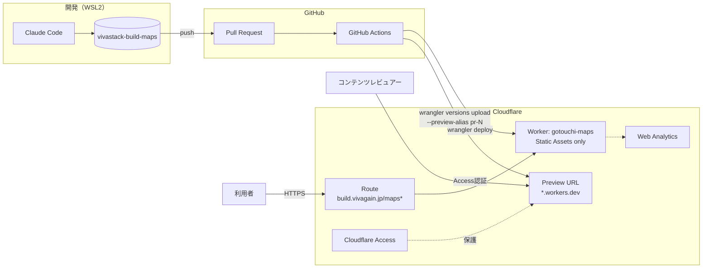
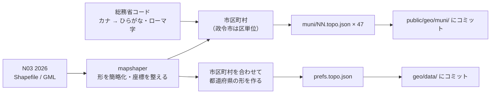
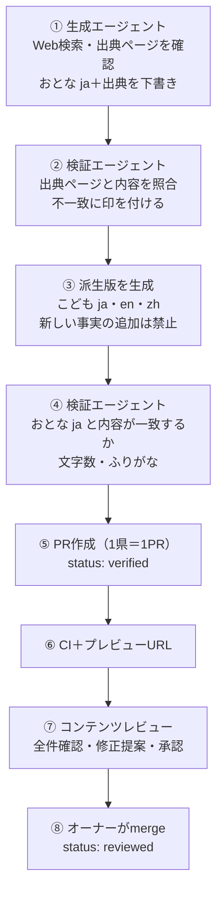
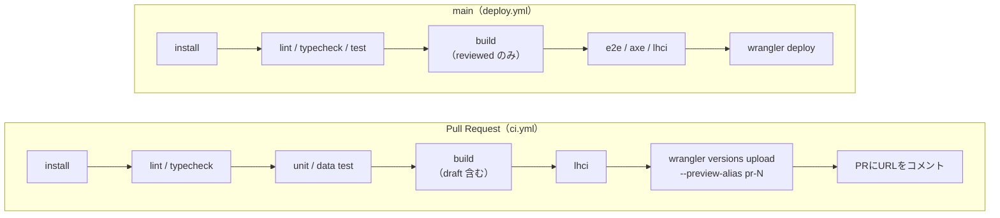
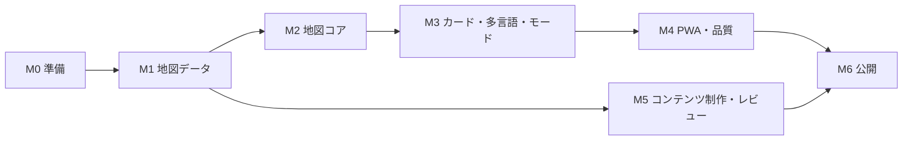

# 「ご当地めいぶつ日本地図」開発概要書

| 項目 | 内容 |
|---|---|
| ドキュメント | docs/development-overview.md |
| 版 | 0.6（ドラフト） |
| 作成日 | 2026-11-11 |
| 更新日 | 2026-11-11（0.2：リポジトリ構成を `vivastack-labs/vivastack-build-maps` 単独リポジトリに合わせて修正。0.3：操作仕様（4.11）とページの組み立て（6.6、D23・D24）を追加。0.4：対応環境（5.3、D25）とスタイルの方式（6.2、D26）、フォントとUI文言の多言語化（6.2、D27・D28）を確定。0.5：タスク分解を [development-plan.md](development-plan.md) と `docs/tasks/` に分け、未決事項 U12・U13 を追加。0.6：Node.js 26 で corepack が同梱されなくなったことに合わせて、pnpm の入れ方（11.6）を修正） |
| リポジトリ | vivastack-labs/vivastack-build-maps（リポジトリ直下がアプリ本体） |
| 公開URL | `https://build.vivagain.jp/maps/{ja,en,zh}/` |
| ステータス | 検討フェーズの決定事項を反映。「要検証」とした項目は実装時に確定する |

---

## 1. 概要

### 1.1 目的

47都道府県の名物と名所を、日本地図から直感的に探せるWebアプリを作り、無料で一般公開する。子どもの学習にも、大人の旅行の下調べにも使えることを目指す。

### 1.2 背景

別のLLMで作った単一HTMLのプロトタイプ（`Japanese_Local_Specialties_Map.html`、約926KB）で、操作感と機能の方向性は確認できた。ただし、データ構造、表示速度、コンテンツの正確性、スマホ操作、多言語対応の面で、正式なアプリとして公開するには作り直しが必要である。

### 1.3 プロトタイプからの主な変更点

| 観点 | プロトタイプ | 正式版 |
|---|---|---|
| 構成 | 単一HTML・素のJavaScript | Next.js（静的出力）＋TypeScript |
| 地図データ | 座標変換済みのSVGパスを埋め込み（約800KB）。市区町村は2016年のデータ | 国土数値情報 N03 **2026年版**から作るTopoJSON。市区町村は県ごとに分けて必要なときに読み込む |
| 県のデータ | 番号参照の配列、`<ruby>` HTMLを直書き | スキーマ付きのYAML。ふりがなは独自の記法で書く |
| 言語 | 日本語のみ | 日本語・英語・中国語（簡体字） |
| 利用者 | 子ども向けの文体だけ | こども向け／おとな向けの2系統。ふりがなON/OFF |
| 政令指定都市 | 市を1つの区域として表示 | 区まで分けて表示 |
| 東京からの距離 | 固定値 | 緯度経度から計算 |
| コンテンツの正確性 | 確認していない | AIで作成し、検証エージェントとチームのレビュアーが確認する。出典を明記する |
| スマホ | ホバー前提。ダブルタップは動作未確認 | タップで選択、下から出るパネル、ピンチで拡大 |
| 配信 | なし | Cloudflare Workers（Static Assets）、GitHub Actionsで自動デプロイ |

---

## 2. 対象ユーザーと利用シーン

| ユーザー | 利用シーン | モード |
|---|---|---|
| 小学生（中学年以上） | 社会科で都道府県を覚える、家庭学習 | こども（ふりがなON） |
| 保護者・教員 | 子どもと一緒に見る、授業の補助 | こども／おとな |
| 一般の大人・旅行者 | 旅行先の名物・名所を下調べする | おとな |
| 訪日客 | 英語・中国語で日本の地域の特色を知る | おとな（en / zh） |

- **言語**：`ja` / `en` / `zh`（簡体字。言語指定は `zh-Hans`）
- **モード**：`kids` / `adult`。すべての言語で両方を用意する
- **ふりがな**：日本語では、こども向け・おとな向けのどちらでもON/OFFを切り替えられる

---

## 3. スコープ

### 3.1 MVP

- プロトタイプの全機能（第4章）
- 第1章 1.3 で挙げた変更点
- 3言語 × 2モード × ふりがなON/OFF
- 出典の表示（出典がないものは「出典なし」と明記）
- PWA（ホーム画面への追加、オフライン表示。範囲は第5章）

### 3.2 PHASE 2

- 検索（県名、名物、名所）
- お気に入り
- クイズ・学習モード
- 名物のカテゴリ絞り込み（食べ物・工芸・祭りなど）

### 3.3 対象外

- ユーザー投稿やコメント機能
- ログイン・アカウント機能
- 実際の地図（道路・地形）を重ねること
- 乗換案内とのリアルタイム連携（所要時間は「目安」として静的に持つ）
- 県ごとの個別ページ（SEO目的の詳細ページは PHASE 2 以降で検討）

---

## 4. 機能要件

> 【MVP】と書いたものは MVP の必須機能。プロトタイプにあった機能は原則すべて引き継ぐ。

### 4.1 地図表示

| ID | 要件 |
|---|---|
| F-MAP-01 | 47都道府県を8地方ごとに色分けし、県名ラベルを表示する。画面が狭いとき（目安：幅820px以下）は県名ラベルを出さない |
| F-MAP-02 | 沖縄県は左上の点線枠の中に移して表示する |
| F-MAP-03 | 地図の下に8地方の色見本（凡例）を表示する |
| F-MAP-04 | 閲覧環境の設定（`prefers-color-scheme`）に合わせてライト／ダークを切り替える |
| F-MAP-05 | 画面が狭いときは、地図とカードを縦に並べる。スマホではカードを下から出るパネルにする（幅の区切りは 4.11.7） |
| F-MAP-06 | 「日本海」「太平洋」の海域名を表示する |

### 4.2 県の情報カード

| ID | 要件 |
|---|---|
| F-CARD-01 | 県にマウスをのせる（ホバー）と、その県の情報をカードに表示する（ホバーできる環境のみ） |
| F-CARD-02 | 基本情報として、地方名、県名、県庁所在地を表示する |
| F-CARD-03 | 東京都庁から県庁所在地までの直線距離（km、概算）を表示する。値は緯度経度から計算する（第7章） |
| F-CARD-04 | おすすめの行き方を表示する（交通手段、経路、所要時間の目安）。「目安」であることを明記する |
| F-CARD-05 | 名物を3つ表示する（絵文字、名前、ひとこと解説） |
| F-CARD-06 | 名所を3つ表示する（名前、ひとこと解説） |
| F-CARD-07 | 県をクリック（スマホではタップ）すると、その県をカードに固定表示する |
| F-CARD-08 | 「大きくして市区町村を見る」「元の大きさにもどす」ボタンを置く |

### 4.3 ツールチップ

| ID | 要件 |
|---|---|
| F-TIP-01 | 県のツールチップに、県名と名物3つの名前を表示する（マウス操作のときのみ） |
| F-TIP-02 | 県を最大化しているときは、市区町村のツールチップに名前と読みがなを表示する。政令指定都市の区は「市名＋区名」で表示する |

### 4.4 拡大・縮小・移動

| ID | 要件 |
|---|---|
| F-ZOOM-01 | 地図全体を拡大・縮小できる。方法は「＋」「−」ボタン、キーボードの `+` `-`、マウスホイール、スマホのピンチ |
| F-ZOOM-02 | 「全体」ボタンまたは `0` キーで、全体表示に戻す |
| F-ZOOM-03 | 拡大しているときは、ドラッグ（スマホは1本指のスワイプ）で地図を動かせる |
| F-ZOOM-04 | 県をダブルクリックすると最大化し、もう一度ダブルクリックすると元に戻す。最大化した県は固定表示にする。スマホではカード内のボタンで操作する（4.11） |
| F-ZOOM-05 | 動きを減らす設定（`prefers-reduced-motion`）がされている環境では、アニメーションしない |

### 4.5 市区町村の表示（県の最大化中）

| ID | 要件 |
|---|---|
| F-MUNI-01 | その県の市区町村の境界を、濃淡をつけて表示する。**政令指定都市（20市）は区まで分けて表示する** |
| F-MUNI-02 | 名前ラベルは入りきる所だけ表示し、さらに拡大するとラベルが増える |
| F-MUNI-03 | マウスをのせた市区町村を強調する |
| F-MUNI-04 | ほかの県は薄く表示する。別の県をダブルクリックすると、その県の表示に切り替える |
| F-MUNI-05 | 市区町村データは、県を最大化したときに初めて読み込む（第7章 7.4） |

### 4.6 県名さくいん

| ID | 要件 |
|---|---|
| F-IDX-01 | 47都道府県を8地方に分けて、県名ボタンの一覧を表示する |
| F-IDX-02 | 地図と同じ操作ができる（ホバーで表示、クリックで固定、ダブルクリックで最大化） |
| F-IDX-03 | 地図を見られない利用者のために、地図の代わりに使える操作手段として作る（第5章 5.2） |

### 4.7 キーボード操作

| ID | 要件 |
|---|---|
| F-KB-01 | Tabキーで地図に入り、矢印キーで県を移動すると、カードを表示する（地図全体をTabの停止位置1つにする。4.11.6） |
| F-KB-02 | Enter または Space で固定表示にする |
| F-KB-03 | Shift + Enter で最大化する |
| F-KB-04 | `+` `-` `0` で拡大・縮小・全体表示にする |
| F-KB-05 | Esc で最大化を解除する。最大化していないときは固定表示を解除する（新規） |

### 4.8 モード・ふりがなの切替

| ID | 要件 |
|---|---|
| F-MODE-01 | 「こども」「おとな」のモードを切り替えられる。切り替わるのは解説文と表現 |
| F-MODE-02 | 日本語では、どちらのモードでもふりがなをON/OFFできる |
| F-MODE-03 | 選んだモードとふりがなの設定は、ブラウザ（localStorage）に保存する。保存できない環境でも既定値で正しく表示する |
| F-MODE-04 | 両方のモードの文を静的なHTMLに含めておき、表示はCSSで切り替える（JavaScriptがなくても既定のモードで読める） |

### 4.9 言語の切替

| ID | 要件 |
|---|---|
| F-I18N-01 | URLは `/maps/ja/`、`/maps/en/`、`/maps/zh/` とする |
| F-I18N-02 | `/maps` へのアクセスは `/maps/ja/` へリダイレクト（301）する。**ブラウザの言語設定による自動の振り分けはしない** |
| F-I18N-03 | 各ページに言語切替ボタンと `hreflang`（`ja` / `en` / `zh-Hans` / `x-default`）を設定する |
| F-I18N-04 | 画面の文言（UI）も3言語に対応する |
| F-I18N-05 | 市区町村名は、英語はローマ字（ヘボン式）、中国語は日本語の漢字表記をそのまま使う（MVP） |

### 4.10 出典の表示

| ID | 要件 |
|---|---|
| F-SRC-01 | カードの下に、折りたたみ式（`<details>`）の「出典」欄を置く |
| F-SRC-02 | 名物・名所・行き方の項目ごとに、出典（タイトル、URL、確認日）を表示する |
| F-SRC-03 | 出典がない項目には「出典なし」と表示する |
| F-SRC-04 | フッターに、地図データの出典と「AIで作成し、人が確認しています」を明記する。詳しくは「このサイトについて」のページに書く |

### 4.11 操作仕様

4.1〜4.7 の要件を組み合わせたときの動きを定める。E2Eテストと、操作の状態遷移の単体テストは、この節を元に書く。

#### 4.11.1 操作の状態

| 状態 | 内容 |
|---|---|
| `hovered` | マウスをのせている（またはフォーカスしている）県。なければ空 |
| `pinned` | 固定表示している県。なければ空 |
| `maximized` | 最大化している県。なければ空 |
| `viewport` | 拡大率と表示位置 |

- カードには、`pinned` があればその県を、なければ最後に `hovered` になった県を表示する。
  - マウスが県から離れても、最後に表示したカードは残す（県と県の間の海を通るたびにカードがちらつかないようにするため）。
  - どちらもないときは「県にマウスをのせるか、タップしてください」と案内を表示する。
- **最大化した県は必ず固定表示にする**（`maximized` が空でなければ、`pinned` は同じ県）。
- 状態の変化は純粋関数（`mapReducer(state, event)`）で実装し、4.11.2 の表の1行ごとに単体テストを書く。

#### 4.11.2 状態遷移

| 操作 | 通常 | 固定中 | 最大化中 |
|---|---|---|---|
| ホバー（県） | カードに表示する | カードは変えない（ツールチップだけ） | 市区町村のツールチップだけ |
| クリック（県） | 固定する | 同じ県なら解除、別の県なら固定を移す | 何もしない |
| ダブルクリック（県） | 最大化＋固定 | 最大化＋固定 | 同じ県なら元に戻す（固定は残す）、別の県ならその県に切り替える |
| 海・余白をクリック | — | 固定を解除する | 何もしない |
| Esc | — | 固定を解除する | 最大化を解除する（固定は残す） |
| `0`／「全体」 | 全体表示 | 全体表示（固定は残す） | 最大化を解除して全体表示（固定は残す） |
| `+` `-` | 拡大・縮小 | 拡大・縮小 | 拡大・縮小（縮小は県全体が収まる倍率まで） |

- ダブルクリックの前には、クリックが2回起きる（固定 → 解除）。この表のとおりにすると最後は必ず「最大化＋固定」になるので、クリックの処理を遅らせるタイマーは使わない（反応が遅くなり、INPも悪くなるため）。
- 最大化中のシングルクリックで何もしないのは、元に戻すダブルクリックで固定が外れないようにするため。
- キーボードは、フォーカス＝ホバー、Enter／Space＝クリック、Shift + Enter＝ダブルクリックとして扱う。
- 県名さくいんのボタンも、この表に従う（F-IDX-02）。
- 言語を切り替えるときは、固定している県をURLのハッシュ（例：`/maps/en/#pref-13`）で引き継ぐ。ページを開いたときにハッシュがあれば、その県を固定する。

#### 4.11.3 スマホ（タッチ操作）

- マウスとタッチは、Pointer Events の `pointerType` で区別する。
- タップはクリックとして扱う（固定する）。固定と同時に、下から出るパネルを開く。**パネルの開閉は、固定の有無に合わせる**。
- ダブルタップは使わない（ブラウザのダブルタップ拡大と衝突するため）。最大化はカード内のボタンで行う（F-ZOOM-04）。
- 地図のSVGには `touch-action: none` を付け、ピンチとスワイプは d3-zoom で処理する。d3-zoom のダブルクリックでの拡大は無効にする。
- ツールチップは表示しない（F-TIP-01）。

#### 4.11.4 本番で `reviewed` になっていない県

7.1 のとおり、`reviewed` でない項目がある県は、名物・名所・行き方を本番に出さない。その県は次のように表示する。

- 地図：形は描く。地方の色ではなく、灰色の斜線で塗る。凡例に「準備中」を加える。
- カード：県名、県庁所在地、東京からの距離と、「名物・名所は準備中です」を表示する。
- ツールチップ：県名だけを表示する。
- さくいん：ボタンに「（準備中）」を付ける。
- 固定・最大化などの操作は、ほかの県と同じようにできる。

M6 の完了条件は「全項目が `reviewed`」なので、この表示は公開前の途中経過でだけ使う。プレビュービルドでは使わない（すべて表示し「下書き」と付ける。7.1）。

#### 4.11.5 異常系

| 状況 | 動き |
|---|---|
| 市区町村データの読み込み中 | 最大化はすぐに行い、県の形だけを先に表示する。300msを超えたら「読み込み中」を表示し、`aria-live="polite"` で伝える（短いときにちらつかないようにするため） |
| 読み込みに失敗した（通信エラー、404、データの形が不正） | 県の形だけで最大化したままにし、「市区町村を読み込めませんでした」と再試行ボタンを表示する。自動での再試行は繰り返さない。読み込んだデータは、使う前に形を簡単に検証する |
| オフラインで、まだ見ていない県を最大化した | 上と同じ表示にし、文言を「オフラインのため表示できません」にする |
| localStorage が使えない | 既定値で表示する。切替はそのページを開いている間は効く。エラーは表示しない |

#### 4.11.6 フォーカスとキーボード

- 地図全体をTabの停止位置1つにする（roving tabindex）。Tabで地図に入ると、固定している県に、なければ北海道にフォーカスする。
- ←↑ で前の県、→↓ で次の県に移る（県コード順。おおむね北から南）。Home で北海道、End で沖縄県に移る。
- 県名をボタンとして1つずつTabでたどりたい利用者は、県名さくいんを使う（F-IDX-03）。
- 市区町村にはフォーカスを当てない。代わりに、最大化中はカードに折りたたみ式（`<details>`）の「市区町村の一覧」を表示する。ホバーでしか分からない情報を、キーボードでも得られるようにするため（WCAG 2.1.1）。
- 下から出るパネルを開いたら、フォーカスをパネルの見出しに移す。閉じたら、フォーカスを元の県に戻す。

#### 4.11.7 画面構成

| 画面の幅 | 配置 |
|---|---|
| 1024px以上 | 2列。左に地図（約2/3）、右にカード（スクロールしても見える位置に固定） |
| 768〜1023px | 縦に並べる（地図 → カード） |
| 768px未満 | 地図を全幅で表示し、カードは下から出るパネルにする |

```text
PC（1024px以上）                          スマホ（768px未満）
+--------------------------------------+  +------------------+
| Header                               |  | Header           |
+-------------------------+------------+  +------------------+
|                         |            |  |                  |
|  Map                    |  Card      |  |  Map             |
|  (+ - 全体, Legend)     |  (sticky)  |  |                  |
|                         |            |  +------------------+
+-------------------------+------------+  | Index            |
| Index                                |  | Footer           |
+--------------------------------------+  +------------------+
| Footer                               |  | Sheet (peek)     |
+--------------------------------------+  +------------------+
```

| 部分 | 内容 |
|---|---|
| Header | タイトル、言語切替、モード切替、ふりがな切替（日本語のページだけ） |
| Map | 地図、「＋」「−」「全体」ボタン、凡例（F-MAP-03） |
| Card | 上から順に、見出し（地方名・県名・県庁所在地）→ 東京からの距離・行き方 → 名物3つ → 名所3つ → 最大化ボタン → 市区町村の一覧（最大化中だけ）→ 出典（`<details>`） |
| Sheet | 下から出るパネル。2段階で、一部だけ見える状態は見出しと最大化ボタン、全部見える状態は画面の高さの約85% |
| Index | 県名さくいん（8地方ごと） |
| Footer | 地図データの出典、「AIで作成し、人が確認しています」、「このサイトについて」・プライバシーポリシーへのリンク |

---

## 5. 非機能要件

### 5.1 表示速度

| 指標 | 基準値（案） |
|---|---|
| 最初に読み込むHTML＋JavaScript＋CSS（圧縮後。都道府県の地図とカードの内容はHTMLに含む。6.6） | 300KB以下 |
| 1県分の市区町村データ（圧縮後） | 100KB以下（目安） |
| Lighthouse Performance（スマホ） | 90以上 |
| LCP / CLS / INP | 2.5秒以下 / 0.1以下 / 200ms以下 |

Lighthouse CIでこの基準値を超えたら、CIを失敗させる。

### 5.2 アクセシビリティ

- 目標は **WCAG 2.2 AA**。
- 県の形（SVGのパス）には `role="button"` と `aria-label`（県名）を付け、キーボードで操作できるようにする。
- 地図を見られない利用者は、県名さくいんでも同じ情報にたどり着けるようにする。
- コントラストは、ライト・ダークの両方の配色で 4.5:1 以上にする。
- 動きを減らす設定がされている環境では、アニメーションしない。
- ふりがな（`<ruby>`）は、スクリーンリーダーで二重に読み上げられないか確認する。
- CIで axe（Playwright）を実行し、違反が1件でもあれば失敗させる。

### 5.3 対応環境

小学生は学校の端末（GIGAスクール端末。Chromebook・iPad・Windowsが中心）で使うことが多いため、学校の端末とタブレットを対象に含める（D25）。

| 区分 | 対象 | 確認のしかた |
|---|---|---|
| PC | Chrome / Edge / Firefox / Safari の最新版と、その1つ前の版 | CI（Playwright：Chromium、Firefox、WebKit） |
| 学校の端末 | ChromeOS の Chrome、iPadOS の Safari、Windows の Edge（それぞれ最新版と1つ前の版） | CI＋公開前に実機で確認 |
| スマホ | iOS Safari の最新版と1つ前の版、Android Chrome の最新版 | CI（端末のエミュレーション）＋公開前に実機で確認 |
| タブレット | iPad（縦・横）、Androidタブレット | CI（画面幅768〜1366px）＋公開前に実機で確認 |
| 画面幅 | 360px以上 | CI |
| 動けばよい範囲 | LINE・WeChatなどのアプリ内ブラウザ、上記より古い版 | 確認しない。問題の報告があれば対応を検討する |
| 対象外 | Internet Explorer、旧Edge（EdgeHTML）、Androidの標準ブラウザ | — |

- 「最新版と1つ前の版」は、Safari・iOS・iPadOSでは**メジャーバージョン**で数える。
- 同じ範囲を `package.json` の `browserslist` に書き、ビルドツールとlintで同じ基準を使う（例：`last 2 Chrome major versions`、`last 2 iOS major versions`）。
- 学校で管理されているiPadは、OSの更新が遅れることがある。M4の実機確認では、1つ前のiPadOSでも動くことを確かめる。
- Tailwind CSS v4（6.2、D26）は Safari 16.4・Chrome 111・Firefox 128 以降を前提にしている。対象の範囲はこれより新しいので問題ない。これより古いブラウザでは、表示が崩れることがある。
- JavaScriptが使えない環境でも、既定のモードで読めて、県名さくいんから県のカードを開ける（F-MODE-04、6.6）。

### 5.4 PWA

- Web App Manifest を置き、ホーム画面に追加できるようにする。
- Service Worker で次をキャッシュする（案）：
  - アプリの枠組み（HTML・JS・CSS。都道府県の地図と全コンテンツはHTMLに含まれる。6.6）：インストール時にキャッシュ
  - 市区町村の地図データ：一度見た県だけキャッシュ
- 使うツールは実装時に選ぶ（Serwist、workbox-build など）。

### 5.5 セキュリティ

- 静的配信のみ。サーバー側の処理、データベース、ログイン機能は持たない。
- `_headers` で次のヘッダーを設定する：CSP、`X-Content-Type-Options`、`Referrer-Policy`、`Permissions-Policy`、HSTS。
- CSPについて：
  - Next.jsの静的出力にはインラインのスクリプトが含まれる。静的配信ではnonceを使えないため、ビルド後にハッシュを集めてCSPに書き込む方法で許可する（6.6、D23）。
  - Web Analyticsのドメインを許可する。
- Webフォントは使わず、端末のシステムフォントで表示する（6.2、D27）。フォントのための外部リクエストはしない。
- GitHub Actionsで使うActionは、コミットSHAでバージョンを固定する。
- シークレットの扱いは第11章 11.2 に従う。
- シークレットの混入は、既存の gitleaks の設定（`.gitleaks.toml`）で検出する。手元ではClaude Codeのhookで、CIでは `ci.yml` の `gitleaks` job で全履歴を検査する（12.3）。

### 5.6 プライバシー

- アクセス解析は **Cloudflare Web Analytics**（Cookieを使わない）。Google Analyticsは使わない。
- Cookieの同意バナーは置かない（Cookieを使わないため）。
- プライバシーポリシーのページを用意する。

---

## 6. システム構成

### 6.1 全体構成



### 6.2 技術スタック

| 層 | 採用 | 備考 |
|---|---|---|
| フレームワーク | Next.js（App Router、`output: 'export'`） | `basePath: '/maps'`、`trailingSlash: true` |
| 言語 | TypeScript（strict） | |
| 地図描画 | SVG＋d3-geo＋topojson-client | 背景地図は使わない |
| スタイル | Tailwind CSS v4（`@tailwindcss/postcss`） | 書き方は下記（D26） |
| フォント | システムフォント（Webフォントは使わない） | 下記（D27） |
| UI文言の多言語化 | 型付きの自前の辞書（ライブラリは使わない） | 下記（D28） |
| テスト | Vitest、Testing Library、Playwright、axe-core、Lighthouse CI | 第10章 |
| 整形・lint | ESLint、Prettier、markdownlint、yamllint | Prettier・markdownlint・yamllintは、リポジトリにある設定（`.prettierrc`、`.markdownlint.json`、`.yamllint`）を使う |
| 配信 | Cloudflare Workers（Static Assets） | Workerのスクリプトは使わない |
| CI/CD | GitHub Actions＋cloudflare/wrangler-action | 第12章 |
| パッケージ管理 | pnpm | |
| 実行環境 | Node.js（その時点のActive LTS） | `.nvmrc` で固定する |

**スタイルの書き方（D26）**

- `app/globals.css` で `@import "tailwindcss";` を読み込む。設定ファイル（`tailwind.config.*`）は作らず、設定はCSSに書く。
- 色・フォントなどは `@theme` でCSS変数として定義し、ユーティリティからはこの変数だけを使う。色の値を直接書かない（ライト・ダークの配色とコントラスト 4.5:1 の確認をしやすくするため。5.2）。
- モードとふりがなの切替ルール（6.6 (3)）は `globals.css` に素のCSSで書く。部品ごとにモードで見た目を変えたいときは、`@custom-variant` でバリアントを定義して使う（例：`@custom-variant kids (&:where([data-mode=kids], [data-mode=kids] *));`）。
- 選択中・ホバー・フォーカス中の県などの状態は、`aria-*` や `data-*` のバリアントで書く。
- 動きを減らす設定では、`motion-safe:` / `motion-reduce:` でアニメーションを止める（5.2）。
- 出力は静的なCSSファイルなので、CSP（6.6 (4)）に影響しない。

**フォント（D27）**

- 日本語・中国語のWebフォントは1書体で数MBある。県の解説文には数千種類の漢字が出てくるため、分割して配信しても 5.1 の基準値（最初の読み込みで300KB以下）に収まらない。対象の端末（5.3）には日本語・中国語のフォントが入っているので、システムフォントを使う。
- `@theme` の `--font-sans` に言語ごとのフォントの並びを定義し、`:lang()` で切り替える。

| 言語 | フォントの並び（例） |
|---|---|
| ja | `"Hiragino Sans", "Hiragino Kaku Gothic ProN", "Yu Gothic UI", Meiryo, "Noto Sans JP", sans-serif` |
| zh | `"PingFang SC", "Microsoft YaHei", "Noto Sans SC", sans-serif` |
| en | `system-ui, -apple-system, "Segoe UI", Roboto, sans-serif` |

- `<html lang>` を `ja` / `en` / `zh-Hans` と正しく付ける。付けないと、中国語のページで漢字が日本語の字形で表示される。

**UI文言の多言語化（D28）**

- 言語の自動振り分けはせず（D8）、静的出力なので middleware も使えない。UI文言は数十件なので、next-intl などのライブラリは使わず、自前の辞書にする。数値・距離の表示は `Intl.NumberFormat` を使う。
- `src/i18n/ja.ts` を基準にし、`en.ts`・`zh.ts` は `satisfies Messages` で同じキーを持つことを型で保証する（キーが足りなければ型チェックで失敗する）。
- 日本語の文言にも `{漢字|よみ}` の記法を使い、`ruby.ts` で変換する（7.2）。ふりがなのON/OFFがUIにも効く。
- こども向け・おとな向けで言い方を変える文言だけ、`{ kids, adult }` の形にする。
- `app/[lang]/layout.tsx` をルートレイアウトにして `<html lang>` を出力する。`dynamicParams = false` とし、言語は型ガード（`isLang()`）で検証する。
- クライアントコンポーネントには、必要な文言だけを props で渡す（エラー表示、再試行ボタンなど）。文言は小さいので、6.6 (2) のサイズの問題にはならない。
- 単体テストで、3言語のキーがそろっていること、空の文言がないことを確認する。

### 6.3 地図の描き方を選んだ理由

| 方式 | 長所 | 短所 |
|---|---|---|
| **SVG＋TopoJSON（採用）** | デフォルメした見た目を保てる。背景地図が要らない。静的配信だけで済み、運用費がほぼゼロ | 実際の道路や地形は表示できない |
| MapLibre GL＋ベクトルタイル | 実際の地図と重ねられ、拡大もなめらか | タイルの用意や外部サービスが必要。子ども向けの見た目に合わせにくい |

このアプリの目的は都道府県とその特色を知ることで、実際の地図は必要ないため、SVG方式を採用する。

### 6.4 配信の構成とURL

- Worker名は `gotouchi-maps`（案）。割り当ては **Route**（`build.vivagain.jp/maps*`）。
  - Custom Domainにしない理由：Custom Domainはホスト名全体を1つのWorkerに割り当てる方式のため。将来、`build.vivagain.jp` の別のパスに別アプリを置けるようにしておく。
- 静的出力の構成（D29）：

```
dist/                       ← wrangler の assets.directory
├─ _redirects
├─ _headers
└─ maps/
   ├─ ja/index.html
   ├─ en/index.html
   ├─ zh/index.html
   ├─ 404.html                ← app/global-not-found.tsx
   ├─ _next/...
   ├─ geo/muni/01.topo.json ... 47.topo.json   ← 都道府県の地図はHTMLに埋め込むので配信しない（6.6）
   ├─ manifest.webmanifest
   └─ sw.js
```

- **`out/` の構成（U8。T0-03 で確認、Next.js 16.4.6）**：`basePath` を指定しても、`out/` の中は `/maps` の下にまとまらない（`out/ja/index.html`、`out/_next/...`、`out/404.html` が直下に出る）。一方、HTMLの中の参照は `/maps/_next/...` のように `/maps` 付きで出る。
- そのため、`scripts/postbuild.ts` で `out/` の中身を `dist/maps/` に移し、`_redirects`・`_headers`（`public/` に置き、Next.js が `out/` の直下にコピーする）だけを `dist/` の直下に置く。`out/` の構成が版で変わっても、この組み立ては変えずに済む（R7）。`pnpm build` は `next build` → `node scripts/postbuild.ts` の順に実行する。
- 404 のページは `dist/maps/404.html`（`app/global-not-found.tsx`。`<html lang="ja">`）。`wrangler.jsonc` の `not_found_handling: "404-page"` で、`/maps/` の下の存在しないパスにはこのページが 404 で返る。

### 6.5 ディレクトリ構成（案）

リポジトリ直下がアプリ本体になる。`（既存）` と書いたものは、すでにリポジトリにある。

```
vivastack-build-maps/
├─ docs/
│  ├─ development-overview.md     ← 本書
│  ├─ development-plan.md         ← 開発計画（タスクの一覧・進み具合）
│  └─ tasks/                      ← マイルストーンごとのタスクの定義
├─ app/
│  ├─ globals.css                  ← Tailwind の読み込み、@theme、モード・ふりがなの切替（6.2、6.6）
│  ├─ global-not-found.tsx         ← 存在しないパスの404（<html lang="ja">。6.4）
│  └─ [lang]/                      ← generateStaticParams で ja / en / zh を生成
│     ├─ layout.tsx
│     └─ page.tsx
├─ src/
│  ├─ components/                  ← Map, PrefCard, Tooltip, Index, ModeToggle...
│  ├─ features/map/                ← 投影法と沖縄の別枠（projection.ts。6.6 (1)）、表示範囲の計算、拡大縮小、ラベル間引き、操作の状態（mapReducer。4.11）
│  ├─ lib/
│  │  ├─ ruby.ts                   ← ふりがな記法のパーサー
│  │  ├─ distance.ts               ← 距離の計算（ハバーサイン公式）
│  │  └─ content.ts                ← コンテンツの読み込みと型
│  └─ i18n/                        ← UI文言の辞書（ja.ts を基準に en.ts・zh.ts。isLang() などの言語の判定。D28）
├─ content/
│  ├─ .yamllint                    ← （既存）content/ 用の yamllint 設定（1行200字まで）
│  ├─ schema/prefecture.schema.json
│  ├─ prefectures/01-hokkaido.yaml ... 47-okinawa.yaml
│  └─ guidelines/
│     ├─ writing.md                ← 執筆ルール・文字数の基準
│     └─ review-checklist.md       ← コンテンツレビューのチェックリスト
├─ geo/
│  ├─ scripts/build-geo.ts         ← 地図データの変換（手動で実行）
│  ├─ scripts/lib/kana.ts          ← カナ → 読みがな・ローマ字（7.4.1）
│  ├─ sources/                     ← 読みがななどの元データ、読み・ローマ字の修正表（7.4.1）
│  ├─ data/prefs.topo.json         ← 都道府県のTopoJSON（ビルドの入力。コミットする。配信しない）
│  ├─ downloads/                   ← 地図の原データ（N03）の置き場。.gitignore の downloads/ によりコミットされない
│  └─ README.md                    ← 手順と出典
├─ public/
│  ├─ geo/muni/                    ← 市区町村のTopoJSON（コミットする）
│  ├─ _redirects
│  └─ _headers
├─ scripts/
│  ├─ validate-content.ts
│  ├─ check-links.ts
│  └─ postbuild.ts                 ← dist/ の組み立て、CSPのハッシュの書き込み（6.6）
├─ tests/
│  ├─ unit/
│  └─ e2e/
├─ .github/
│  ├─ workflows/                   ← ci.yml / deploy.yml / link-check.yml（第12章）
│  ├─ CODEOWNERS
│  └─ dependabot.yml
├─ .claude/                        ← （既存）Claude Code の設定・ルール・エージェント・スキル・hooks
│  ├─ rules/                       ← （既存）開発ルール（TDD、レビュー、コミット規約など）
│  ├─ agents/                      ← （既存）planner、code-reviewer など。コンテンツ検証用のサブエージェントを追加する
│  └─ skills/                      ← （既存）コンテンツ生成用のスキルを追加する
├─ .codex/ .agents/                ← （既存）Codex 用の設定・スキル
├─ .playwright/cli.config.json     ← （既存）Playwright CLI（対話的なブラウザ操作）の設定。E2Eテストの設定とは別
├─ .prettierrc .markdownlint.json .yamllint .prettierignore   ← （既存）
├─ .gitleaks.toml .gitleaksignore  ← （既存）シークレット検出の設定
├─ AGENTS.md                       ← Claude Code と Codex の共通の指示（エージェント向けの指示はここに書く）
├─ CLAUDE.md                       ← `@AGENTS.md` で AGENTS.md を読み込む。Claude Code 固有の内容だけを追記する
├─ README.md                       ← （既存）見出しはリポジトリ名に変更済み。本文はM0でこのアプリ向けに書き直す
├─ CHANGELOG.md                    ← （既存）Keep a Changelog 形式
├─ wrangler.jsonc
├─ next.config.ts
├─ package.json
└─ .nvmrc
```

- **`.gitignore`**：Python 用の `lib/` の行はどの階層にも効くため、`!src/lib/` の例外を加えて `src/lib/` をコミットできるようにした（対応済み）。`dist/`（ビルド結果）はコミットしないので、そのままでよい。

### 6.6 ページの組み立て

**(1) 都道府県の地図（D24）**

- ビルド時に `geo/data/prefs.topo.json` を d3-geo でSVGのパスに変換し、HTMLに埋め込む。実行時には読み込まない（最初の表示を速くし、読み込むJSを減らすため）。
- 拡大・縮小・移動は、地図をまとめた `<g>` の `transform` で行う。
- 投影法の設定は、ビルド時（都道府県）と実行時（市区町村）で同じものを使う。設定は1つのモジュール（`src/features/map/projection.ts`）にまとめ、実行時にデータから計算し直さない。値と選んだ理由はモジュールの先頭のコメントにある（T1-03）。
  - ランベルト正角円錐図法（中央経線 137°E、中心の緯度 37°N、標準緯線 33°N・44°N）、縮尺 3300。`viewBox` は 1000×1130（縦長）。N03 の形（沖縄県と小笠原村を除く）が上下左右に約20の余白で入る。
  - 沖縄県（尖閣諸島・大東諸島を含む）は、**等倍のまま**左上の点線枠（x 20・y 20・幅500・高さ305）に移す（F-MAP-02）。移すかどうかは**県コード（47）で決める**（与論島（鹿児島県）と伊平屋島（沖縄県）は近く、座標では区別できない）。
  - 小笠原村（父島・南鳥島・沖ノ鳥島）は `viewBox` の外に出る。扱いは U16。

**(2) カードの内容（D24）**

- 47県分のカードを、サーバーコンポーネントでHTMLに出力し、`hidden` 属性で隠しておく。JSは、表示する県を切り替えるだけにする。
- **内容をクライアントコンポーネントの props に渡さない**。渡すと、同じ内容がRSCのデータとしてもHTMLに埋め込まれ、サイズがほぼ倍になる。
- ふりがなの変換（7.2）もビルド時に行う。`dangerouslySetInnerHTML` は使わない。
- JavaScriptが使えない環境では、県名さくいんをリンク（`href="#pref-13"`）にし、CSSの `:target` で選んだ県のカードを表示する。
- 試算：1言語あたり、解説文564本と出典で、圧縮前は約250KB、gzip後は50〜70KBの見込み。M3でLighthouseを使って実測し、5.1の基準値を超えたら、言語ごとのJSONを後から読み込む方式に切り替える。

**(3) モードとふりがなの初期表示（D23）**

- `<head>` に固定の小さなインラインスクリプト（500バイト未満）を置き、描画の前に localStorage の値を `<html data-mode="kids" data-ruby="on">` に反映する。localStorage の読み書きは try/catch で囲む。
- 表示の切替はCSSだけで行う（例：`html[data-mode="kids"] .adult { display: none }`、`html[data-ruby="off"] rt { display: none }`）。
- ビルド時に、言語ごとの既定値（U1）を `<html>` に書いておく。JavaScriptがなくても既定のモードで読める（F-MODE-04）。

**(4) CSP（D23）**

- `scripts/postbuild.ts` で、出力したHTMLに含まれるインラインスクリプトをすべて集めてSHA-256を計算し、`_headers` のCSPにページ（言語）ごとに書き込む。
- Next.js自体のインラインスクリプトと、(3) の初期化スクリプトを、同じ仕組みで許可する（R9）。
- E2Eテストで、CSP違反がコンソールに出ないことを確認する。

---

## 7. データ設計

### 7.1 コンテンツのスキーマ

1県につき1つのYAMLファイルにする。JSON Schemaで検証し、TypeScriptの型もスキーマから生成する。

```yaml
# content/prefectures/01-hokkaido.yaml（例。値は説明用）
id: hokkaido
code: "01"                 # 全国地方公共団体コードの都道府県コード
region: hokkaido           # hokkaido | tohoku | kanto | chubu | kinki | chugoku | shikoku | kyushu
name:
  ja: "{北海道|ほっかいどう}"
  en: "Hokkaido"
  zh: "北海道"
capital:
  name:
    ja: "{札幌市|さっぽろし}"
    en: "Sapporo"
    zh: "札幌市"
  lat: 43.0642             # 都道府県庁の位置（第8章 8.1）
  lon: 141.3469
access:
  emoji: "✈️"
  mode: { ja: "{飛行機|ひこうき}", en: "Plane", zh: "飞机" }
  route:
    ja: "{羽田空港|はねだくうこう} → {新千歳空港|しんちとせくうこう}"
    en: "Haneda Airport → New Chitose Airport"
    zh: "羽田机场 → 新千岁机场"
  durationMin: 95          # 所要時間の目安（分）
  sources: []              # 空なら「出典なし」と表示
  status: reviewed
specialties:               # ちょうど3件
  - id: potato
    emoji: "🥔"
    name: { ja: "じゃがいも", en: "Potatoes", zh: "土豆" }
    description:
      ja:
        kids:  "{生産量|せいさんりょう}は{日本一|にほんいち}。..."
        adult: "..."
      en: { kids: "...", adult: "..." }
      zh: { kids: "...", adult: "..." }
    sources:
      - title: "（出典ページのタイトル）"
        url: "https://..."
        accessed: 2026-11-11
    status: draft          # draft | verified | reviewed
spots:                     # ちょうど3件。項目の構成は specialties と同じ（emoji は任意）
  - ...
```

| 項目 | ルール |
|---|---|
| `status` | `draft`（AIが下書き）→ `verified`（検証エージェントが確認済み）→ `reviewed`（人がレビュー済み） |
| 本番ビルド | `reviewed` の項目だけを含める。そうでない項目が1つでもある県は、名物・名所・行き方を本番に出さず「準備中」と表示する（4.11.4） |
| プレビュービルド | すべての状態の項目を含め、`reviewed` でない項目には「下書き」と表示する（レビュー作業用） |
| `sources` | 空の配列を許す。空なら画面に「出典なし」と表示する。CIでは警告にとどめる |
| 検証 | `pnpm content:validate`（`scripts/validate-content.ts`）。形は JSON Schema（`content/schema/prefecture.schema.json`、draft-07）、内容のルールは `src/lib/content-rules.ts` で見る。型はスキーマから `pnpm content:types` で `src/lib/content-schema.generated.ts` に作り、コミットする（作り直し忘れはテストで止まる）。読み込むディレクトリは環境変数 `CONTENT_DIR` で変えられる（E2E は `tests/fixtures/content/`）。誤りは `ファイル名:行 場所 メッセージ` の形で出す。YAML のエイリアス（`&`・`*`）は使えない。空や空白だけの文は書けない（T1-07） |
| 未作成 | 名物・名所は `[]` と書く（キーは省かない）。行き方は `access` ごと省く（T1-07） |
| `id` | 県の `id`・`code` は全ファイルで重複しない。ファイル名は `<code>-<id>.yaml`。名物・名所の `id` は、その県の中（名物と名所を合わせて）で重複しない（T1-07） |
| 書式 | yamllintで検査する。ふりがなを付けた文は長くなるので、`content/` だけ専用の設定 `content/.yamllint`（1行200字まで）を使う（`yamllint -c content/.yamllint content/`）。ルートの `.yamllint`（120字まで）は、行の長さのチェックで `content/` を対象外にしている。yamllint の既定の規則で、先頭に `---` を書き、1行のマップは `{ja: "…", en: "…"}` のように括弧の内側に空白を入れない（上の例は説明用で、空白が入っている） |

### 7.2 ふりがなの記法

- 書き方は `{漢字|よみ}`。ルビを付ける単位は、ふりがなを付ける語ごととする。
- `src/lib/ruby.ts` で `<ruby>漢字<rt>よみ</rt></ruby>` に変換する。変換はビルド時に行う（6.6）。ふりがなOFFのときは `rt` をCSSで隠す。
- CIで次をチェックする：
  - 括弧の対応が正しいか
  - 読みが空になっていないか
  - 読みがひらがな（と長音記号「ー」）だけか
  - 日本語の文で、ふりがなの付いていない漢字が残っていないか（警告）
- 細かいルール（T1-06）：
  - 読みに使える字は、ひらがな（ぁ〜ゖ）と「ー」だけ。空白・ゝ・ゞ も誤りにする。
  - 括弧の対応の誤りには、対応しない `}`、括弧の中の `{`、括弧の中の `|` が2つ以上、親文字（`|` の前）が空（空白だけを含む）も含める。括弧の外の `|` はただの文字として扱う（英語・中国語の文で使われうるため）。
  - 警告にする漢字は Unicode の `Script=Han`（々・〆 を含む）。続いた漢字はまとめて1件にする。
  - 英語・中国語の文に記法（`{…|…}`）があれば誤りにする（T1-07）。
  - 誤りのある文は変換しない（`parseRuby` が例外を投げ、ビルドが止まる）。例外のメッセージの「何文字目」は、𩸽 のような BMP の外の字も1字と数える。誤りと警告の一覧は `checkRuby` で得る（`index` は UTF-16 の位置）。
- 下書きのときは、形態素解析（Sudachiなど）で自動的にふりがなを付け、人がレビューで直す。固有名詞（地名・人名）はレビューで特に注意して確認する。

### 7.3 解説文の文字数の基準

| | こども ja | おとな ja | こども en | おとな en | こども zh | おとな zh |
|---|---|---|---|---|---|---|
| 名物 | 20〜35字 | 30〜50字 | 10〜20語 | 12〜25語 | 15〜30字 | 20〜40字 |
| 名所 | 15〜25字 | 25〜40字 | 8〜15語 | 8〜18語 | 12〜22字 | 15〜30字 |

- 文字数はふりがなを除いて数える。範囲の外（上限を超える・下限に足りない）なら、CIで**警告**を出す（エラーにはしない。T1-07）。
- 数え方：日本語・中国語は空白を除いた字数（𩸽 などの字も1字）、英語は空白で区切った語数。
- **こども向け**：小学校中学年が読める表現にする。理由や体験（何がすごいか、どう楽しむか）を中心に書く。
- **おとな向け**：事実を1つ加える（時期・地域・由来など）。
- **英語・中国語**：同じモードの日本語文の意味を訳す（逐語訳ではない）。新しい事実は加えない。
- 根拠：プロトタイプの実際の長さ（名物は中央値25字、名所は中央値19字）を基準にした。PCではカードに名物3つ・名所3つがスクロールなしで収まり、スマホでは下から出るパネルの1画面に収まる量である。

### 7.4 地図データの形式

| ファイル | 内容 | 読み込むタイミング |
|---|---|---|
| `geo/data/prefs.topo.json` | 47都道府県の形、県名ラベルの位置（オブジェクト名 `prefectures`。属性は `code`（`01`〜`47`）と `label`（`[経度, 緯度]`）。形もラベルも経緯度のままで、沖縄の別枠の変換値は入れない。`src/features/map/projection.ts` にある。6.6 (1)） | ビルド時（SVGのパスにしてHTMLに埋め込む。配信しない。6.6） |
| `public/geo/muni/{01..47}.topo.json`（配信先は `/maps/geo/muni/`） | その県の市区町村（政令指定都市は区）の形と、名前・読みがな・ローマ字（オブジェクト名 `municipalities`）。所属未定地は入れない（8.2、D34） | 県を最大化したとき |

市区町村ごとに次の項目を持つ：

| 項目 | 内容 |
|---|---|
| `code` | 全国地方公共団体コード |
| `name.ja` | 名前（例：「札幌市中央区」） |
| `kana` | 読みがな（ひらがな）。政令指定都市の区は市名を含む読み（`さっぽろしちゅうおうく`） |
| `name.en` | ローマ字表記（区は `Chuo-ku, Sapporo-shi`。7.4.1） |
| `cityName` | 政令指定都市の区の場合、所属する市の名前 |

#### 7.4.1 読みがなとローマ字の作り方（D33）

`kana` と `name.en` は、総務省のコード表のカナ（8.1）から `geo/scripts/lib/kana.ts` で機械的に作る（F-TIP-02、F-I18N-05）。

- **読みがな**：コード表のカナは半角カタカナで、濁点・半濁点が別の字（`ﾎﾟ`）。NFKC で全角にしてからひらがなにする（`ｻｯﾎﾟﾛｼ` → `さっぽろし`）。
- **ローマ字**：ヘボン式。先頭だけ大文字にする。
  - 長音を書かない。お段＋う・お段＋お は `o`、う段＋う は `u`（`Tokyo`、`Osaka`、`Chuo`、`Kyushu`）。いい・ええ・えい・ああ は書く（`Iida`、`Meiji`）。
  - ん はいつも `n`。母音・や行の前でも `'` を付けず（`Kanonji`、`Nanyo`）、ば・ま・ぱ行の前も `m` にしない（`Gunma`）。自治体の英語名や道路標識の一般的な表記とそろえるため。
  - 促音は次の子音を重ね（`Sapporo`）、ch の前は `t` にする（`Hatcho`）。語頭や、子音を重ねられない字（母音・ん・な・ま・や・ら・わ行）の前の促音はエラーにする。
  - 長音の判定は、直前に残した拍と比べる（3つ以上続いても同じ規則になる）。
  - 市・区・町・村はハイフンで分け、小文字にする：`-shi`・`-ku`・`-cho`／`-machi`・`-mura`／`-son`（`Sapporo-shi`、`Mori-machi`）。町・村の読みは、カナの終わり（ちょう・まち、むら・そん）で決める。
  - 政令指定都市の区は、区を先にしてカンマで市を続ける（`Chuo-ku, Sapporo-shi`）。英語の住所の並びで、ツールチップの主役である区の名前が先に読める。
- コード表に出てこない字（長音記号「ー」、小書きの ぁぃぅぇぉゎ、ゐ・ゑ・ゔ）や、名前の接尾辞とカナの終わりが合わないものは、推測せずにエラーにする。

**修正表**：次の2つは、カナから機械的に作ると間違う（T1-02 でコード表の全件を変換して確かめた）。`geo/sources/` に団体コードで引く修正表を置き、変換のときに当てる（T1-04）。

| 問題 | 例 | 修正表 |
|---|---|---|
| 拗音が大きい字で書かれている（14件。表の中でそろっていない） | 庄内町 `ｼﾖｳﾅｲ`、北谷町 `ﾁﾔﾀﾝ`、羽生市 `ﾊﾆﾕｳ` | 読み（ひらがな）を直す。ツールチップの読みがなも間違うため |
| 語の境目で、長音を書かない規則が母音を消す（24件。候補は語幹で数えて303件） | 勝浦 → `Katsura`、瀬戸内 → `Setochi`、豊岡 → `Toyoka`、勝央 → `Sho` | ローマ字の語幹を直す（`Katsuura`、`Setouchi`、`Suo-Oshima`）。接尾辞は規則のまま付ける |

修正表は「直す前」の値を持ち、変換のときに今の結果と合わなければ止まる。選び方と一覧は `geo/README.md`（T1-04）。

### 7.5 東京からの距離

- 東京都庁と各都道府県庁の緯度経度から、ハバーサイン公式で直線距離を計算する（地球の半径 6,371km、10km単位に丸めて「約○km」と表示）。
- ビルド時に計算して値を埋め込む。テストで、既知の値と誤差の範囲内で一致するか確認する。

---

## 8. 地図データの作成手順

### 8.1 元データ

| データ | 出典 | ライセンス | 用途 |
|---|---|---|---|
| 行政区域（N03）2026年版（2026年1月1日時点） | 国土交通省 国土数値情報ダウンロードサイト（<https://nlftp.mlit.go.jp/ksj/gml/datalist/KsjTmplt-N03-2026.html>）。全国の `N03-20260101_GML.zip` | オープンデータ（CC BY 4.0）。サイトの利用規約は公共データ利用規約（第1.0版）（PDL1.0）。商用利用も可 | 都道府県・市区町村・政令指定都市の区の形 |
| 都道府県コード及び市区町村コード（令和6年1月1日更新） | 総務省「全国地方公共団体コード」（<https://www.soumu.go.jp/denshijiti/code.html>）の Excel | 公共データ利用規約（第1.0版）（総務省ホームページの「著作権について」） | 市区町村名の読みがな（カナ） |
| 都道府県庁の位置 | 地理院地図（国土地理院）。各都道府県の公式サイトの庁舎の住所を、地理院地図の住所検索で緯度経度にし、地理院地図で庁舎の上にあることを確かめる（D32） | 国土地理院コンテンツ利用規約（PDL1.0） | 距離の計算 |

- 国土地理院は、都道府県庁の緯度経度の一覧を公表していない。日本の東西南北端点の FAQ（<https://www.gsi.go.jp/KOKUJYOHO/center-faq.html>）で、「地理院地図を用いて地図上の位置を把握することが可能」と案内している（T1-01 で確認）。
- 国土数値情報の「国・都道府県の機関」（P28）にも都道府県庁の位置があるが、平成25年度のデータで、使用許諾条件が「非商用」なので使わない。
- 国土数値情報のメタデータには測量法の承認番号の記載があるが、国土数値情報の利用規約で、測量法に基づく承認が要るとされているのは、国土調査の成果など背景図に基本測量成果を使っているものである。N03 は「オープンデータ（CC BY 4.0）」で、出典を書けば使える。

### 8.2 変換の流れ



- `geo/scripts/build-geo.ts` で実行する。**手動で実行する**ものとし、毎回のビルドでは動かさない。
- 都道府県の形は市区町村の形を合わせて作る（N03 の `_prefecture` は使わない）。ただし簡略化の度合いは、市区町村が100m、都道府県が1km（HTML に埋め込むため。D34）なので、県を最大化したときの、その県の市区町村の外周と周りの県の境界は、最大で約1kmずれる（描き方は T2-08）。
- 簡略化は距離で指定する（mapshaper の `-simplify interval=`）。1県分の市区町村データが gzip 後に100KB（5.1）を超えたら、変換が止まる。T1-04 の結果は、最大が北海道の84KB。
- 原データ（全国分で約766MB）は `geo/downloads/` に置き、コミットしない。変換後のTopoJSONと、変換に使った設定（データの版、簡略化の度合い）を `geo/README.md` に記録する。
- N03には境界が確定していない地域があり、境界線が暫定で引かれている箇所がある（N03 のページの「その他の情報」）。属性では区別できない。「このサイトについて」のページにその旨を書く。

T1-01 で確かめた N03 2026年版の中身（全国の zip。属性は Shapefile の `.dbf` で数えた）：

| 項目 | 結果 |
|---|---|
| zip の中身 | 市区町村の `N03-20260101`（Shapefile・GeoJSON・GML）と、都道府県の形の `N03-20260101_prefecture`（同じ3形式）。Shapefile の文字コードは UTF-8（`.cpg`）、座標系は JGD2011 の経緯度（`.prj`） |
| 属性 | `N03_001`（都道府県名）、`N03_002`（北海道の振興局名）、`N03_003`（郡名）、`N03_004`（市区町村名）、`N03_005`（政令指定都市の区名）、`N03_007`（全国地方公共団体コード5桁） |
| 形の数 | 125,130。島などで1つの市区町村が複数の形に分かれる（693のコード。所属未定地を含む。最も多いのは小笠原村の4,812） |
| 都道府県 | 47 |
| 地図の単位（コード） | 1,905 ＝ 市区町村と政令指定都市の区 1,892 ＋ 北方領土の6村（色丹村など、北海道根室振興局）＋ 所属未定地 7 |
| 政令指定都市の区 | 20市すべてで、区ごとに別の形とコードがある。区は合計171（浜松市は2024年1月の再編後の3区）。市全体の形はないので、区と市が重ならない（U9 → D31） |
| 所属未定地 | 市区町村名が「所属未定地」、コードが県のコード（例：`13000`）の形。7都県で141（東京都123、鹿児島県12、愛知県2、千葉県・和歌山県・福岡県・沖縄県が各1）。どれも小さな島や埋立地。市区町村のファイルには入れず、県の形には含める（D34） |
| 総務省のコードとの照合 | N03 の地図の単位 1,898（所属未定地を除く）すべてに、総務省のコード表のカナがある。名前が違うのは高知県の檮原町（N03 は「檮」、総務省は「梼」）の1件だけ。照合はコードで行う。カナには機械的に変換すると間違うものがあり、修正表で直す（T1-02 で確認。7.4.1） |

政令指定都市ごとの区の数：

| 市 | 区 | 市 | 区 | 市 | 区 | 市 | 区 |
|---|---|---|---|---|---|---|---|
| 札幌市 | 10 | 川崎市 | 7 | 名古屋市 | 16 | 岡山市 | 4 |
| 仙台市 | 5 | 相模原市 | 3 | 京都市 | 11 | 広島市 | 8 |
| さいたま市 | 10 | 新潟市 | 8 | 大阪市 | 24 | 北九州市 | 7 |
| 千葉市 | 6 | 静岡市 | 3 | 堺市 | 7 | 福岡市 | 7 |
| 横浜市 | 18 | 浜松市 | 3 | 神戸市 | 9 | 熊本市 | 5 |

### 8.3 出典の表記

国土数値情報の利用規約に従い、フッターと「このサイトについて」のページに次を記載する。

```
出典：「国土数値情報（行政区域データ）」（国土交通省）
（https://nlftp.mlit.go.jp/ksj/gml/datalist/KsjTmplt-N03-2026.html）を加工して作成
```

地図用に形を簡略化しているので、加工したことも明記する。加工したデータを国が作ったもののように見せない。

読みがな（カナ）と県庁の位置の出典も、同じページに記載する（公共データ利用規約（第1.0版）。T1-01 で確認）。

```
出典：「全国地方公共団体コード」（総務省）（https://www.soumu.go.jp/denshijiti/code.html）を加工して作成
出典：地理院地図（国土地理院）（https://maps.gsi.go.jp/）で都道府県庁の位置を調べて作成
```

### 8.4 地図データの更新

国土数値情報は年に1回更新される。年1回、合併などで変わった市区町村を確認し、必要があれば変換をやり直してPRを出す（第13章）。

---

## 9. コンテンツ制作フロー

### 9.1 作業量

47県 ×（名物3＋名所3）× 2モード × 3言語 ＝ **解説文1,692本**、名前などの短い文言は約850件。

### 9.2 流れ

**事実はおとな向けの日本語文で確定させ、ほかの版はそこから作る**方式をとる。



| 手順 | 担当 | 使うもの |
|---|---|---|
| ①〜④ | Claude Code | `.claude/` 以下のスキルと、検証用のサブエージェント |
| ⑤⑥ | Claude Code / GitHub Actions | PR、CI、プレビューURL |
| ⑦ | コンテンツレビュアー（チームメンバー） | プレビューURL（Access経由）、PRのSuggested changesと承認 |
| ⑧ | オーナー | PRのmerge |

### 9.3 執筆ルール

- 出典の文章をそのまま写さない。要約して自分の言葉で書き直す。
- 出典として残すのは、**実際に開いて内容を確認できたURLだけ**。確認できなければ `sources: []`（出典なし）とする。
- 出典の優先順位：
  1. 自治体・観光協会の公式サイト
  2. 公的機関の一覧（農林水産省「うちの郷土料理」、経済産業大臣指定の伝統的工芸品など）
  3. それ以外
- 画像は使わない。名物の見た目は絵文字で表す（絵文字の見え方はOSによって違う）。
- 所要時間は「目安」とし、交通機関の公式情報を出典にする。
- 特定の店や商品を宣伝する表現は避ける。

### 9.4 コンテンツレビュー

| 項目 | 内容 |
|---|---|
| 担当 | `vivastack-labs` 組織のメンバー。GitHub Team（例：`@vivastack-labs/maps-reviewers`）にまとめる |
| 権限 | Teamにリポジトリの **Write** 権限を付ける。PRの承認はレビュアーが行い、mergeはオーナーが行う（承認とmergeを別の人にする） |
| 確認範囲 | 全件（事実、出典、文字数、ふりがな、表現の適切さ、翻訳） |
| 作業環境 | PRのプレビューURL（Cloudflare Accessで制限）で、実際のカード表示を見ながら確認する |
| 修正方法 | PRへのコメント（Suggested changes） |
| 基準 | `content/guidelines/review-checklist.md` |

---

## 10. 開発プロセス

### 10.1 進め方

- 開発はオーナー＋Claude Codeで行う。Codexを使うこともある。
- エージェント向けの指示は `AGENTS.md` にまとめる（Codexは `AGENTS.md` を読み、Claude Codeは `CLAUDE.md` から `@AGENTS.md` で読み込む）。片方にしかない指示を作らない。
- **TDD**（Red → Green → Refactor）で進める。仕様（第4章の要件ID）を先にテストとして書き、テスト名やコメントに要件IDを入れて、要件とテストを対応付ける。
- 1つの機能を1つのPRにする。`main` に直接pushしない。
- 開発の進め方は `.claude/rules/` のルールに従う（計画 → TDD → コードレビュー → コミット。詳細は `development-workflow.md`）。
- コミットメッセージは `<type>: <description>` の形式にする（type は feat / fix / refactor / docs / test / chore / perf / ci。`.claude/rules/git-workflow.md`）。
- リリースごとの変更は `CHANGELOG.md`（Keep a Changelog 形式）に記録する。

### 10.2 テスト戦略

| 層 | ツール | 主な対象 | 目標 |
|---|---|---|---|
| 単体 | Vitest | ふりがなのパーサー、距離の計算、表示範囲の計算と拡大縮小、ラベル間引き、操作の状態遷移（mapReducer。4.11.2）、コンテンツの読み込み | ドメインロジックのカバレッジ90%以上（全体は `.claude/rules/testing.md` の基準どおり80%以上） |
| コンポーネント | Vitest＋Testing Library | カード、さくいん、モード・ふりがなの切替、言語切替 | 主な状態がすべて表示できること |
| データ | Vitest＋JSON Schema | 全YAMLのスキーマ、件数（3件ずつ）、全言語・全モードがそろっているか、文字数、ふりがな | CIで必ず実行 |
| E2E | Playwright（PC＋スマホ＋タブレット。5.3） | ホバー、固定、最大化、拡大縮小・移動、キーボード操作、言語・モードの切替、`/maps` のリダイレクト | 第4章の主要な要件をすべて確認。開発中は CI では PR ごとに実行せず、手動で実行する（12.1、D30） |
| アクセシビリティ | @axe-core/playwright | 3言語 × 2モード × ライト・ダーク | 違反0件 |
| 表示速度 | Lighthouse CI | `/maps/ja/`、`/maps/en/`、`/maps/zh/` | 第5章 5.1 の基準値 |

---

## 11. デプロイの前提条件

### 11.1 必要なアカウント・サービス

| サービス | 必要なもの | 備考 |
|---|---|---|
| GitHub | `vivastack-labs/vivastack-build-maps`、Actionsの有効化、Environments（`preview` / `production`） | レビュアーは `vivastack-labs` 組織のメンバー（GitHub Teamで管理）。リポジトリは private、組織は Free プラン。この組み合わせでは、ブランチ保護と Environments を使えない（11.5、U14） |
| Cloudflare | 既存アカウント（vivagain.jpのゾーンがあるもの）、Workers Freeプラン、workers.devのサブドメイン登録 | プレビューURLは workers.dev 上にしか発行できない |
| Cloudflare Zero Trust（Access） | 無料プランで組織を作り、プレビューURLを保護する | 無料枠の人数と、支払い方法の登録が必要かどうかは**要確認** |
| Cloudflare Web Analytics | `build.vivagain.jp` を登録 | プロキシ経由なので、計測タグを埋め込まない自動設定が使える見込み |
| Claude Code | Pro / Maxプランのサブスクリプション（またはAPIキー） | 開発とコンテンツ生成に使う。CIではAIを動かさないので、GitHubにAnthropicのAPIキーは置かない |

### 11.2 シークレット・IDの一覧と保存場所

| 名前 | 保存場所 | 用途 | 扱い |
|---|---|---|---|
| `CLOUDFLARE_API_TOKEN` | GitHub Environment Secrets（`preview` / `production`） | wranglerでのデプロイ | 機密。このアプリ専用。有効期限を設けて定期的に更新する |
| `CLOUDFLARE_ACCOUNT_ID` | GitHub Secrets | wranglerでのデプロイ | 公式には機密とされていないが、Secretとして扱う |
| `GITHUB_TOKEN` | Actionsが自動で発行 | PRにプレビューURLをコメントする | workflowで `pull-requests: write` だけを付与する |
| Web Analyticsのトークン | （自動設定なら不要） | アクセス解析 | 公開されても問題ない値 |

- シークレットは、リポジトリ、`.env`、ログ、PRのコメントには一切書かない。
- ローカルからのデプロイ作業は `wrangler login`（OAuth）で行い、トークンを手元に保存しない。

### 11.3 Cloudflare API Tokenの権限

公式手順では、「Edit Cloudflare Workers」テンプレートを元にして、権限をできるだけ絞るよう推奨されている。

| 範囲 | 権限 | 対象リソース |
|---|---|---|
| Account | Workers Scripts: Edit | 自分のアカウントだけ |
| Account | Account Settings: Read | 同上 |
| Zone | Workers Routes: Edit | **vivagain.jpだけ** |
| User | Memberships: Read / User Details: Read | wranglerが必要とする場合だけ |

- **要検証**：Zone側の「Workers Routes: Edit」の正式名称と、最小限の組み合わせは、公式ドキュメントからは確定できなかった。権限を絞ったトークンで `wrangler deploy` と `wrangler versions upload` を試して確定し、本書を更新する。
- 有効期限は1年とし、期限が切れる前に更新する（手順は第13章）。

### 11.4 Cloudflareの事前設定

**(1) DNS**

- `build.vivagain.jp` のレコードを**プロキシ有効**で作る。Routeを使うにはプロキシ経由のDNSレコードが必要と公式に書かれている。
- Worker専用のホスト名なので、ダミーのアドレス（`AAAA 100::`）でよい見込み。
- 既存サイト（vivagain.jpのほかのホスト名）には影響しない。

**(2) wrangler.jsonc**

```jsonc
{
  "$schema": "./node_modules/wrangler/config-schema.json",
  "name": "gotouchi-maps",
  "compatibility_date": "YYYY-MM-DD",          // 実装時の日付
  "assets": {
    "directory": "./dist",
    "not_found_handling": "404-page"
  },
  "routes": [
    { "pattern": "build.vivagain.jp/maps*", "zone_name": "vivagain.jp" }
  ],
  "workers_dev": false,                        // 本番を workers.dev で公開しない
  "preview_urls": true                         // PRプレビュー（バージョンごとのURL）を有効にする
}
```

- **要検証**：`workers_dev: false` と `preview_urls: true` を同時に設定できるかは、公式ドキュメントに記載がない。実際に試して確認する。

**(3) `_redirects`（`dist/` の直下に置く）**

```
/maps   /maps/ja/  301
/maps/  /maps/ja/  301
```

**(4) `_headers`（`dist/` の直下に置く。例）**

```
/maps/*
  X-Content-Type-Options: nosniff
  Referrer-Policy: strict-origin-when-cross-origin
  Permissions-Policy: geolocation=(), camera=(), microphone=()
  Strict-Transport-Security: max-age=31536000; includeSubDomains
  Content-Security-Policy: （実装時に決める。5.5 を参照）

/maps/geo/*
  Cache-Control: public, max-age=86400

/maps/_next/static/*
  Cache-Control: public, max-age=31536000, immutable
```

**(5) Cloudflare Access（プレビューURLの保護）**

- 公式ドキュメントでは、Accessで「本番の workers.dev URL、プレビューURL、またはその両方を保護できる」とされている。
- 許可するのは、オーナーとレビュアーのメールアドレスだけにする。ログインはメールのワンタイムPINで行う。
- 設定手順（ダッシュボードのどこで有効にするか）は**要確認**。確定したら本書に追記する。
- プレビューのページはすべて `noindex` にする。

### 11.5 GitHubの事前設定

| 設定 | 内容 |
|---|---|
| ブランチ保護（`main`） | PRを通さないとmergeできない。CIの成功と、CODEOWNERSによる承認を必須にする |
| Environment `production` | `main` からのデプロイだけを許可する |
| Environment `preview` | PRからのデプロイに使う |
| CODEOWNERS | `*`（リポジトリ全体）はオーナー。`/content/` は `@vivastack-labs/maps-reviewers` |
| Team | `maps-reviewers` を作成し、リポジトリにWrite権限を付ける |
| Actionsの権限 | 既定は `contents: read`。必要なjobだけで権限を追加する |
| Dependabot | npmとGitHub Actionsの更新を週1回提案させる。公開から7日たっていない版は提案しない（`cooldown`）。npm の minor・patch は1つのPRにまとめる |

- ブランチ保護で必須にするチェックは、`ci.yml` の `check` と `gitleaks`（12.3）。
- **プランの制約**（T0-04 で確認）：private リポジトリで、組織が Free プランのとき、ブランチ保護（ルールセットを含む）と Environments・Environment の Secrets は使えない（API が「Upgrade to GitHub Pro or make this repository public」を返す）。GitHub Team への変更、public 化、ブランチ保護なしでの運用のどれにするかは U14 として T0-05 で決める。Actions は private の Free では月2,000分まで。

### 11.6 ローカル開発環境

| 項目 | 内容 |
|---|---|
| OS | Windows 11＋WSL2（Ubuntu）。作業は **WSL側**（`~/works/vivastack-build-maps`）で行う |
| Node.js | その時点のActive LTS（`.nvmrc` で固定する） |
| パッケージ管理 | pnpm（corepackで有効にする。Node.js 25 以降は corepack が同梱されないので、先に `npm install -g corepack` で入れる） |
| wrangler | v4（devDependencyとして入れる） |
| mapshaper | npm（devDependency） |
| Playwright | `pnpm exec playwright install --with-deps` |
| Claude Code | リポジトリ直下で起動する。`.claude/settings.json` の許可リストに `Bash(pnpm *)` を追加済み |

```bash
# WSL（bash）
cd ~/works/vivastack-build-maps
nvm install            # .nvmrc の版を入れる
npm install -g corepack   # Node.js 25 以降は同梱されない
corepack enable
pnpm install
pnpm dev              # http://localhost:3000/maps/ja/
pnpm test             # Vitest
pnpm test:e2e         # Playwright
pnpm build            # 静的出力を作り、dist/ を組み立てる
pnpm exec wrangler dev   # dist/ を Workers と同じ動きでローカル確認する
```

---

## 12. CI/CD

### 12.1 workflowの一覧

| ファイル | 実行タイミング | 内容 |
|---|---|---|
| `.github/workflows/ci.yml` | `main` 向けのPR | チェック一式 → プレビューへデプロイ → PRにURLをコメント |
| `.github/workflows/e2e.yml` | **手動で実行**（`workflow_dispatch`） | E2E（Playwright）。プロジェクト（`all` か1つ）を選べる。開発中は PR ごとには実行しない（D30） |
| `.github/workflows/deploy.yml` | `main` へのpush | チェック一式 → 本番へデプロイ |
| `.github/workflows/link-check.yml` | **手動で実行**（`workflow_dispatch`） | 全コンテンツの出典URLのリンク切れチェック。結果はレポートとして残す |

- リポジトリ全体がアプリなので、パスでの絞り込みは基本的にしない。
- アプリの動作に関係しない変更（`docs/`・`.claude/`・`.codex/`・`.agents/` の下と、リポジトリの直下の `*.md`）だけのPRでは、`check` job の中で typecheck・test・build を飛ばす。lint（markdownlint・yamllint を含む）とgitleaksは実行する。判定は `scripts/docs-only.ts`（PRの分岐点からの `git diff --name-only --no-renames` を見る。リネームは移動元と移動先の両方で判定する。ファイルがないときは全部を実行する）。`public/`・`app/` などの下の `.md` は、配信や読み込みの対象になりうるので文書とみなさない。
- **E2E は開発中は PR ごとに実行しない**（D30。T0-04 でオーナーが決定）。private・Free の Actions は月2,000分までで、E2E は7プロジェクトを `workers: 1` で順に回すため時間がかかる。UI やルーティングを変えたPRでは、merge の前に `e2e.yml` を手動で実行して通ることを確かめる（`gh workflow run e2e.yml --ref <ブランチ> -f project=all`）。本番リリース後の扱いは U15 で決める。
- `paths-ignore` は使わない（T0-04 で決定）。GitHubの公式ドキュメントのとおり、`paths-ignore` で実行されなかったworkflowのチェックは「Pending」のままになり、必須にしているとPRをmergeできないため。また、`paths-ignore` では文書だけのPRで markdownlint も実行されなくなる。

### 12.2 パイプライン



- 開発中は、PR の E2E・axe を `e2e.yml` で手動で実行する（D30）。`deploy.yml` で E2E を実行するかは T0-06 で決める。

### 12.3 PR用workflow（`ci.yml`）

実際の設定は `.github/workflows/ci.yml`。T0-04 で `check`・`gitleaks` を作った。
`（後で）` を付けた手順・jobは、後のタスクで加える（`content:validate` は T1-07 で加えた。`build:preview` と `preview` job は T0-06、`lhci` は T4-04）。

```yaml
# .github/workflows/ci.yml（概略。Action はコミットSHAで固定する）
name: ci
"on":
  pull_request:
    branches: [main]            # paths-ignore は使わない（12.1）

permissions:
  contents: read

concurrency:
  group: ci-${{ github.event.pull_request.number }}
  cancel-in-progress: true

jobs:
  check:                        # ブランチ保護で必須にするチェック
    runs-on: ubuntu-latest
    steps:
      - uses: actions/checkout@<SHA>          # fetch-depth: 0（文書だけかの判定に使う）
      - uses: pnpm/action-setup@<SHA>         # 版は package.json の packageManager
      - uses: actions/setup-node@<SHA>        # node-version-file: .nvmrc、cache: pnpm
      - run: pipx install yamllint==1.33.0    # pnpm lint が使う
      - run: pnpm install --frozen-lockfile
      - run: git diff --name-only --no-renames "$BASE...$HEAD" | node scripts/docs-only.ts >> "$GITHUB_OUTPUT"
      - run: pnpm lint                        # ESLint・Prettier・markdownlint・yamllint。文書だけでも実行する
      # ここから下は、文書だけのPRでは飛ばす
      - run: pnpm typecheck
      - run: pnpm test
      - run: pnpm content:validate            # 誤りで失敗し、警告はログに出すだけ
      - run: pnpm build                       # （後で）build:preview にする。draft を含め「下書き」と表示、noindex を付ける
      # E2E は開発中はここで実行しない（D30）。e2e.yml で手動で実行する
      - run: pnpm lhci                        # （後で）

  gitleaks:                     # ブランチ保護で必須にするチェック
    runs-on: ubuntu-latest
    steps:
      - uses: actions/checkout@<SHA>          # fetch-depth: 0
      - run: （公式のバイナリをダウンロードし、SHA-256 を確かめる）
      - run: gitleaks git --redact --no-banner --exit-code 1 .

  preview:                      # （後で）T0-06
    needs: check
    runs-on: ubuntu-latest
    environment: preview
    permissions:
      contents: read
      pull-requests: write
    steps:
      - uses: actions/checkout@<SHA>
      - uses: actions/download-artifact@<SHA>
        with: { name: dist, path: dist }
      - uses: cloudflare/wrangler-action@<SHA>
        id: wrangler
        with:
          apiToken: ${{ secrets.CLOUDFLARE_API_TOKEN }}
          accountId: ${{ secrets.CLOUDFLARE_ACCOUNT_ID }}
          command: versions upload --preview-alias pr-${{ github.event.pull_request.number }}
      # wrangler の出力からプレビューURLを取り出し、PRにコメントする（実装時に詳細化）
```

- gitleaks は `gitleaks/gitleaks-action` を使わない。組織のリポジトリではライセンスキー（`GITLEAKS_LICENSE`）の登録が要るため。公式のリリースのバイナリを、SHA-256 を確かめてから実行する。
- `e2e.yml`（手動）は、選んだプロジェクトが使うブラウザだけを `playwright install --with-deps` で入れ、`pnpm test:e2e` を実行する。サーバーは `webServer` の `pnpm build` → `wrangler dev`。E2E は CI では `workers: 1`・`retries: 2` で動く（`playwright.config.ts`）。失敗したときのレポートは Actions の Artifact（`playwright-report`、14日）に残る。
- 本番用のworkflow（`deploy.yml`）も同じ構成にする。違いは、`on: push`（`main`）、`environment: production`、`pnpm build`（reviewedのみ）、`command: deploy` の4点。
- フォークからのPRにはSecretsが渡らないため、プレビューへのデプロイは行われない（このリポジトリではフォークからのPRを想定しない）。
- プレビューURLの形式（`<alias>-<worker名>.<サブドメイン>.workers.dev`）と、出力から取り出す方法は実装時に確認する。

### 12.4 リンク切れチェック（手動実行）

- `workflow_dispatch` で実行する。必要なら対象の県を入力で指定できる。
- すべての `sources[].url` にリクエストを送り、HTTPステータス、リダイレクト先、タイムアウトを記録する。
- 結果はMarkdownのレポートとしてActionsのArtifactに保存する。リンク切れがあればIssueを作る（自動で作るかは実装時に決める）。
- 相手のサーバーに負担をかけないよう、同時に送るリクエスト数とリクエストの間隔に上限を設ける。

---

## 13. 運用

| 項目 | 頻度 | 内容 |
|---|---|---|
| アクセス解析 | 月1回 | Cloudflare Web Analyticsで、言語別・端末別の利用状況を見る |
| 出典のリンク切れ | 四半期に1回（手動） | `link-check` を実行し、切れたリンクを直すPRを出す |
| コンテンツの見直し | 年1回＋必要なとき | 所要時間・名所の情報が変わっていないか。修正は第9章の流れで行う |
| 地図データの更新 | 年1回 | 国土数値情報の新しい版を確認し、合併などがあれば変換をやり直す |
| API Tokenの更新 | 年1回（期限が切れる前） | 新しいトークンを発行 → Secretsを更新 → 古いトークンを無効にする |
| 依存パッケージの更新 | 週1回 | DependabotのPRをCIで確認してmergeする |
| 切り戻し | 障害時 | `wrangler rollback` で1つ前のバージョンに戻すか、Gitで元に戻すコミットを入れて再デプロイする |

---

## 14. リスクと対策

| # | リスク | 影響 | 対策 |
|---|---|---|---|
| R1 | AIが作ったコンテンツに誤りがある | 信用を失う。子ども向けなので影響が大きい | 出典の確認、検証エージェント、チームのレビュアーによる全件レビュー。reviewedの項目だけを本番に出す |
| R2 | 行き方・所要時間がすぐ古くなる | 誤った案内になる | 「目安」と明記する。年1回見直す |
| R3 | 出典ページのリンク切れ・内容の変更 | 出典が確認できなくなる | 確認日を記録する。手動のリンク切れチェック |
| R4 | プレビューURLの公開 | レビュー前のコンテンツが外に出る | Cloudflare Access、`noindex` |
| R5 | API Tokenの漏えい | 不正にデプロイされる | 最小権限、アプリ専用、Environment Secrets、有効期限、ActionのSHA固定 |
| R6 | 地図データが重い | スマホで表示が遅い | 県ごとに分けて必要なときに読み込む、形の簡略化、Lighthouse CIの基準値 |
| R7 | Next.jsの静的出力とbasePathの組み合わせ | パスの不整合で表示されない | ビルド後に `dist/` を組み立てるスクリプトを用意し、E2Eテストで確認する |
| R8 | 解説文の量（1,692本）が多く、時間がかかる | 公開が遅れる | 1県＝1PRで並行して進める。期限は設けない |
| R9 | CSPとNext.jsのインラインスクリプトの相性 | ページが動かない、または保護が弱くなる | ビルド後にインラインスクリプトのハッシュを集めてCSPに書き込む（6.6）。CSP違反が出ないことをE2Eで確認する |
| R10 | 境界が確定していない地域の扱い | 誤解を招く | データが暫定である旨を明記する |

---

## 15. マイルストーン

期限は設けず、できしだい公開する。各段階の完了条件を満たしたら次へ進む。コンテンツ制作（M5）は、M1が終わったら並行して始める。

各段階をPR単位のタスクに分けたものは [development-plan.md](development-plan.md)（一覧・進み具合）と `docs/tasks/`（タスクごとの目的・実装内容・完了条件・テスト条件）にある。



| 段階 | 内容 | 完了条件 |
|---|---|---|
| M0 準備 | Next.jsの雛形をリポジトリ直下に作る、既存ファイルの調整（`README.md` の本文、`AGENTS.md` のコマンド）、CIの骨組み、Cloudflareの事前設定（DNS、Token、Access）、要検証項目（11.3、11.4）の確認 | 空のページがプレビューと本番にデプロイできる |
| M1 地図データ | N03の変換スクリプト、読みがな・ローマ字、`prefs` と `muni` のTopoJSON。コンテンツのスキーマ・検証・ふりがなのパーサーと、47県の基本情報のYAML（M5の前提） | 47都道府県と全市区町村（区を含む）を確認でき、サイズが基準値以内。全県の基本情報がスキーマの検証を通る |
| M2 地図コア | 地図表示、拡大縮小・移動、最大化、市区町村、ツールチップ、さくいん、キーボード操作 | F-MAP / F-ZOOM / F-MUNI / F-TIP / F-IDX / F-KB のE2Eが通る |
| M3 カード・多言語・モード | カード、出典表示、言語切替、モード・ふりがな切替、UI文言 | F-CARD / F-I18N / F-MODE / F-SRC のE2Eが通る |
| M4 PWA・品質 | PWA、CSPなどのヘッダー、アクセシビリティ対応、表示速度の改善、「このサイトについて」・プライバシーポリシー | axe違反0件、Lighthouseが基準値以内 |
| M5 コンテンツ | 生成用スキルと検証エージェントの用意、レビュー基準、47県分の作成とレビュー | 全項目が `reviewed` |
| M6 公開 | 本番デプロイ、Web Analyticsの確認 | `https://build.vivagain.jp/maps/ja/` で公開されている |

---

## 16. 未決事項

| # | 項目 | 案・メモ | 決める時期 |
|---|---|---|---|
| U1 | モードとふりがなの既定値 | 案：日本語はこども向け＋ふりがなON、英語・中国語はおとな向け | M3 |
| U2 | ~~対応ブラウザの範囲~~ | 決定（D25）：第5章 5.3 | — |
| U3 | PWAでオフライン時に使える範囲 | 第5章 5.4 の案 | M4 |
| U4 | ~~スタイルの方式（CSS Modules / Tailwind CSS）~~ | 決定（D26）：Tailwind CSS v4。第6章 6.2 | — |
| U5 | API Tokenの最小権限 | 第11章 11.3 で要検証 | M0 |
| U6 | `workers_dev: false` と `preview_urls: true` を同時に設定できるか | 第11章 11.4 で要検証 | M0 |
| U7 | Accessの設定手順、Zero Trust無料プランの条件 | 第11章 11.4 で要確認 | M0 |
| U8 | ~~basePathを指定したときの静的出力の構成~~ | 決定（D29）：第6章 6.4 | — |
| U9 | ~~政令指定都市の区がN03に区単位で入っているか~~ | 決定（D31）：第8章 8.2 | — |
| U10 | ~~総務省コードと国土地理院データの利用条件~~ | 決定（D32）：第8章 8.1 | — |
| U11 | ~~コンテンツ生成用スキルの置き場所~~ | 決定（D22）：リポジトリ直下の `.claude/skills/` と `.claude/agents/` | — |
| U12 | ~~市区町村名のローマ字の書き方~~ | 決定（D33）：第7章 7.4.1 | — |
| U13 | Service Worker のツール | Serwist / workbox-build（第5章 5.4） | M4 |
| U14 | GitHub のプランの制約（private・Free ではブランチ保護と Environments を使えない） | GitHub Team に変える / public にする / ブランチ保護なしで運用する（第11章 11.5） | M0 |
| U15 | 本番リリース後の E2E の実行のしかた | 開発中は手動（D30）。リリース後に PR ごと・`main` への push ごと・手動のどれにするか（Actions の分数とプランによる） | M6 |
| U16 | 小笠原諸島など、地図の本体の枠の外に出る島の表示 | 小笠原村（父島・南鳥島・沖ノ鳥島）は投影すると `viewBox` の外に出る（6.6 (1)、T1-03）。案：小笠原の別枠を作る／東京都を最大化したときだけ表示する。東京都に寄るときの範囲（T2-06）にも関わる | M2（T2-04） |

---

## 付録A. 決定事項の一覧

| # | 項目 | 決定内容 |
|---|---|---|
| D1 | 利用者 | こども・おとなの両方。モードで切り替える |
| D2 | ふりがな | ON/OFFで切り替える。日本語のこども向け・おとな向けの両方に適用 |
| D3 | 提供形態 | Web＋PWA |
| D4 | コンテンツ管理 | リポジトリ内のYAML（JSON Schemaで検証） |
| D5 | 公開範囲 | 無料で一般公開。収益化しない |
| D6 | 解説文 | 削減しない（3言語 × 2モード）。できるだけ簡潔にする（第7章 7.3） |
| D7 | 多言語 | ja / en / zh（簡体字のみ） |
| D8 | URL | `https://build.vivagain.jp/maps/{ja,en,zh}/`。ブラウザの言語による自動振り分けはしない |
| D9 | MVPの範囲 | プロトタイプの全機能＋改善点。検索・お気に入り・クイズ・カテゴリ絞り込みはPHASE 2 |
| D10 | 技術 | Next.js（静的出力）＋TypeScript、地図はSVG＋TopoJSON |
| D11 | 配信 | Cloudflare Workers（Static Assets）、Route `build.vivagain.jp/maps*` |
| D12 | CI/CD | GitHub Actions＋wrangler-action |
| D13 | 確認体制 | AI生成 → 検証エージェント → チームのレビュアーが全件レビュー・承認 → オーナーがmerge |
| D14 | 出典 | カードに折りたたみで表示する。出典がなければ「出典なし」と明記する |
| D15 | 手動workflow | 手動で実行するのは出典URLのリンク切れチェックだけ。PRでの検証とデプロイは自動 |
| D16 | 政令指定都市 | 区まで分けて表示する |
| D17 | 地図データ | 国土数値情報 N03 2026年版 |
| D18 | 開発体制 | オーナー＋Claude Code、TDD。期限は設けない |
| D19 | リポジトリ | `vivastack-labs/vivastack-build-maps`（単独リポジトリ。直下がアプリ本体） |
| D20 | プレビューの保護 | Cloudflare Access |
| D21 | アクセス解析 | Cloudflare Web Analytics |
| D22 | コンテンツ生成用スキルの置き場所 | リポジトリ直下の `.claude/skills/`（生成）と `.claude/agents/`（検証）。既存のスキル・エージェントと名前が重ならないようにする |
| D23 | モード・ふりがなの初期表示とCSP | `<head>` の小さなインラインスクリプトで、描画の前に localStorage の値を `<html>` に反映し、切替はCSSだけで行う。インラインスクリプトは、ビルド後に集めたSHA-256をCSPに書き込んで許可する（6.6） |
| D24 | 都道府県の地図とカードの内容 | ビルド時にHTMLに出力する（地図はSVGのパス、カードはサーバーコンポーネント）。JSは表示の切替だけを行う。市区町村は実行時に読み込む。M3でサイズを実測し、基準値を超えたら言語ごとのJSONを後から読み込む方式に切り替える（6.6） |
| D25 | 対応環境 | PC（Chrome / Edge / Firefox / Safari）、学校の端末（ChromeOS・iPadOS・Windows）、スマホ、タブレット。原則として最新版と1つ前の版（Android Chrome は最新版）。画面幅360px以上。CIで確認し、学校の端末・スマホ・タブレットは公開前に実機でも確認する（5.3） |
| D26 | スタイルの方式 | Tailwind CSS v4。設定はCSS（`@theme`、`@custom-variant`）に書き、色はCSS変数だけを使う（6.2） |
| D27 | フォント | Webフォントは使わず、システムフォントを言語ごとに指定する（6.2） |
| D28 | UI文言の多言語化 | ライブラリは使わず、型付きの自前の辞書にする。日本語の文言にもふりがなの記法を使う（6.2） |
| D29 | 配信するファイルの組み立て | `out/` の構成にかかわらず、`scripts/postbuild.ts` で `dist/maps/` に組み立てる。`_redirects`・`_headers` は `dist/` の直下（6.4） |
| D30 | 開発中の E2E の実行 | CI では PR ごとに実行せず、`e2e.yml` を手動で実行する。Actions の分数を抑えるため。本番リリース後は U15 で決める（12.1） |
| D31 | 政令指定都市の区の形 | N03 の区ごとの形をそのまま使う。N03 には20市すべての区（合計171）が区ごとの形とコードで入っていて、市全体の形はない（8.2） |
| D32 | 読みがなと県庁の位置の出典 | 読みがなは総務省の「都道府県コード及び市区町村コード」、県庁の位置は地理院地図で調べた値。どちらも公共データ利用規約（第1.0版）で、出典を書いて使う。国土地理院は県庁の位置の一覧を公表していない（8.1） |
| D33 | 市区町村名の読みがなとローマ字 | 総務省のカナから機械的に作る。ローマ字はヘボン式で、長音を書かず（`Tokyo`）、ん はいつも `n`（`Kanonji`）。市・区・町・村はハイフンで分ける（`Sapporo-shi`）。区は `Chuo-ku, Sapporo-shi`。機械的に作ると間違うものは、団体コードで引く修正表で直す（7.4.1） |
| D34 | 地図データの変換 | mapshaper で、簡略化は市区町村100m・都道府県1km（距離で指定）。所属未定地は市区町村のファイルに入れず、県の形に含める。名前は N03、読みは総務省のカナ（コードで照合）。修正表は「直す前」の値を持つ（8.2、`geo/README.md`） |

## 付録B. 参考資料

- [国土数値情報 行政区域データ 2026年版](https://nlftp.mlit.go.jp/ksj/gml/datalist/KsjTmplt-N03-2026.html)
- [国土数値情報ダウンロードサイト コンテンツ利用規約](https://nlftp.mlit.go.jp/ksj/other/agreement_01.html)
- [Cloudflare Workers – Migrate from Pages to Workers](https://developers.cloudflare.com/workers/static-assets/migration-guides/migrate-from-pages/)
- [Cloudflare Workers – GitHub Actions](https://developers.cloudflare.com/workers/ci-cd/external-cicd/github-actions/)
- [Cloudflare Workers – Routes](https://developers.cloudflare.com/workers/configuration/routing/routes/)
- [Cloudflare Workers – workers.dev](https://developers.cloudflare.com/workers/configuration/routing/workers-dev/)
- [Cloudflare Workers – Version URLs](https://developers.cloudflare.com/workers/versions-and-deployments/version-urls/)
- [Cloudflare Workers – Wrangler configuration](https://developers.cloudflare.com/workers/wrangler/configuration/)
- [Cloudflare Workers – Static Assets: Redirects](https://developers.cloudflare.com/workers/static-assets/redirects/)
- [Cloudflare Workers – Static Assets: Headers](https://developers.cloudflare.com/workers/static-assets/headers/)
- [Cloudflare Workers – Limits](https://developers.cloudflare.com/workers/platform/limits/)
- [Cloudflare – API token permissions](https://developers.cloudflare.com/fundamentals/api/reference/permissions/)
- [Cloudflare – Find account and zone IDs](https://developers.cloudflare.com/fundamentals/account/find-account-and-zone-ids/)
- [Next.js – Static Exports](https://nextjs.org/docs/app/guides/static-exports)
- [Next.js – basePath](https://nextjs.org/docs/app/api-reference/config/next-config-js/basePath)
