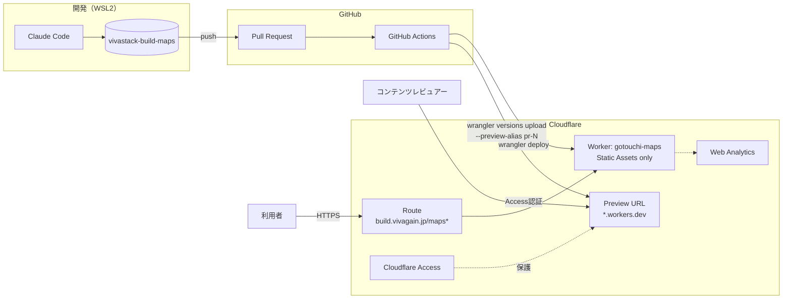
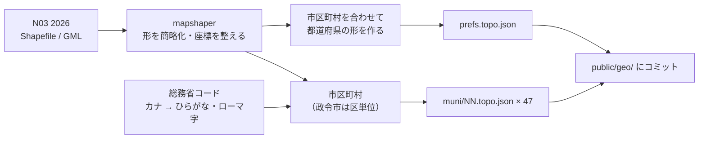
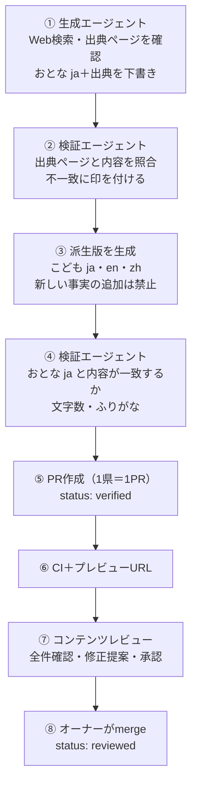
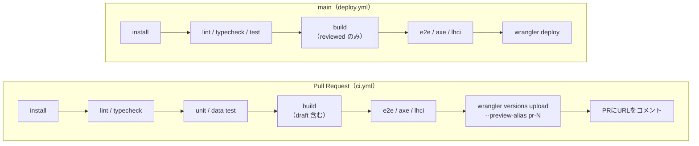
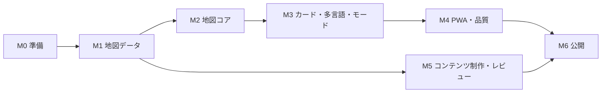

# 「ご当地めいぶつ日本地図」開発概要書

| 項目 | 内容 |
|---|---|
| ドキュメント | docs/development-overview.md |
| 版 | 0.2（ドラフト） |
| 作成日 | 2026-11-11 |
| 更新日 | 2026-11-11（リポジトリ構成を `vivastack-labs/vivastack-build-maps` 単独リポジトリに合わせて修正） |
| リポジトリ | vivastack-labs/vivastack-build-maps（リポジトリ直下がアプリ本体） |
| 公開URL | `https://build.vivagain.jp/maps/{ja,en,zh}/` |
| ステータス | 検討フェーズの決定事項を反映。「要検証」とした項目は実装時に確定する |

---

## 1. 概要

### 1.1 目的

47都道府県の名物と名所を、日本地図から直感的に探せるWebアプリを作り、無料で一般公開する。子どもの学習にも、大人の旅行の下調べにも使えることを目指す。

### 1.2 背景

別のLLMで作った単一HTMLのプロトタイプ（`Japanese_Local_Specialties_Map.html`、約926KB）で、操作感と機能の方向性は確認できた。ただし、データ構造、表示速度、コンテンツの正確性、スマホ操作、多言語対応の面で、正式なアプリとして公開するには作り直しが必要である。

### 1.3 プロトタイプからの主な変更点

| 観点 | プロトタイプ | 正式版 |
|---|---|---|
| 構成 | 単一HTML・素のJavaScript | Next.js（静的出力）＋TypeScript |
| 地図データ | 座標変換済みのSVGパスを埋め込み（約800KB）。市区町村は2016年のデータ | 国土数値情報 N03 **2026年版**から作るTopoJSON。市区町村は県ごとに分けて必要なときに読み込む |
| 県のデータ | 番号参照の配列、`<ruby>` HTMLを直書き | スキーマ付きのYAML。ふりがなは独自の記法で書く |
| 言語 | 日本語のみ | 日本語・英語・中国語（簡体字） |
| 利用者 | 子ども向けの文体だけ | こども向け／おとな向けの2系統。ふりがなON/OFF |
| 政令指定都市 | 市を1つの区域として表示 | 区まで分けて表示 |
| 東京からの距離 | 固定値 | 緯度経度から計算 |
| コンテンツの正確性 | 確認していない | AIで作成し、検証エージェントとチームのレビュアーが確認する。出典を明記する |
| スマホ | ホバー前提。ダブルタップは動作未確認 | タップで選択、下から出るパネル、ピンチで拡大 |
| 配信 | なし | Cloudflare Workers（Static Assets）、GitHub Actionsで自動デプロイ |

---

## 2. 対象ユーザーと利用シーン

| ユーザー | 利用シーン | モード |
|---|---|---|
| 小学生（中学年以上） | 社会科で都道府県を覚える、家庭学習 | こども（ふりがなON） |
| 保護者・教員 | 子どもと一緒に見る、授業の補助 | こども／おとな |
| 一般の大人・旅行者 | 旅行先の名物・名所を下調べする | おとな |
| 訪日客 | 英語・中国語で日本の地域の特色を知る | おとな（en / zh） |

- **言語**：`ja` / `en` / `zh`（簡体字。言語指定は `zh-Hans`）
- **モード**：`kids` / `adult`。すべての言語で両方を用意する
- **ふりがな**：日本語では、こども向け・おとな向けのどちらでもON/OFFを切り替えられる

---

## 3. スコープ

### 3.1 MVP

- プロトタイプの全機能（第4章）
- 第1章 1.3 で挙げた変更点
- 3言語 × 2モード × ふりがなON/OFF
- 出典の表示（出典がないものは「出典なし」と明記）
- PWA（ホーム画面への追加、オフライン表示。範囲は第5章）

### 3.2 PHASE 2

- 検索（県名、名物、名所）
- お気に入り
- クイズ・学習モード
- 名物のカテゴリ絞り込み（食べ物・工芸・祭りなど）

### 3.3 対象外

- ユーザー投稿やコメント機能
- ログイン・アカウント機能
- 実際の地図（道路・地形）を重ねること
- 乗換案内とのリアルタイム連携（所要時間は「目安」として静的に持つ）
- 県ごとの個別ページ（SEO目的の詳細ページは PHASE 2 以降で検討）

---

## 4. 機能要件

> 【MVP】と書いたものは MVP の必須機能。プロトタイプにあった機能は原則すべて引き継ぐ。

### 4.1 地図表示

| ID | 要件 |
|---|---|
| F-MAP-01 | 47都道府県を8地方ごとに色分けし、県名ラベルを表示する。画面が狭いとき（目安：幅820px以下）は県名ラベルを出さない |
| F-MAP-02 | 沖縄県は左上の点線枠の中に移して表示する |
| F-MAP-03 | 地図の下に8地方の色見本（凡例）を表示する |
| F-MAP-04 | 閲覧環境の設定（`prefers-color-scheme`）に合わせてライト／ダークを切り替える |
| F-MAP-05 | 画面が狭いときは、地図とカードを縦に並べる。スマホではカードを下から出るパネルにする |
| F-MAP-06 | 「日本海」「太平洋」の海域名を表示する |

### 4.2 県の情報カード

| ID | 要件 |
|---|---|
| F-CARD-01 | 県にマウスをのせる（ホバー）と、その県の情報をカードに表示する（ホバーできる環境のみ） |
| F-CARD-02 | 基本情報として、地方名、県名、県庁所在地を表示する |
| F-CARD-03 | 東京都庁から県庁所在地までの直線距離（km、概算）を表示する。値は緯度経度から計算する（第7章） |
| F-CARD-04 | おすすめの行き方を表示する（交通手段、経路、所要時間の目安）。「目安」であることを明記する |
| F-CARD-05 | 名物を3つ表示する（絵文字、名前、ひとこと解説） |
| F-CARD-06 | 名所を3つ表示する（名前、ひとこと解説） |
| F-CARD-07 | 県をクリック（スマホではタップ）すると、その県をカードに固定表示する |
| F-CARD-08 | 「大きくして市区町村を見る」「元の大きさにもどす」ボタンを置く |

### 4.3 ツールチップ

| ID | 要件 |
|---|---|
| F-TIP-01 | 県のツールチップに、県名と名物3つの名前を表示する（マウス操作のときのみ） |
| F-TIP-02 | 県を最大化しているときは、市区町村のツールチップに名前と読みがなを表示する。政令指定都市の区は「市名＋区名」で表示する |

### 4.4 拡大・縮小・移動

| ID | 要件 |
|---|---|
| F-ZOOM-01 | 地図全体を拡大・縮小できる。方法は「＋」「−」ボタン、キーボードの `+` `-`、マウスホイール、スマホのピンチ |
| F-ZOOM-02 | 「全体」ボタンまたは `0` キーで、全体表示に戻す |
| F-ZOOM-03 | 拡大しているときは、ドラッグ（スマホは1本指のスワイプ）で地図を動かせる |
| F-ZOOM-04 | 県をダブルクリックすると最大化し、もう一度ダブルクリックすると元に戻す。スマホではカード内のボタンで操作する |
| F-ZOOM-05 | 動きを減らす設定（`prefers-reduced-motion`）がされている環境では、アニメーションしない |

### 4.5 市区町村の表示（県の最大化中）

| ID | 要件 |
|---|---|
| F-MUNI-01 | その県の市区町村の境界を、濃淡をつけて表示する。**政令指定都市（20市）は区まで分けて表示する** |
| F-MUNI-02 | 名前ラベルは入りきる所だけ表示し、さらに拡大するとラベルが増える |
| F-MUNI-03 | マウスをのせた市区町村を強調する |
| F-MUNI-04 | ほかの県は薄く表示する。別の県をダブルクリックすると、その県の表示に切り替える |
| F-MUNI-05 | 市区町村データは、県を最大化したときに初めて読み込む（第7章 7.4） |

### 4.6 県名さくいん

| ID | 要件 |
|---|---|
| F-IDX-01 | 47都道府県を8地方に分けて、県名ボタンの一覧を表示する |
| F-IDX-02 | 地図と同じ操作ができる（ホバーで表示、クリックで固定、ダブルクリックで最大化） |
| F-IDX-03 | 地図を見られない利用者のために、地図の代わりに使える操作手段として作る（第5章 5.2） |

### 4.7 キーボード操作

| ID | 要件 |
|---|---|
| F-KB-01 | Tabキーで県に移動すると、カードを表示する |
| F-KB-02 | Enter または Space で固定表示にする |
| F-KB-03 | Shift + Enter で最大化する |
| F-KB-04 | `+` `-` `0` で拡大・縮小・全体表示にする |
| F-KB-05 | Esc で最大化を解除する（新規） |

### 4.8 モード・ふりがなの切替

| ID | 要件 |
|---|---|
| F-MODE-01 | 「こども」「おとな」のモードを切り替えられる。切り替わるのは解説文と表現 |
| F-MODE-02 | 日本語では、どちらのモードでもふりがなをON/OFFできる |
| F-MODE-03 | 選んだモードとふりがなの設定は、ブラウザ（localStorage）に保存する。保存できない環境でも既定値で正しく表示する |
| F-MODE-04 | 両方のモードの文を静的なHTMLに含めておき、表示はCSSで切り替える（JavaScriptがなくても既定のモードで読める） |

### 4.9 言語の切替

| ID | 要件 |
|---|---|
| F-I18N-01 | URLは `/maps/ja/`、`/maps/en/`、`/maps/zh/` とする |
| F-I18N-02 | `/maps` へのアクセスは `/maps/ja/` へリダイレクト（301）する。**ブラウザの言語設定による自動の振り分けはしない** |
| F-I18N-03 | 各ページに言語切替ボタンと `hreflang`（`ja` / `en` / `zh-Hans` / `x-default`）を設定する |
| F-I18N-04 | 画面の文言（UI）も3言語に対応する |
| F-I18N-05 | 市区町村名は、英語はローマ字（ヘボン式）、中国語は日本語の漢字表記をそのまま使う（MVP） |

### 4.10 出典の表示

| ID | 要件 |
|---|---|
| F-SRC-01 | カードの下に、折りたたみ式（`<details>`）の「出典」欄を置く |
| F-SRC-02 | 名物・名所・行き方の項目ごとに、出典（タイトル、URL、確認日）を表示する |
| F-SRC-03 | 出典がない項目には「出典なし」と表示する |
| F-SRC-04 | フッターに、地図データの出典と「AIで作成し、人が確認しています」を明記する。詳しくは「このサイトについて」のページに書く |

---

## 5. 非機能要件

### 5.1 表示速度

| 指標 | 基準値（案） |
|---|---|
| 最初に読み込むJavaScript＋地図データ（圧縮後） | 300KB以下 |
| 1県分の市区町村データ（圧縮後） | 100KB以下（目安） |
| Lighthouse Performance（スマホ） | 90以上 |
| LCP / CLS / INP | 2.5秒以下 / 0.1以下 / 200ms以下 |

Lighthouse CIでこの基準値を超えたら、CIを失敗させる。

### 5.2 アクセシビリティ

- 目標は **WCAG 2.2 AA**。
- 県の形（SVGのパス）には `role="button"` と `aria-label`（県名）を付け、キーボードで操作できるようにする。
- 地図を見られない利用者は、県名さくいんでも同じ情報にたどり着けるようにする。
- コントラストは、ライト・ダークの両方の配色で 4.5:1 以上にする。
- 動きを減らす設定がされている環境では、アニメーションしない。
- ふりがな（`<ruby>`）は、スクリーンリーダーで二重に読み上げられないか確認する。
- CIで axe（Playwright）を実行し、違反が1件でもあれば失敗させる。

### 5.3 対応環境（案）

| 区分 | 対象 |
|---|---|
| PC | Chrome / Edge / Firefox / Safari の最新版と、その1つ前の版 |
| スマホ | iOS Safari 最新版と1つ前の版、Android Chrome 最新版 |
| 画面幅 | 360px以上 |

確定は「未決事項」（第16章）で扱う。

### 5.4 PWA

- Web App Manifest を置き、ホーム画面に追加できるようにする。
- Service Worker で次をキャッシュする（案）：
  - アプリの枠組み（HTML・JS・CSS）、都道府県の地図データ、全コンテンツ：インストール時にキャッシュ
  - 市区町村の地図データ：一度見た県だけキャッシュ
- 使うツールは実装時に選ぶ（Serwist、workbox-build など）。

### 5.5 セキュリティ

- 静的配信のみ。サーバー側の処理、データベース、ログイン機能は持たない。
- `_headers` で次のヘッダーを設定する：CSP、`X-Content-Type-Options`、`Referrer-Policy`、`Permissions-Policy`、HSTS。
- CSPについて：
  - Next.jsの静的出力にはインラインのスクリプトが含まれるため、ハッシュかnonceで許可する方法を実装時に検証する。
  - Web Analyticsのドメインを許可する。
- フォントは `next/font` で自前で配信する。Google Fontsへの外部リクエストはしない。
- GitHub Actionsで使うActionは、コミットSHAでバージョンを固定する。
- シークレットの扱いは第11章 11.2 に従う。
- シークレットの混入は、既存の gitleaks の設定（`.gitleaks.toml`）で検出する。手元ではClaude Codeのhookで、CIでも実行する（案）。

### 5.6 プライバシー

- アクセス解析は **Cloudflare Web Analytics**（Cookieを使わない）。Google Analyticsは使わない。
- Cookieの同意バナーは置かない（Cookieを使わないため）。
- プライバシーポリシーのページを用意する。

---

## 6. システム構成

### 6.1 全体構成



### 6.2 技術スタック

| 層 | 採用 | 備考 |
|---|---|---|
| フレームワーク | Next.js（App Router、`output: 'export'`） | `basePath: '/maps'`、`trailingSlash: true` |
| 言語 | TypeScript（strict） | |
| 地図描画 | SVG＋d3-geo＋topojson-client | 背景地図は使わない |
| スタイル | CSS Modules または Tailwind CSS | 実装時に決める |
| テスト | Vitest、Testing Library、Playwright、axe-core、Lighthouse CI | 第10章 |
| 整形・lint | ESLint、Prettier、markdownlint、yamllint | Prettier・markdownlint・yamllintは、リポジトリにある設定（`.prettierrc`、`.markdownlint.json`、`.yamllint`）を使う |
| 配信 | Cloudflare Workers（Static Assets） | Workerのスクリプトは使わない |
| CI/CD | GitHub Actions＋cloudflare/wrangler-action | 第12章 |
| パッケージ管理 | pnpm | |
| 実行環境 | Node.js（その時点のActive LTS） | `.nvmrc` で固定する |

### 6.3 地図の描き方を選んだ理由

| 方式 | 長所 | 短所 |
|---|---|---|
| **SVG＋TopoJSON（採用）** | デフォルメした見た目を保てる。背景地図が要らない。静的配信だけで済み、運用費がほぼゼロ | 実際の道路や地形は表示できない |
| MapLibre GL＋ベクトルタイル | 実際の地図と重ねられ、拡大もなめらか | タイルの用意や外部サービスが必要。子ども向けの見た目に合わせにくい |

このアプリの目的は都道府県とその特色を知ることで、実際の地図は必要ないため、SVG方式を採用する。

### 6.4 配信の構成とURL

- Worker名は `gotouchi-maps`（案）。割り当ては **Route**（`build.vivagain.jp/maps*`）。
  - Custom Domainにしない理由：Custom Domainはホスト名全体を1つのWorkerに割り当てる方式のため。将来、`build.vivagain.jp` の別のパスに別アプリを置けるようにしておく。
- 静的出力の構成（想定）：

```
dist/                       ← wrangler の assets.directory
├─ _redirects
├─ _headers
└─ maps/
   ├─ ja/index.html
   ├─ en/index.html
   ├─ zh/index.html
   ├─ _next/...
   ├─ geo/prefs.topo.json
   ├─ geo/muni/01.topo.json ... 47.topo.json
   ├─ manifest.webmanifest
   └─ sw.js
```

- **要検証**：Next.jsの公式ドキュメントには、`basePath` を指定したときに `out/` の中が `/maps` の下にまとまるかの記載がない。まとまらない場合は、ビルド後に `out/` を `dist/maps/` へ移すスクリプトを用意する。

### 6.5 ディレクトリ構成（案）

リポジトリ直下がアプリ本体になる。`（既存）` と書いたものは、すでにリポジトリにある。

```
vivastack-build-maps/
├─ docs/
│  └─ development-overview.md     ← 本書
├─ app/
│  └─ [lang]/                      ← generateStaticParams で ja / en / zh を生成
│     ├─ layout.tsx
│     └─ page.tsx
├─ src/
│  ├─ components/                  ← Map, PrefCard, Tooltip, Index, ModeToggle...
│  ├─ features/map/                ← 表示範囲の計算、拡大縮小、ラベル間引き
│  ├─ lib/
│  │  ├─ ruby.ts                   ← ふりがな記法のパーサー
│  │  ├─ distance.ts               ← 距離の計算（ハバーサイン公式）
│  │  └─ content.ts                ← コンテンツの読み込みと型
│  └─ i18n/                        ← UI文言（ja / en / zh）
├─ content/
│  ├─ .yamllint                    ← （既存）content/ 用の yamllint 設定（1行200字まで）
│  ├─ schema/prefecture.schema.json
│  ├─ prefectures/01-hokkaido.yaml ... 47-okinawa.yaml
│  └─ guidelines/
│     ├─ writing.md                ← 執筆ルール・文字数の基準
│     └─ review-checklist.md       ← コンテンツレビューのチェックリスト
├─ geo/
│  ├─ scripts/build-geo.ts         ← 地図データの変換（手動で実行）
│  ├─ sources/                     ← 読みがななどの元データ
│  ├─ downloads/                   ← 地図の原データ（N03）の置き場。.gitignore の downloads/ によりコミットされない
│  └─ README.md                    ← 手順と出典
├─ public/
│  ├─ geo/                         ← 変換後のTopoJSON（コミットする）
│  ├─ _redirects
│  └─ _headers
├─ scripts/
│  ├─ validate-content.ts
│  ├─ check-links.ts
│  └─ postbuild.ts                 ← dist/ の組み立て
├─ tests/
│  ├─ unit/
│  └─ e2e/
├─ .github/
│  ├─ workflows/                   ← ci.yml / deploy.yml / link-check.yml（第12章）
│  ├─ CODEOWNERS
│  └─ dependabot.yml
├─ .claude/                        ← （既存）Claude Code の設定・ルール・エージェント・スキル・hooks
│  ├─ rules/                       ← （既存）開発ルール（TDD、レビュー、コミット規約など）
│  ├─ agents/                      ← （既存）planner、code-reviewer など。コンテンツ検証用のサブエージェントを追加する
│  └─ skills/                      ← （既存）コンテンツ生成用のスキルを追加する
├─ .codex/ .agents/                ← （既存）Codex 用の設定・スキル
├─ .playwright/cli.config.json     ← （既存）Playwright CLI（対話的なブラウザ操作）の設定。E2Eテストの設定とは別
├─ .prettierrc .markdownlint.json .yamllint .prettierignore   ← （既存）
├─ .gitleaks.toml .gitleaksignore  ← （既存）シークレット検出の設定
├─ AGENTS.md                       ← Claude Code と Codex の共通の指示（エージェント向けの指示はここに書く）
├─ CLAUDE.md                       ← `@AGENTS.md` で AGENTS.md を読み込む。Claude Code 固有の内容だけを追記する
├─ README.md                       ← （既存）見出しはリポジトリ名に変更済み。本文はM0でこのアプリ向けに書き直す
├─ CHANGELOG.md                    ← （既存）Keep a Changelog 形式
├─ wrangler.jsonc
├─ next.config.ts
├─ package.json
└─ .nvmrc
```

- **`.gitignore`**：Python 用の `lib/` の行はどの階層にも効くため、`!src/lib/` の例外を加えて `src/lib/` をコミットできるようにした（対応済み）。`dist/`（ビルド結果）はコミットしないので、そのままでよい。

---

## 7. データ設計

### 7.1 コンテンツのスキーマ

1県につき1つのYAMLファイルにする。JSON Schemaで検証し、TypeScriptの型もスキーマから生成する。

```yaml
# content/prefectures/01-hokkaido.yaml（例。値は説明用）
id: hokkaido
code: "01"                 # 全国地方公共団体コードの都道府県コード
region: hokkaido           # hokkaido | tohoku | kanto | chubu | kinki | chugoku | shikoku | kyushu
name:
  ja: "{北海道|ほっかいどう}"
  en: "Hokkaido"
  zh: "北海道"
capital:
  name:
    ja: "{札幌市|さっぽろし}"
    en: "Sapporo"
    zh: "札幌市"
  lat: 43.0642             # 都道府県庁の位置（第8章 8.4）
  lon: 141.3469
access:
  emoji: "✈️"
  mode: { ja: "{飛行機|ひこうき}", en: "Plane", zh: "飞机" }
  route:
    ja: "{羽田空港|はねだくうこう} → {新千歳空港|しんちとせくうこう}"
    en: "Haneda Airport → New Chitose Airport"
    zh: "羽田机场 → 新千岁机场"
  durationMin: 95          # 所要時間の目安（分）
  sources: []              # 空なら「出典なし」と表示
  status: reviewed
specialties:               # ちょうど3件
  - id: potato
    emoji: "🥔"
    name: { ja: "じゃがいも", en: "Potatoes", zh: "土豆" }
    description:
      ja:
        kids:  "{生産量|せいさんりょう}は{日本一|にほんいち}。..."
        adult: "..."
      en: { kids: "...", adult: "..." }
      zh: { kids: "...", adult: "..." }
    sources:
      - title: "（出典ページのタイトル）"
        url: "https://..."
        accessed: 2026-11-11
    status: draft          # draft | verified | reviewed
spots:                     # ちょうど3件。項目の構成は specialties と同じ（emoji は任意）
  - ...
```

| 項目 | ルール |
|---|---|
| `status` | `draft`（AIが下書き）→ `verified`（検証エージェントが確認済み）→ `reviewed`（人がレビュー済み） |
| 本番ビルド | `reviewed` の項目だけを含める。そうでない項目が1つでもある県は本番に出さない |
| プレビュービルド | すべての状態の項目を含め、`reviewed` でない項目には「下書き」と表示する（レビュー作業用） |
| `sources` | 空の配列を許す。空なら画面に「出典なし」と表示する。CIでは警告にとどめる |
| 書式 | yamllintで検査する。ふりがなを付けた文は長くなるので、`content/` だけ専用の設定 `content/.yamllint`（1行200字まで）を使う（`yamllint -c content/.yamllint content/`）。ルートの `.yamllint`（120字まで）は、行の長さのチェックで `content/` を対象外にしている |

### 7.2 ふりがなの記法

- 書き方は `{漢字|よみ}`。ルビを付ける単位は、ふりがなを付ける語ごととする。
- `src/lib/ruby.ts` で `<ruby>漢字<rt>よみ</rt></ruby>` に変換する。ふりがなOFFのときは `rt` をCSSで隠す。
- CIで次をチェックする：
  - 括弧の対応が正しいか
  - 読みが空になっていないか
  - 読みがひらがな（と長音記号「ー」）だけか
  - 日本語の文で、ふりがなの付いていない漢字が残っていないか（警告）
- 下書きのときは、形態素解析（Sudachiなど）で自動的にふりがなを付け、人がレビューで直す。固有名詞（地名・人名）はレビューで特に注意して確認する。

### 7.3 解説文の文字数の基準

| | こども ja | おとな ja | こども en | おとな en | こども zh | おとな zh |
|---|---|---|---|---|---|---|
| 名物 | 20〜35字 | 30〜50字 | 10〜20語 | 12〜25語 | 15〜30字 | 20〜40字 |
| 名所 | 15〜25字 | 25〜40字 | 8〜15語 | 8〜18語 | 12〜22字 | 15〜30字 |

- 文字数はふりがなを除いて数える。上限を超えたら、CIで**警告**を出す（エラーにはしない）。
- **こども向け**：小学校中学年が読める表現にする。理由や体験（何がすごいか、どう楽しむか）を中心に書く。
- **おとな向け**：事実を1つ加える（時期・地域・由来など）。
- **英語・中国語**：同じモードの日本語文の意味を訳す（逐語訳ではない）。新しい事実は加えない。
- 根拠：プロトタイプの実際の長さ（名物は中央値25字、名所は中央値19字）を基準にした。PCではカードに名物3つ・名所3つがスクロールなしで収まり、スマホでは下から出るパネルの1画面に収まる量である。

### 7.4 地図データの形式

| ファイル | 内容 | 読み込むタイミング |
|---|---|---|
| `geo/prefs.topo.json` | 47都道府県の形、県名ラベルの位置、沖縄の別枠表示用の変換値 | 最初に読み込む |
| `geo/muni/{01..47}.topo.json` | その県の市区町村（政令指定都市は区）の形と、名前・読みがな・ローマ字 | 県を最大化したとき |

市区町村ごとに次の項目を持つ：

| 項目 | 内容 |
|---|---|
| `code` | 全国地方公共団体コード |
| `name.ja` | 名前（例：「札幌市中央区」） |
| `kana` | 読みがな（ひらがな） |
| `name.en` | ローマ字表記 |
| `cityName` | 政令指定都市の区の場合、所属する市の名前 |

### 7.5 東京からの距離

- 東京都庁と各都道府県庁の緯度経度から、ハバーサイン公式で直線距離を計算する（地球の半径 6,371km、10km単位に丸めて「約○km」と表示）。
- ビルド時に計算して値を埋め込む。テストで、既知の値と誤差の範囲内で一致するか確認する。

---

## 8. 地図データの作成手順

### 8.1 元データ

| データ | 出典 | ライセンス | 用途 |
|---|---|---|---|
| 行政区域（N03）2026年版（2026年1月1日時点） | 国土交通省 国土数値情報ダウンロードサイト | CC BY 4.0互換（商用利用も可） | 都道府県・市区町村・政令指定都市の区の形 |
| 全国地方公共団体コード | 総務省 | 政府標準利用規約（要確認） | 市区町村名の読みがな（カナ） |
| 都道府県庁の位置 | 国土地理院の公表値（要確認） | 同上 | 距離の計算 |

### 8.2 変換の流れ



- `geo/scripts/build-geo.ts` で実行する。**手動で実行する**ものとし、毎回のビルドでは動かさない。
- 都道府県の形は市区町村の形を合わせて作るので、県境と市区町村の境界が必ず一致する。
- 原データ（全国分で約766MB）は `geo/downloads/` に置き、コミットしない。変換後のTopoJSONと、変換に使った設定（データの版、簡略化の度合い）を `geo/README.md` に記録する。
- N03には境界が確定していない地域があり、境界線が暫定で引かれている箇所がある。「このサイトについて」のページにその旨を書く。
- 政令指定都市の区が区単位の形として入っていることは、ページの記載から読み取れるが、**実際のデータで要検証**。

### 8.3 出典の表記

国土数値情報の利用規約に従い、フッターと「このサイトについて」のページに次を記載する。

```
出典：「国土数値情報（行政区域データ）」（国土交通省）
（https://nlftp.mlit.go.jp/ksj/gml/datalist/KsjTmplt-N03-2026.html）を加工して作成
```

地図用に形を簡略化しているので、加工したことも明記する。加工したデータを国が作ったもののように見せない。

### 8.4 地図データの更新

国土数値情報は年に1回更新される。年1回、合併などで変わった市区町村を確認し、必要があれば変換をやり直してPRを出す（第13章）。

---

## 9. コンテンツ制作フロー

### 9.1 作業量

47県 ×（名物3＋名所3）× 2モード × 3言語 ＝ **解説文1,692本**、名前などの短い文言は約850件。

### 9.2 流れ

**事実はおとな向けの日本語文で確定させ、ほかの版はそこから作る**方式をとる。



| 手順 | 担当 | 使うもの |
|---|---|---|
| ①〜④ | Claude Code | `.claude/` 以下のスキルと、検証用のサブエージェント |
| ⑤⑥ | Claude Code / GitHub Actions | PR、CI、プレビューURL |
| ⑦ | コンテンツレビュアー（チームメンバー） | プレビューURL（Access経由）、PRのSuggested changesと承認 |
| ⑧ | オーナー | PRのmerge |

### 9.3 執筆ルール

- 出典の文章をそのまま写さない。要約して自分の言葉で書き直す。
- 出典として残すのは、**実際に開いて内容を確認できたURLだけ**。確認できなければ `sources: []`（出典なし）とする。
- 出典の優先順位：
  1. 自治体・観光協会の公式サイト
  2. 公的機関の一覧（農林水産省「うちの郷土料理」、経済産業大臣指定の伝統的工芸品など）
  3. それ以外
- 画像は使わない。名物の見た目は絵文字で表す（絵文字の見え方はOSによって違う）。
- 所要時間は「目安」とし、交通機関の公式情報を出典にする。
- 特定の店や商品を宣伝する表現は避ける。

### 9.4 コンテンツレビュー

| 項目 | 内容 |
|---|---|
| 担当 | `vivastack-labs` 組織のメンバー。GitHub Team（例：`@vivastack-labs/maps-reviewers`）にまとめる |
| 権限 | Teamにリポジトリの **Write** 権限を付ける。PRの承認はレビュアーが行い、mergeはオーナーが行う（承認とmergeを別の人にする） |
| 確認範囲 | 全件（事実、出典、文字数、ふりがな、表現の適切さ、翻訳） |
| 作業環境 | PRのプレビューURL（Cloudflare Accessで制限）で、実際のカード表示を見ながら確認する |
| 修正方法 | PRへのコメント（Suggested changes） |
| 基準 | `content/guidelines/review-checklist.md` |

---

## 10. 開発プロセス

### 10.1 進め方

- 開発はオーナー＋Claude Codeで行う。Codexを使うこともある。
- エージェント向けの指示は `AGENTS.md` にまとめる（Codexは `AGENTS.md` を読み、Claude Codeは `CLAUDE.md` から `@AGENTS.md` で読み込む）。片方にしかない指示を作らない。
- **TDD**（Red → Green → Refactor）で進める。仕様（第4章の要件ID）を先にテストとして書き、テスト名やコメントに要件IDを入れて、要件とテストを対応付ける。
- 1つの機能を1つのPRにする。`main` に直接pushしない。
- 開発の進め方は `.claude/rules/` のルールに従う（計画 → TDD → コードレビュー → コミット。詳細は `development-workflow.md`）。
- コミットメッセージは `<type>: <description>` の形式にする（type は feat / fix / refactor / docs / test / chore / perf / ci。`.claude/rules/git-workflow.md`）。
- リリースごとの変更は `CHANGELOG.md`（Keep a Changelog 形式）に記録する。

### 10.2 テスト戦略

| 層 | ツール | 主な対象 | 目標 |
|---|---|---|---|
| 単体 | Vitest | ふりがなのパーサー、距離の計算、表示範囲の計算と拡大縮小、ラベル間引き、コンテンツの読み込み | ドメインロジックのカバレッジ90%以上（全体は `.claude/rules/testing.md` の基準どおり80%以上） |
| コンポーネント | Vitest＋Testing Library | カード、さくいん、モード・ふりがなの切替、言語切替 | 主な状態がすべて表示できること |
| データ | Vitest＋JSON Schema | 全YAMLのスキーマ、件数（3件ずつ）、全言語・全モードがそろっているか、文字数、ふりがな | CIで必ず実行 |
| E2E | Playwright（PC＋スマホ） | ホバー、固定、最大化、拡大縮小・移動、キーボード操作、言語・モードの切替、`/maps` のリダイレクト | 第4章の主要な要件をすべて確認 |
| アクセシビリティ | @axe-core/playwright | 3言語 × 2モード × ライト・ダーク | 違反0件 |
| 表示速度 | Lighthouse CI | `/maps/ja/`、`/maps/en/`、`/maps/zh/` | 第5章 5.1 の基準値 |

---

## 11. デプロイの前提条件

### 11.1 必要なアカウント・サービス

| サービス | 必要なもの | 備考 |
|---|---|---|
| GitHub | `vivastack-labs/vivastack-build-maps`、Actionsの有効化、Environments（`preview` / `production`） | レビュアーは `vivastack-labs` 組織のメンバー（GitHub Teamで管理） |
| Cloudflare | 既存アカウント（vivagain.jpのゾーンがあるもの）、Workers Freeプラン、workers.devのサブドメイン登録 | プレビューURLは workers.dev 上にしか発行できない |
| Cloudflare Zero Trust（Access） | 無料プランで組織を作り、プレビューURLを保護する | 無料枠の人数と、支払い方法の登録が必要かどうかは**要確認** |
| Cloudflare Web Analytics | `build.vivagain.jp` を登録 | プロキシ経由なので、計測タグを埋め込まない自動設定が使える見込み |
| Claude Code | Pro / Maxプランのサブスクリプション（またはAPIキー） | 開発とコンテンツ生成に使う。CIではAIを動かさないので、GitHubにAnthropicのAPIキーは置かない |

### 11.2 シークレット・IDの一覧と保存場所

| 名前 | 保存場所 | 用途 | 扱い |
|---|---|---|---|
| `CLOUDFLARE_API_TOKEN` | GitHub Environment Secrets（`preview` / `production`） | wranglerでのデプロイ | 機密。このアプリ専用。有効期限を設けて定期的に更新する |
| `CLOUDFLARE_ACCOUNT_ID` | GitHub Secrets | wranglerでのデプロイ | 公式には機密とされていないが、Secretとして扱う |
| `GITHUB_TOKEN` | Actionsが自動で発行 | PRにプレビューURLをコメントする | workflowで `pull-requests: write` だけを付与する |
| Web Analyticsのトークン | （自動設定なら不要） | アクセス解析 | 公開されても問題ない値 |

- シークレットは、リポジトリ、`.env`、ログ、PRのコメントには一切書かない。
- ローカルからのデプロイ作業は `wrangler login`（OAuth）で行い、トークンを手元に保存しない。

### 11.3 Cloudflare API Tokenの権限

公式手順では、「Edit Cloudflare Workers」テンプレートを元にして、権限をできるだけ絞るよう推奨されている。

| 範囲 | 権限 | 対象リソース |
|---|---|---|
| Account | Workers Scripts: Edit | 自分のアカウントだけ |
| Account | Account Settings: Read | 同上 |
| Zone | Workers Routes: Edit | **vivagain.jpだけ** |
| User | Memberships: Read / User Details: Read | wranglerが必要とする場合だけ |

- **要検証**：Zone側の「Workers Routes: Edit」の正式名称と、最小限の組み合わせは、公式ドキュメントからは確定できなかった。権限を絞ったトークンで `wrangler deploy` と `wrangler versions upload` を試して確定し、本書を更新する。
- 有効期限は1年とし、期限が切れる前に更新する（手順は第13章）。

### 11.4 Cloudflareの事前設定

**(1) DNS**

- `build.vivagain.jp` のレコードを**プロキシ有効**で作る。Routeを使うにはプロキシ経由のDNSレコードが必要と公式に書かれている。
- Worker専用のホスト名なので、ダミーのアドレス（`AAAA 100::`）でよい見込み。
- 既存サイト（vivagain.jpのほかのホスト名）には影響しない。

**(2) wrangler.jsonc**

```jsonc
{
  "$schema": "./node_modules/wrangler/config-schema.json",
  "name": "gotouchi-maps",
  "compatibility_date": "YYYY-MM-DD",          // 実装時の日付
  "assets": {
    "directory": "./dist",
    "not_found_handling": "404-page"
  },
  "routes": [
    { "pattern": "build.vivagain.jp/maps*", "zone_name": "vivagain.jp" }
  ],
  "workers_dev": false,                        // 本番を workers.dev で公開しない
  "preview_urls": true                         // PRプレビュー（バージョンごとのURL）を有効にする
}
```

- **要検証**：`workers_dev: false` と `preview_urls: true` を同時に設定できるかは、公式ドキュメントに記載がない。実際に試して確認する。

**(3) `_redirects`（`dist/` の直下に置く）**

```
/maps   /maps/ja/  301
/maps/  /maps/ja/  301
```

**(4) `_headers`（`dist/` の直下に置く。例）**

```
/maps/*
  X-Content-Type-Options: nosniff
  Referrer-Policy: strict-origin-when-cross-origin
  Permissions-Policy: geolocation=(), camera=(), microphone=()
  Strict-Transport-Security: max-age=31536000; includeSubDomains
  Content-Security-Policy: （実装時に決める。5.5 を参照）

/maps/geo/*
  Cache-Control: public, max-age=86400

/maps/_next/static/*
  Cache-Control: public, max-age=31536000, immutable
```

**(5) Cloudflare Access（プレビューURLの保護）**

- 公式ドキュメントでは、Accessで「本番の workers.dev URL、プレビューURL、またはその両方を保護できる」とされている。
- 許可するのは、オーナーとレビュアーのメールアドレスだけにする。ログインはメールのワンタイムPINで行う。
- 設定手順（ダッシュボードのどこで有効にするか）は**要確認**。確定したら本書に追記する。
- プレビューのページはすべて `noindex` にする。

### 11.5 GitHubの事前設定

| 設定 | 内容 |
|---|---|
| ブランチ保護（`main`） | PRを通さないとmergeできない。CIの成功と、CODEOWNERSによる承認を必須にする |
| Environment `production` | `main` からのデプロイだけを許可する |
| Environment `preview` | PRからのデプロイに使う |
| CODEOWNERS | `*`（リポジトリ全体）はオーナー。`/content/` は `@vivastack-labs/maps-reviewers` |
| Team | `maps-reviewers` を作成し、リポジトリにWrite権限を付ける |
| Actionsの権限 | 既定は `contents: read`。必要なjobだけで権限を追加する |
| Dependabot | npmとGitHub Actionsの更新を週1回提案させる |

### 11.6 ローカル開発環境

| 項目 | 内容 |
|---|---|
| OS | Windows 11＋WSL2（Ubuntu）。作業は **WSL側**（`~/works/vivastack-build-maps`）で行う |
| Node.js | その時点のActive LTS（`.nvmrc` で固定する） |
| パッケージ管理 | pnpm（corepackで有効にする） |
| wrangler | v4（devDependencyとして入れる） |
| mapshaper | npm（devDependency） |
| Playwright | `pnpm exec playwright install --with-deps` |
| Claude Code | リポジトリ直下で起動する。`.claude/settings.json` の許可リストに `Bash(pnpm *)` を追加済み |

```bash
# WSL（bash）
cd ~/works/vivastack-build-maps
corepack enable
pnpm install
pnpm dev              # http://localhost:3000/maps/ja/
pnpm test             # Vitest
pnpm test:e2e         # Playwright
pnpm build            # 静的出力を作り、dist/ を組み立てる
pnpm exec wrangler dev   # dist/ を Workers と同じ動きでローカル確認する
```

---

## 12. CI/CD

### 12.1 workflowの一覧

| ファイル | 実行タイミング | 内容 |
|---|---|---|
| `.github/workflows/ci.yml` | `main` 向けのPR | チェック一式 → プレビューへデプロイ → PRにURLをコメント |
| `.github/workflows/deploy.yml` | `main` へのpush | チェック一式 → 本番へデプロイ |
| `.github/workflows/link-check.yml` | **手動で実行**（`workflow_dispatch`） | 全コンテンツの出典URLのリンク切れチェック。結果はレポートとして残す |

- リポジトリ全体がアプリなので、パスでの絞り込みは基本的にしない。ただし、アプリの動作に関係しない変更（`docs/**`、`.claude/**`、`.codex/**`、`.agents/**`、`*.md`）は `paths-ignore` で対象外にする（案）。
- ブランチ保護でCIの成功を必須にするため、`paths-ignore` で実行されなかったPRがmergeできなくならないかを M0 で確認する。

### 12.2 パイプライン



### 12.3 PR用workflowの例（概略）

```yaml
# .github/workflows/ci.yml（概略。Action は実装時に SHA で固定する）
name: ci
on:
  pull_request:
    branches: [main]
    paths-ignore: ["docs/**", ".claude/**", ".codex/**", ".agents/**", "**/*.md"]

permissions:
  contents: read

concurrency:
  group: ci-${{ github.event.pull_request.number }}
  cancel-in-progress: true

jobs:
  check:
    runs-on: ubuntu-latest
    steps:
      - uses: actions/checkout@<SHA>
      - uses: pnpm/action-setup@<SHA>
      - uses: actions/setup-node@<SHA>
        with:
          node-version-file: .nvmrc
          cache: pnpm
      - run: pnpm install --frozen-lockfile
      - run: pnpm lint && pnpm typecheck   # ESLint・Prettier・markdownlint・yamllint
      - run: pnpm test
      - run: pnpm content:validate
      - run: pnpm build:preview          # draft を含め「下書き」と表示、noindex を付ける
      - run: pnpm exec playwright install --with-deps
      - run: pnpm test:e2e               # axe を含む
      - run: pnpm lhci
      - uses: actions/upload-artifact@<SHA>
        with: { name: dist, path: dist }

  preview:
    needs: check
    runs-on: ubuntu-latest
    environment: preview
    permissions:
      contents: read
      pull-requests: write
    steps:
      - uses: actions/checkout@<SHA>
      - uses: actions/download-artifact@<SHA>
        with: { name: dist, path: dist }
      - uses: cloudflare/wrangler-action@<SHA>
        id: wrangler
        with:
          apiToken: ${{ secrets.CLOUDFLARE_API_TOKEN }}
          accountId: ${{ secrets.CLOUDFLARE_ACCOUNT_ID }}
          command: versions upload --preview-alias pr-${{ github.event.pull_request.number }}
      # wrangler の出力からプレビューURLを取り出し、PRにコメントする（実装時に詳細化）
```

- 本番用のworkflow（`deploy.yml`）も同じ構成にする。違いは、`on: push`（`main`）、`environment: production`、`pnpm build`（reviewedのみ）、`command: deploy` の4点。
- フォークからのPRにはSecretsが渡らないため、プレビューへのデプロイは行われない（このリポジトリではフォークからのPRを想定しない）。
- プレビューURLの形式（`<alias>-<worker名>.<サブドメイン>.workers.dev`）と、出力から取り出す方法は実装時に確認する。

### 12.4 リンク切れチェック（手動実行）

- `workflow_dispatch` で実行する。必要なら対象の県を入力で指定できる。
- すべての `sources[].url` にリクエストを送り、HTTPステータス、リダイレクト先、タイムアウトを記録する。
- 結果はMarkdownのレポートとしてActionsのArtifactに保存する。リンク切れがあればIssueを作る（自動で作るかは実装時に決める）。
- 相手のサーバーに負担をかけないよう、同時に送るリクエスト数とリクエストの間隔に上限を設ける。

---

## 13. 運用

| 項目 | 頻度 | 内容 |
|---|---|---|
| アクセス解析 | 月1回 | Cloudflare Web Analyticsで、言語別・端末別の利用状況を見る |
| 出典のリンク切れ | 四半期に1回（手動） | `link-check` を実行し、切れたリンクを直すPRを出す |
| コンテンツの見直し | 年1回＋必要なとき | 所要時間・名所の情報が変わっていないか。修正は第9章の流れで行う |
| 地図データの更新 | 年1回 | 国土数値情報の新しい版を確認し、合併などがあれば変換をやり直す |
| API Tokenの更新 | 年1回（期限が切れる前） | 新しいトークンを発行 → Secretsを更新 → 古いトークンを無効にする |
| 依存パッケージの更新 | 週1回 | DependabotのPRをCIで確認してmergeする |
| 切り戻し | 障害時 | `wrangler rollback` で1つ前のバージョンに戻すか、Gitで元に戻すコミットを入れて再デプロイする |

---

## 14. リスクと対策

| # | リスク | 影響 | 対策 |
|---|---|---|---|
| R1 | AIが作ったコンテンツに誤りがある | 信用を失う。子ども向けなので影響が大きい | 出典の確認、検証エージェント、チームのレビュアーによる全件レビュー。reviewedの項目だけを本番に出す |
| R2 | 行き方・所要時間がすぐ古くなる | 誤った案内になる | 「目安」と明記する。年1回見直す |
| R3 | 出典ページのリンク切れ・内容の変更 | 出典が確認できなくなる | 確認日を記録する。手動のリンク切れチェック |
| R4 | プレビューURLの公開 | レビュー前のコンテンツが外に出る | Cloudflare Access、`noindex` |
| R5 | API Tokenの漏えい | 不正にデプロイされる | 最小権限、アプリ専用、Environment Secrets、有効期限、ActionのSHA固定 |
| R6 | 地図データが重い | スマホで表示が遅い | 県ごとに分けて必要なときに読み込む、形の簡略化、Lighthouse CIの基準値 |
| R7 | Next.jsの静的出力とbasePathの組み合わせ | パスの不整合で表示されない | ビルド後に `dist/` を組み立てるスクリプトを用意し、E2Eテストで確認する |
| R8 | 解説文の量（1,692本）が多く、時間がかかる | 公開が遅れる | 1県＝1PRで並行して進める。期限は設けない |
| R9 | CSPとNext.jsのインラインスクリプトの相性 | ページが動かない、または保護が弱くなる | ハッシュかnonceを使う方法を実装時に検証する |
| R10 | 境界が確定していない地域の扱い | 誤解を招く | データが暫定である旨を明記する |

---

## 15. マイルストーン

期限は設けず、できしだい公開する。各段階の完了条件を満たしたら次へ進む。コンテンツ制作（M5）は、M1が終わったら並行して始める。



| 段階 | 内容 | 完了条件 |
|---|---|---|
| M0 準備 | Next.jsの雛形をリポジトリ直下に作る、既存ファイルの調整（`README.md` の本文、`AGENTS.md` のコマンド）、CIの骨組み、Cloudflareの事前設定（DNS、Token、Access）、要検証項目（11.3、11.4）の確認 | 空のページがプレビューと本番にデプロイできる |
| M1 地図データ | N03の変換スクリプト、読みがな・ローマ字、`prefs` と `muni` のTopoJSON | 47都道府県と全市区町村（区を含む）を確認でき、サイズが基準値以内 |
| M2 地図コア | 地図表示、拡大縮小・移動、最大化、市区町村、ツールチップ、さくいん、キーボード操作 | F-MAP / F-ZOOM / F-MUNI / F-TIP / F-IDX / F-KB のE2Eが通る |
| M3 カード・多言語・モード | カード、出典表示、言語切替、モード・ふりがな切替、UI文言 | F-CARD / F-I18N / F-MODE / F-SRC のE2Eが通る |
| M4 PWA・品質 | PWA、CSPなどのヘッダー、アクセシビリティ対応、表示速度の改善、「このサイトについて」・プライバシーポリシー | axe違反0件、Lighthouseが基準値以内 |
| M5 コンテンツ | 生成用スキルと検証エージェントの用意、レビュー基準、47県分の作成とレビュー | 全項目が `reviewed` |
| M6 公開 | 本番デプロイ、Web Analyticsの確認 | `https://build.vivagain.jp/maps/ja/` で公開されている |

---

## 16. 未決事項

| # | 項目 | 案・メモ | 決める時期 |
|---|---|---|---|
| U1 | モードとふりがなの既定値 | 案：日本語はこども向け＋ふりがなON、英語・中国語はおとな向け | M3 |
| U2 | 対応ブラウザの範囲 | 第5章 5.3 の案 | M0 |
| U3 | PWAでオフライン時に使える範囲 | 第5章 5.4 の案 | M4 |
| U4 | スタイルの方式（CSS Modules / Tailwind CSS） | | M0 |
| U5 | API Tokenの最小権限 | 第11章 11.3 で要検証 | M0 |
| U6 | `workers_dev: false` と `preview_urls: true` を同時に設定できるか | 第11章 11.4 で要検証 | M0 |
| U7 | Accessの設定手順、Zero Trust無料プランの条件 | 第11章 11.4 で要確認 | M0 |
| U8 | basePathを指定したときの静的出力の構成 | 第6章 6.4 で要検証 | M0 |
| U9 | 政令指定都市の区がN03に区単位で入っているか | 第8章 8.2 で要検証 | M1 |
| U10 | 総務省コードと国土地理院データの利用条件 | 第8章 8.1 で要確認 | M1 |
| U11 | ~~コンテンツ生成用スキルの置き場所~~ | 決定（D22）：リポジトリ直下の `.claude/skills/` と `.claude/agents/` | — |

---

## 付録A. 決定事項の一覧

| # | 項目 | 決定内容 |
|---|---|---|
| D1 | 利用者 | こども・おとなの両方。モードで切り替える |
| D2 | ふりがな | ON/OFFで切り替える。日本語のこども向け・おとな向けの両方に適用 |
| D3 | 提供形態 | Web＋PWA |
| D4 | コンテンツ管理 | リポジトリ内のYAML（JSON Schemaで検証） |
| D5 | 公開範囲 | 無料で一般公開。収益化しない |
| D6 | 解説文 | 削減しない（3言語 × 2モード）。できるだけ簡潔にする（第7章 7.3） |
| D7 | 多言語 | ja / en / zh（簡体字のみ） |
| D8 | URL | `https://build.vivagain.jp/maps/{ja,en,zh}/`。ブラウザの言語による自動振り分けはしない |
| D9 | MVPの範囲 | プロトタイプの全機能＋改善点。検索・お気に入り・クイズ・カテゴリ絞り込みはPHASE 2 |
| D10 | 技術 | Next.js（静的出力）＋TypeScript、地図はSVG＋TopoJSON |
| D11 | 配信 | Cloudflare Workers（Static Assets）、Route `build.vivagain.jp/maps*` |
| D12 | CI/CD | GitHub Actions＋wrangler-action |
| D13 | 確認体制 | AI生成 → 検証エージェント → チームのレビュアーが全件レビュー・承認 → オーナーがmerge |
| D14 | 出典 | カードに折りたたみで表示する。出典がなければ「出典なし」と明記する |
| D15 | 手動workflow | 手動で実行するのは出典URLのリンク切れチェックだけ。PRでの検証とデプロイは自動 |
| D16 | 政令指定都市 | 区まで分けて表示する |
| D17 | 地図データ | 国土数値情報 N03 2026年版 |
| D18 | 開発体制 | オーナー＋Claude Code、TDD。期限は設けない |
| D19 | リポジトリ | `vivastack-labs/vivastack-build-maps`（単独リポジトリ。直下がアプリ本体） |
| D20 | プレビューの保護 | Cloudflare Access |
| D21 | アクセス解析 | Cloudflare Web Analytics |
| D22 | コンテンツ生成用スキルの置き場所 | リポジトリ直下の `.claude/skills/`（生成）と `.claude/agents/`（検証）。既存のスキル・エージェントと名前が重ならないようにする |

## 付録B. 参考資料

- [国土数値情報 行政区域データ 2026年版](https://nlftp.mlit.go.jp/ksj/gml/datalist/KsjTmplt-N03-2026.html)
- [国土数値情報ダウンロードサイト コンテンツ利用規約](https://nlftp.mlit.go.jp/ksj/other/agreement_01.html)
- [Cloudflare Workers – Migrate from Pages to Workers](https://developers.cloudflare.com/workers/static-assets/migration-guides/migrate-from-pages/)
- [Cloudflare Workers – GitHub Actions](https://developers.cloudflare.com/workers/ci-cd/external-cicd/github-actions/)
- [Cloudflare Workers – Routes](https://developers.cloudflare.com/workers/configuration/routing/routes/)
- [Cloudflare Workers – workers.dev](https://developers.cloudflare.com/workers/configuration/routing/workers-dev/)
- [Cloudflare Workers – Version URLs](https://developers.cloudflare.com/workers/versions-and-deployments/version-urls/)
- [Cloudflare Workers – Wrangler configuration](https://developers.cloudflare.com/workers/wrangler/configuration/)
- [Cloudflare Workers – Static Assets: Redirects](https://developers.cloudflare.com/workers/static-assets/redirects/)
- [Cloudflare Workers – Static Assets: Headers](https://developers.cloudflare.com/workers/static-assets/headers/)
- [Cloudflare Workers – Limits](https://developers.cloudflare.com/workers/platform/limits/)
- [Cloudflare – API token permissions](https://developers.cloudflare.com/fundamentals/api/reference/permissions/)
- [Cloudflare – Find account and zone IDs](https://developers.cloudflare.com/fundamentals/account/find-account-and-zone-ids/)
- [Next.js – Static Exports](https://nextjs.org/docs/app/guides/static-exports)
- [Next.js – basePath](https://nextjs.org/docs/app/api-reference/config/next-config-js/basePath)
