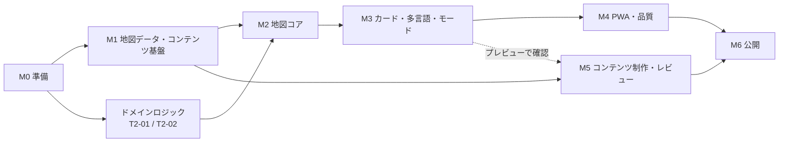

# 「ご当地めいぶつ日本地図」開発計画（タスク分解）

| 項目 | 内容 |
|---|---|
| ドキュメント | docs/development-plan.md |
| 版 | 0.3（ドラフト） |
| 作成日 | 2026-11-11 |
| 更新日 | 2026-11-11（0.2：タスクごとに目的・参照仕様・実装内容・完了条件・テスト条件・依存関係を定義し、詳細を `docs/tasks/` に分けた。0.3：lint・型検査・カバレッジの基準を T0-02 から T0-01 に移した） |
| 元にした設計書 | [development-overview.md](development-overview.md) 0.6 |

---

## 1. この文書について

- [開発概要書](development-overview.md)（以下「仕様」）の第15章のマイルストーン（M0〜M6）を、**1タスク＝1ブランチ＝1PR** の大きさに分ける。LLM（Claude Code・Codex）が1タスクずつ、ほかの文脈がなくても実装できる単位にする。
- この文書には、タスクの一覧、順番、進み具合、着手時に決めることを書く。タスクの定義（目的・実装内容・完了条件など）は `docs/tasks/` のマイルストーンごとのファイルに書く。
- 要件・仕様は開発概要書に書く。タスクの定義と仕様が食い違ったら、仕様を正とする。

### 1.1 タスクの定義の項目

| 項目 | 内容 |
|---|---|
| タスクID | `T<マイルストーン>-<連番>`（例：`T0-01`）。ブランチ名・PRの本文に書いて、計画とPRを対応付ける |
| 種別 | コミット・PRの `<type>`（feat / chore / ci / docs / test / perf）。`手作業` はPRを作らないオーナーの作業 |
| 目的 | なぜこのタスクが必要か。実装中に判断に迷ったときの基準にする |
| 参照仕様 | 開発概要書の章・要件ID・決定事項（D）・未決事項（U）。実装の前に必ず読む |
| 実装内容 | 作るもの・変えるもの。ファイルのパスは開発概要書 6.5 のディレクトリ構成に従う |
| 完了条件 | PRをmergeしてよい状態。テスト以外の条件（ビルドが通る、文書を更新した、など）も含む |
| テスト条件 | TDDで**先に書く**テスト。層（単体・コンポーネント・データ・E2E）と、確かめる振る舞いを書く。テスト名には要件IDを入れる。自動テストがないタスクは、確認の方法を書く |
| 依存関係 | 先にmergeされている必要があるタスク |

- すべてのタスクに共通する完了条件：`pnpm lint`・`pnpm typecheck`・`pnpm test`・`pnpm test:e2e` が通る（それぞれを導入したタスクより後）、カバレッジが基準以上（全体80%、`src/lib/`・`src/features/` は90%）、コードレビューで CRITICAL・HIGH の指摘がない。
- E2Eテストで使うコンテンツは、本物の `content/` ではなく `tests/fixtures/content/` を使う（T1-07）。コンテンツの制作の進み具合でテストの結果が変わらないようにするため。

### 1.2 タスクの進め方

1. この文書の一覧で、依存関係がすべて `完了` のタスクを選び、状態を `作業中` にする。
2. `docs/tasks/` のタスクの定義と、参照仕様の章を読む。
3. タスクの実装計画（`.plan.md`）を作る（`.claude/rules/development-workflow.md`）。
4. テスト条件のテストを書いて失敗を確かめ（Red）、実装し（Green）、整える（Refactor）。
5. 完了条件をすべて満たしたらPRを作る。mergeしたら状態を `完了` にする。

### 1.3 仕様・計画と実際が違ったとき

実装してみて、仕様やタスクの定義と、実際（ライブラリの挙動、データの中身、測った値など）が違うことがある。そのときは次のようにする。

1. 違いと、それぞれを採用した場合の影響を書き出す。
2. どちらを採用するかを、**理由を付けて**選ぶ。判断がオーナーに必要なものは、推奨案と理由を付けて確認する（`AGENTS.md`）。
3. 採用した内容で、仕様（開発概要書）とタスクの定義を同じPRで更新する。仕様を変えたときは、開発概要書の更新履歴と付録Aの決定事項に残す。

---

## 2. 全体の流れ

開発概要書 第15章からの変更点：

| 変更 | 理由 |
|---|---|
| コンテンツのスキーマ・検証・ふりがなのパーサーを M1 に入れる | M5（コンテンツ制作）は M1 の後に始まるが、スキーマと検証がないとYAMLを書き始められないため |
| UI文言の辞書（D28）を M2 の最初に作る | M2 で作るボタン・凡例などの文言を、後から辞書に置き換える手間をなくすため。言語切替（F-I18N-01〜03）は M3 のまま |
| 操作の状態遷移（mapReducer）とUI文言の辞書は、M0 が終われば M1 と並行して作れる | 画面にも地図データにも依存しない純粋なロジックのため |
| 地図の「準備中」の表示（4.11.4）は M3 の T3-02 で作る | 「準備中」かどうかは、本番用・プレビュー用のコンテンツの絞り込み（T3-02）で決まるため |
| M5 のレビューは、M3 のカードができてから本格的に始める | レビュアーはプレビューURLでカードの表示を見て確認するため（9.4） |

---

## 3. タスクの一覧

状態：`未着手` → `作業中` → `完了`。タスクの定義はリンク先にある。

### 3.1 M0 準備（[tasks/m0-setup.md](tasks/m0-setup.md)）

完了条件：空のページ（3言語）がプレビューと本番にデプロイできる。

| ID | 種別 | タスク | 状態 |
|---|---|---|---|
| T0-01 | chore | Next.jsの雛形と、単体テスト・検査の実行環境 | 完了 |
| T0-02 | chore | コンポーネント・E2Eテストの道具 | 完了 |
| T0-03 | chore | `dist/` の組み立てとローカルの Workers 確認 | 完了 |
| T0-04 | ci | PR用のCI（チェックだけ） | 完了 |
| T0-05 | 手作業 | Cloudflare・GitHubの事前設定 | 未着手 |
| T0-06 | ci | プレビュー・本番へのデプロイ | 未着手 |
| T0-07 | docs | README・AGENTS.md・CHANGELOGの更新 | 未着手 |

### 3.2 M1 地図データ・コンテンツ基盤（[tasks/m1-geo-content.md](tasks/m1-geo-content.md)）

完了条件：47都道府県と全市区町村（政令指定都市の区を含む）を確認でき、サイズが基準値（5.1）以内。全県の基本情報のYAMLがスキーマの検証を通る。

| ID | 種別 | タスク | 状態 |
|---|---|---|---|
| T1-01 | docs | 元データの確認 | 完了 |
| T1-02 | feat | 読みがな・ローマ字の変換 | 完了 |
| T1-03 | feat | 投影法の設定と沖縄の別枠 | 完了 |
| T1-04 | feat | 地図データの変換スクリプト | 完了 |
| T1-05 | test | 地図データの検査 | 完了 |
| T1-06 | feat | ふりがなの記法のパーサー | 完了 |
| T1-07 | feat | コンテンツのスキーマと読み込み | 完了 |
| T1-08 | feat | 47県の基本情報 | 完了 |

### 3.3 M2 地図コア（[tasks/m2-map-core.md](tasks/m2-map-core.md)）

完了条件：F-MAP / F-ZOOM / F-MUNI / F-TIP / F-IDX / F-KB の E2E が通る。

| ID | 種別 | タスク | 状態 |
|---|---|---|---|
| T2-01 | feat | 操作の状態遷移（mapReducer） | 完了 |
| T2-02 | feat | UI文言の辞書 | 完了 |
| T2-03 | feat | 画面の枠組み | 完了 |
| T2-04 | feat | 都道府県の地図の描画 | 完了 |
| T2-05 | feat | ホバー・固定・最大化の結線 | 完了 |
| T2-06 | feat | 拡大・縮小・移動 | 完了 |
| T2-07 | feat | 市区町村データの読み込み | 完了 |
| T2-08 | feat | 市区町村の描画 | 完了 |
| T2-09 | feat | ツールチップ | 完了 |
| T2-10 | feat | 県名さくいん | 完了 |
| T2-11 | feat | キーボード操作 | 完了 |

### 3.4 M3 カード・多言語・モード（[tasks/m3-card-i18n-mode.md](tasks/m3-card-i18n-mode.md)）

完了条件：F-CARD / F-I18N / F-MODE / F-SRC の E2E が通る。最初の読み込みのサイズを実測し、5.1 の基準値以内であることを確認する（D24）。

| ID | 種別 | タスク | 状態 |
|---|---|---|---|
| T3-01 | feat | 東京からの距離 | 完了 |
| T3-02 | feat | 本番用・プレビュー用のコンテンツの絞り込み | 完了 |
| T3-03 | feat | 県のカード | 完了 |
| T3-04 | feat | 出典の表示 | 完了 |
| T3-05 | feat | モード・ふりがなの切替 | 完了 |
| T3-06 | feat | スマホの下から出るパネル | 完了 |
| T3-07 | feat | 言語の切替 | 完了 |
| T3-08 | perf | 最初の読み込みのサイズの実測 | 完了 |
| T3-09 | perf | 最初の読み込みのサイズを基準値に収める | 完了 |

### 3.5 M4 PWA・品質（[tasks/m4-pwa-quality.md](tasks/m4-pwa-quality.md)）

完了条件：axe の違反0件、Lighthouse が基準値以内。

| ID | 種別 | タスク | 状態 |
|---|---|---|---|
| T4-01 | feat | CSP | 完了 |
| T4-02 | feat | PWA | 完了 |
| T4-03 | test | アクセシビリティ | 完了 |
| T4-04 | ci | Lighthouse CI | 完了 |
| T4-05 | feat | 「このサイトについて」とプライバシーポリシー | 完了 |
| T4-06 | test | 対応環境の確認 | 完了 |

### 3.6 M5 コンテンツ制作・レビュー（[tasks/m5-content.md](tasks/m5-content.md)）

完了条件：全項目が `reviewed`。

| ID | 種別 | タスク | 状態 |
|---|---|---|---|
| T5-01 | docs | 執筆ルールとレビュー基準 | 完了 |
| T5-02 | feat | 生成スキルと検証エージェント | 完了 |
| T5-03 | ci | 出典のリンク切れチェック | 作業中 |
| T5-04 | feat | 1県目（試行） | 未着手 |
| T5-05 | feat | 残りの46県（県ごとに繰り返す） | 未着手 |

T5-05 の県ごとの進み具合は、YAMLの `status` で分かるので、この文書では管理しない。

### 3.7 M6 公開（[tasks/m6-release.md](tasks/m6-release.md)）

完了条件：`https://maps.vivastack-dev.workers.dev/ja/` で公開されている。

| ID | 種別 | タスク | 状態 |
|---|---|---|---|
| T6-01 | 手作業 | 実機での確認 | 未着手 |
| T6-02 | chore | 公開 | 未着手 |

---

## 4. 並行して進められるタスク

| 時期 | 並行できるタスク |
|---|---|
| M0 の間 | T0-05（手作業）は T0-01〜T0-04 と並行できる |
| M0 の後 | M1 のタスク、T2-01、T2-02 |
| M1 の間 | 地図データ（T1-01〜T1-05）とコンテンツ基盤（T1-06〜T1-08） |
| M2・M3 の間 | T5-01〜T5-03 |

---

## 5. 着手時に決めること

開発概要書の未決事項（第16章）のうち、タスクの中で決めるもの。推奨案は現時点の案で、着手時に確かめてから確定する。決めたらそのPRで開発概要書を更新する。

| 項目 | 決めるタスク | 推奨案 | 理由 |
|---|---|---|---|
| ~~U1 モードとふりがなの既定値~~ | T3-05 | 決定（D37）：推奨案のとおり。日本語はこども向け＋ふりがなON、英語・中国語はおとな向け | 日本語の主な利用者は小学生。英語・中国語の利用者は訪日客などの大人（第2章） |
| ~~最初の読み込みのサイズが基準値を超えた件の対応（T3-08 の実測。開発概要書 6.6 (2)）~~ | T3-09 | 決定（D38）：(a) カードの内容（行き方・名物・名所・出典）を県ごと・言語ごとの JSON（`/cards/{lang}/NN.json`）にして、県を選んだときに読み込む。JavaScript がないときは、カードの見出しまでを表示し、内容の代わりの文を出す | 着手時に調べた (b) は、JavaScript の下限が約 165KB で、ja の上限が約 384KB のまま収まらない。(c) は ja の LCP も緩めることになる。(a) は上限のコンテンツで gzip 後 ja 269.8KB・en 260.3KB・zh 262.2KB に収まる |
| 県ごとの静的なページ（JavaScript なしと検索向け） | 公開（T6-01）の前 | 作る：県ごと・言語ごとに、カードの内容をHTMLに入れた静的なページ（47県×3言語＋α。141ページ増える）を出力し、`/{lang}/pref/NN/` のように検索エンジンに見つけさせる。決めてから、サイトマップ・`canonical`・`hreflang`・Lighthouse の対象を合わせる | T3-09（D38）でカードの内容を県ごとの JSON にしたので、解説文が最初のHTMLに入らず、検索結果に出にくくなり、JavaScript がないときは内容が読めない。県ごとのページなら、両方を戻せる。ページが141増える大きな変更で、サイズ・ビルド時間・URL の設計に影響するので、公開の前に別に決める |
| ~~ハッシュつきで1列の配置（768px 以上 1024px 未満）で開いたときの最初のずれ（CLS 0.6〜0.9）~~ | T4-04（Lighthouse CI）の前 | 決定（D42）：推奨案のとおり。`MODE_INIT_SCRIPT` を広げ、ハッシュの県を `<html data-hash-pref>` に書き、CSS が `:target` の代わりにこの属性で最初のレイアウトからカードの表示・予約・パネルの見た目を決める。E2E の layout-shift は最初のフレームから数える。Lighthouse CI（幅 800px の `/ja/#pref-01`）でも CLS を止める | ブラウザの最初のレイアウトの後で `:target` が決まり、`hidden` のカードが表示されて、さくいんが押された。main（T3-03 の `:target` の方式）で 0.639、T3-09 で 0.899。直した後は 0（Lighthouse の手元の測定） |
| ハッシュつきで開いたときの LCP（約 2.9秒。Lighthouse の1列の配置の設定） | 公開（T6-01）の前 | 決める：直す場合は、カードの内容の JSON を先読みする（初期化スクリプトでハッシュの県の `<link rel="preload" as="fetch">` を足すなど。CSP のハッシュ・500バイトの上限に注意）。直さないなら、5.1 の LCP の基準はハッシュなしの最初の表示だけに当てる（今の Lighthouse CI の設定） | カードの内容を JSON にした（D38）ので、LCP の要素（カードの内容の段落）が、読み込み → ハイドレーション → JSON の取得 → 描画の順で遅れる。ハッシュなしの最初の表示（約 1.06秒）には影響しない |
| ~~U3 PWAでオフライン時に使える範囲~~ | T4-02 | 決定（D40）：推奨案のとおり。アプリの枠組み（3言語の HTML・JS・CSS・manifest・アイコン）はインストール時にプリキャッシュ。市区町村とカードの内容〔JSON。D38〕は一度見た県だけ（NetworkFirst。オンラインは今と同じ、失敗したときだけキャッシュ）。言語ごとの manifest は `/{lang}/app.webmanifest`（開発概要書 5.4） | 都道府県の地図とカードの見出しはHTMLに含まれるので、枠組みだけで地図と県名は使える。カードの内容と市区町村を全部先に読むと通信量が大きい。NetworkFirst なら、カードの内容を直したデプロイがすぐ反映される |
| プライバシーポリシーの運営者の名前・問い合わせ先 | 公開（T6-02）の前 | オーナーが決める。決めたら、辞書の `privacy`（3言語）に足し、改定日（`PRIVACY_REVISED_DATE`）を更新する | 設計書に決まっておらず、個人の名前・メールアドレスを推測で書けない。T4-05 では載せなかった。リポジトリは private なので、GitHub の Issue は問い合わせ先にできない |
| U5 API Tokenの最小権限 | T0-05 | 11.3 の表の組み合わせから始め、`wrangler deploy` と `wrangler versions upload` が通る範囲で減らす | 実際に試さないと必要な権限を確定できないため |
| ~~U6 `workers_dev: false` と `preview_urls: true`~~ | — | 不要になった（D35）：本番を workers.dev（`https://maps.vivastack-dev.workers.dev/`）で公開するので `workers_dev: true`。Access で保護するのはプレビューURLだけ（開発概要書 11.4） | 本番を workers.dev で公開しないことが目的で、Access で保護できれば同じ目的を果たせる（11.4 (5)） |
| U7 Accessの設定手順 | T0-05 | 公式ドキュメントの手順で設定し、手順を開発概要書 11.4 (5) に残す | 年1回のToken更新などで、同じ作業をくり返すため |
| ~~U8 basePathを指定したときの静的出力の構成~~ | T0-03 | 決定（D29）：推奨案のとおり。`out/` は `/maps` の下にまとまらなかった（開発概要書 6.4）。その後 D35 で `basePath` をやめ、`out/` をそのままの構成で `dist/` にコピーするようにした | Next.js の版で出力の構成が変わっても壊れない（R7）。CSPの書き込み（6.6 (4)）でも postbuild は必要 |
| ~~U9 政令指定都市の区がN03に区単位で入っているか~~ | T1-01 | 決定（D31）：入っていた。20市すべての区（合計171）が区ごとの形とコードで入っていて、市全体の形はない（開発概要書 8.2） | 代わりのデータを探すタスクは要らない |
| ~~U10 総務省コードと国土地理院データの利用条件~~ | T1-01 | 決定（D32）：どちらも公共データ利用規約（第1.0版）。国土地理院は県庁の位置の一覧を公表していないので、地理院地図で調べる（オーナーが決定。開発概要書 8.1） | 国土地理院の FAQ が案内する方法で、47県を同じやり方でそろえられる。距離は10km単位に丸める |
| ~~U12 市区町村名のローマ字の書き方~~ | T1-02 | 決定（D33）：推奨案のとおり。ん はいつも `n`（`Kanonji`）、区は `Chuo-ku, Sapporo-shi`。カナから機械的に作ると間違うもの（大きい字の拗音、語の境目の長音）は修正表で直す（T1-04。開発概要書 7.4.1） | 県名の英語表記（例：`Hokkaido`）や自治体の英語名・道路標識の一般的な表記とそろう。接尾辞を分けると地名の部分が読み取りやすい |
| ~~U13 Service Worker のツール~~ | T4-02 | 決定（D41）：推奨案のとおり。`workbox-build` の `generateSW` を `scripts/postbuild.ts` の最後（`writePageCsp` の後）で呼び、`dist/sw.js` を作る。Serwist は Service Worker のソースを組み立てる工程が増えるので選ばなかった（開発概要書 5.4） | Next.js のバンドラーに依存せず、静的出力の後の工程（CSP、`dist/` の組み立て）にそのまま組み込める。Service Worker のコードを自分で書かずに、版の管理・古いキャッシュの削除・NetworkFirst が使える |
| U14 GitHub のプランの制約 | T0-05 | オーナーが決める。CI（T0-04）はプランによらず動く。ブランチ保護と Environments が要るなら GitHub Team に変えるか public にする | private・Free ではブランチ保護（CI の成功・CODEOWNERS の承認の必須化）と Environments・Environment の Secrets を使えない（開発概要書 11.5）。T0-06 の Secrets の置き場所にも影響する |
| U15 本番リリース後の E2E の実行のしかた | T6-02 の前に相談 | オーナーと相談して決める。開発中は手動（D30） | Actions の分数とプラン（U14）しだいで、PR ごと・`main` への push ごと・手動の向き不向きが変わる |
| ~~U16 小笠原諸島など、本体の枠の外に出る島の表示~~ | T2-04 | 決定（D36）：実際の位置のまま描き、`viewBox` の外に出る島は県の形から除く。父島は枠の下端に小さく残る。東京都を最大化したとき（T2-06）は本土と伊豆諸島に寄り、市区町村の形（T2-08）は小笠原村を実際の位置に描く（開発概要書 6.6 (1)） | 別枠に入るのは父島・母島だけ（南鳥島と沖ノ鳥島は約1,800km 離れていて、1つの枠では島が見えない）。別枠にすると、投影と市区町村の両方に規則が広がる。実際の位置のままなら投影法を変えずに済み、後から別枠を足しても県の形のデータは作り直さなくてよい |
