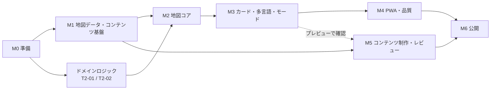

# 「ご当地めいぶつ日本地図」開発計画（タスク分解）

| 項目 | 内容 |
|---|---|
| ドキュメント | docs/development-plan.md |
| 版 | 0.1（ドラフト） |
| 作成日 | 2026-11-11 |
| 元にした設計書 | [development-overview.md](development-overview.md) 0.4 |

---

## 1. この文書について

- [開発概要書](development-overview.md) 第15章のマイルストーン（M0〜M6）を、**1タスク＝1ブランチ＝1PR** の大きさに分ける。
- 要件・仕様は開発概要書に書く。この文書には、作業の順番、依存関係、完了条件だけを書く。仕様を変えるときは開発概要書を先に直す。
- タスクに着手するときは、そのタスクの実装計画（`.plan.md`）を作ってから TDD で進める（`.claude/rules/development-workflow.md`）。
- タスクが終わったら、この文書の「状態」を更新する（`未着手` → `作業中` → `完了`）。

### 1.1 表の見方

| 列 | 内容 |
|---|---|
| ID | `T<マイルストーン>-<連番>`。PRの本文に書いて、計画とPRを対応付ける |
| 種別 | コミット・PRの `<type>`（feat / chore / ci / docs / test / perf）。`手作業` はPRを作らないオーナーの作業 |
| 対応 | 開発概要書の要件ID・章・決定事項（D）・未決事項（U） |
| 依存 | 先に終わっている必要があるタスク |

---

## 2. 全体の流れ

開発概要書 第15章からの変更点：

| 変更 | 理由 |
|---|---|
| コンテンツのスキーマ・検証・ふりがなのパーサーを M1 に入れる | M5（コンテンツ制作）は M1 の後に始まるが、スキーマと検証がないとYAMLを書き始められないため |
| UI文言の辞書（D28）を M2 の最初に作る | M2 で作るボタン・凡例などの文言を、後から辞書に置き換える手間をなくすため。言語切替（F-I18N-01〜03）は M3 のまま |
| 操作の状態遷移（mapReducer）とUI文言の辞書は、M0 が終われば M1 と並行して作れる | 画面にも地図データにも依存しない純粋なロジックのため |
| M5 のレビューは、M3 のカードができてから本格的に始める | レビュアーはプレビューURLでカードの表示を見て確認するため（9.4） |

---

## 3. M0 準備

完了条件：空のページ（3言語）がプレビューと本番にデプロイできる。

| ID | 種別 | タスク | 主な内容 | 対応 | 依存 | 状態 |
|---|---|---|---|---|---|---|
| T0-01 | chore | Next.jsの雛形 | `.nvmrc`（Active LTS）、pnpm、Next.js（App Router、`output: 'export'`、`basePath: '/maps'`、`trailingSlash: true`）、TypeScript strict、`app/[lang]/layout.tsx`（`<html lang>`、`generateStaticParams`、`dynamicParams = false`）、`isLang()`、Tailwind CSS v4（`globals.css` に `@import` と空の `@theme`）、`browserslist` | 6.2、6.5、5.3、D26、D28 | — | 未着手 |
| T0-02 | chore | 検査・テストの道具 | ESLint、Prettier（既存の `.prettierrc`）、markdownlint・yamllint のスクリプト化、Vitest（カバレッジの基準：全体80%・ドメインロジック90%）、Testing Library、Playwright（Chromium・Firefox・WebKit、スマホ・タブレットの端末設定）、`package.json` のスクリプト（`lint` `typecheck` `test` `test:e2e`）。`isLang()` の単体テストとトップページの E2E を最初のテストにする | 10.2、5.3 | T0-01 | 未着手 |
| T0-03 | chore | `dist/` の組み立てとローカルの Workers 確認 | `basePath` を付けたときの `out/` の構成を確認（U8）。`scripts/postbuild.ts` で `dist/maps/` を組み立て、`_redirects`・`_headers`（CSP以外）を置く。`wrangler.jsonc`。`wrangler dev` に対して E2E を実行し、`/maps` → `/maps/ja/` の301を確認する | 6.4、11.4 (2)〜(4)、F-I18N-01・02、U8、R7 | T0-02 | 未着手 |
| T0-04 | ci | PR用のCI（チェックだけ） | `ci.yml` の `check` job（install → lint・typecheck → test → build → e2e）。Action は SHA で固定。`dependabot.yml`、`CODEOWNERS`。`paths-ignore` で実行されなかったPRがブランチ保護でmergeできなくならないかを確認する | 12.1〜12.3、11.5 | T0-03 | 未着手 |
| T0-05 | 手作業 | Cloudflare・GitHubの事前設定 | DNS（`build.vivagain.jp`、プロキシ有効）、workers.dev のサブドメイン、API Token（最小権限を試して確定。U5）、Zero Trust・Access（U7）、GitHub Environments（`preview` / `production`）と Secrets、ブランチ保護、Team `maps-reviewers`。結果を開発概要書 第11章に反映する | 第11章、U5、U7 | — | 未着手 |
| T0-06 | ci | プレビュー・本番へのデプロイ | `ci.yml` の `preview` job（`wrangler versions upload --preview-alias pr-N`、PRにURLをコメント）、`deploy.yml`（`main` へのpushで `wrangler deploy`）。`workers_dev: false` と `preview_urls: true` の同時設定を確認する（U6）。プレビューのページに `noindex` を付ける | 12.1〜12.3、11.4 (5)、U6、R4 | T0-04、T0-05 | 未着手 |
| T0-07 | docs | 既存ファイルの更新 | `README.md` の本文、`AGENTS.md` のコマンド、`CHANGELOG.md` の Unreleased | 6.5 | T0-06 | 未着手 |

- T0-05 は PR を作らないので、T0-01〜T0-04 と並行して進められる。
- U5・U6・U7・U8 の結果は、そのタスクのPRで開発概要書（第6章・第11章・第16章）にも反映する。

---

## 4. M1 地図データ・コンテンツ基盤

完了条件：47都道府県と全市区町村（政令指定都市の区を含む）を確認でき、サイズが基準値（5.1）以内。全県の基本情報のYAMLがスキーマの検証を通る。

### 4.1 地図データ

| ID | 種別 | タスク | 主な内容 | 対応 | 依存 | 状態 |
|---|---|---|---|---|---|---|
| T1-01 | docs | 元データの確認 | N03 2026年版を `geo/downloads/` に取得し、政令指定都市の区が区単位で入っているかを確認する（U9）。総務省コード・国土地理院データの利用条件を確認する（U10）。結果を開発概要書 第8章に反映する | 8.1、8.2、U9、U10 | — | 未着手 |
| T1-02 | feat | 読みがな・ローマ字の変換 | 総務省コードのカナ → ひらがな、ヘボン式ローマ字。長音の書き方は着手時に決める（U12） | 7.4、F-I18N-05 | T0-02 | 未着手 |
| T1-03 | feat | 投影法の設定と沖縄の別枠 | 投影法の設定を1つのモジュールにまとめる（ビルド時と実行時で共用）。沖縄県を左上の枠に移す変換 | 6.6 (1)、F-MAP-02 | T0-02 | 未着手 |
| T1-04 | feat | 地図データの変換スクリプト | `geo/scripts/build-geo.ts`（mapshaper）。市区町村（政令市は区）→ `public/geo/muni/NN.topo.json`、それを合わせて `geo/data/prefs.topo.json`（県名ラベルの位置を含む）。`geo/README.md` に手順・データの版・簡略化の度合い・出典を書く | 第8章、7.4、F-MUNI-01 | T1-01、T1-02、T1-03 | 未着手 |
| T1-05 | test | 地図データの検査 | 47県がそろっているか、市区町村の数と項目（`code` `name.ja` `kana` `name.en` `cityName`）、1県あたりのサイズ（圧縮後100KB以下）をCIで確認する | 5.1、7.4 | T1-04 | 未着手 |

### 4.2 コンテンツ基盤

| ID | 種別 | タスク | 主な内容 | 対応 | 依存 | 状態 |
|---|---|---|---|---|---|---|
| T1-06 | feat | ふりがなの記法のパーサー | `src/lib/ruby.ts`。`{漢字\|よみ}` を構文木にし、`<ruby>` として出力できる形にする（`dangerouslySetInnerHTML` を使わない）。括弧の対応、空の読み、ひらがな以外の読みを検出する。ふりがなのない漢字を警告として返す | 7.2 | T0-02 | 未着手 |
| T1-07 | feat | コンテンツのスキーマと読み込み | `content/schema/prefecture.schema.json`、スキーマからの型の生成、`src/lib/content.ts`（YAMLの読み込みと検証）、`scripts/validate-content.ts`（件数3件ずつ、全言語・全モード、文字数（警告）、ふりがな、`sources` が空なら警告）。`pnpm content:validate` | 7.1〜7.3、10.2 | T1-06 | 未着手 |
| T1-08 | feat | 47県の基本情報 | 47県のYAMLに、コード・地方・県名・県庁所在地（3言語、ふりがな）と県庁の緯度経度だけを書く。名物・名所・行き方は空にして、スキーマで「未作成」を許す | 7.1、8.1 | T1-07 | 未着手 |

- T1-06・T1-07 は地図データに依存しないので、T1-01〜T1-05 と並行して進められる。
- T1-08 で「名物・名所が空の県」を扱えるようにしておくと、M2・M3 は実際のコンテンツがなくても作れる（4.11.4 の「準備中」の表示で確認できる）。

---

## 5. M2 地図コア

完了条件：F-MAP / F-ZOOM / F-MUNI / F-TIP / F-IDX / F-KB の E2E が通る。

| ID | 種別 | タスク | 主な内容 | 対応 | 依存 | 状態 |
|---|---|---|---|---|---|---|
| T2-01 | feat | 操作の状態遷移 | `mapReducer(state, event)`。4.11.2 の表の1行ごとに単体テストを書く。「最大化した県は必ず固定」などの不変条件もテストする | 4.11.1、4.11.2 | T0-02 | 未着手 |
| T2-02 | feat | UI文言の辞書 | `src/i18n/ja.ts`（基準）、`en.ts`・`zh.ts`（`satisfies Messages`）、`{ kids, adult }` の文言、`Intl.NumberFormat`。3言語のキーがそろっていること・空の文言がないことの単体テスト。言語ごとのフォントの並び（`:lang()`） | 6.2（D27・D28）、F-I18N-04 | T1-06 | 未着手 |
| T2-03 | feat | 画面の枠組み | Header・Map・Card・Index・Footer の配置（1024px以上は2列、768〜1023pxは縦、768px未満は地図を全幅）。Card は県名だけを出す仮の表示にする。下から出るパネルは T3-06 で作る | 4.11.7、F-MAP-05 | T0-03、T2-02 | 未着手 |
| T2-04 | feat | 都道府県の地図の描画 | ビルド時に `prefs.topo.json` をSVGのパスにしてHTMLに埋め込む。8地方の色（`@theme` の変数）、県名ラベル（幅820px以下で隠す）、沖縄の点線枠、海域名、凡例、ライト・ダーク。県のパスに `role="button"` と `aria-label` | F-MAP-01〜04・06、6.6 (1)、5.2、D24 | T1-04、T2-03 | 未着手 |
| T2-05 | feat | ホバー・固定・最大化の結線 | Pointer Events で、ホバー・クリック・ダブルクリック・海のクリックを `mapReducer` につなぐ。選択中の県の見た目は `aria-*` / `data-*` のバリアントで書く。カードの表示ルール（最後にホバーした県を残す、案内文）。タップは固定として扱い、ダブルタップは使わない | F-CARD-01・07、F-ZOOM-04、4.11.1〜4.11.3 | T2-01、T2-04 | 未着手 |
| T2-06 | feat | 拡大・縮小・移動 | d3-zoom。「＋」「−」「全体」ボタン、ホイール、ピンチ、ドラッグ・スワイプ、`touch-action: none`、ダブルクリックでの拡大を無効化、最大化した県への拡大と縮小の下限、`prefers-reduced-motion`。表示範囲の計算は純粋関数にして単体テストを書く | F-ZOOM-01〜05、4.11.3 | T2-05 | 未着手 |
| T2-07 | feat | 市区町村データの読み込み | 最大化したときに読み込む。形の簡単な検証、300msを超えたら「読み込み中」（`aria-live`）、失敗時の表示と再試行ボタン、オフライン時の文言 | F-MUNI-05、4.11.5 | T2-06 | 未着手 |
| T2-08 | feat | 市区町村の描画 | 濃淡を付けた境界、ほかの県を薄く表示、ホバーで強調、入りきるラベルだけ表示（拡大すると増える。間引きは純粋関数にして単体テスト）、最大化中の「市区町村の一覧」（`
`） | F-MUNI-01〜04、4.11.6 | T2-07 | 未着手 |
| T2-09 | feat | ツールチップ | 県（県名＋名物3つの名前）と市区町村（名前・読みがな、政令市の区は「市名＋区名」）。マウス操作のときだけ表示する | F-TIP-01・02 | T2-08 | 未着手 |
| T2-10 | feat | 県名さくいん | 8地方ごとの県名ボタン。地図と同じ状態遷移。JavaScriptがないときは `href="#pref-NN"` のリンクとして動く | F-IDX-01〜03、6.6 (2) | T2-05 | 未着手 |
| T2-11 | feat | キーボード操作 | roving tabindex、矢印キー・Home・End、Enter・Space・Shift + Enter、`+` `-` `0`、Esc | F-KB-01〜05、4.11.6 | T2-06、T2-10 | 未着手 |

- T2-01・T2-02 は M1 と並行して進められる。
- T2-09 は、名物の名前を表示するので、県のカードのデータ（T1-07）を使う。名物がない県は県名だけを表示する（4.11.4）。

---

## 6. M3 カード・多言語・モード

完了条件：F-CARD / F-I18N / F-MODE / F-SRC の E2E が通る。最初の読み込みのサイズを実測し、5.1 の基準値以内であることを確認する（D24）。

| ID | 種別 | タスク | 主な内容 | 対応 | 依存 | 状態 |
|---|---|---|---|---|---|---|
| T3-01 | feat | 東京からの距離 | `src/lib/distance.ts`（ハバーサイン公式、半径6,371km、10km単位に丸める）。既知の値と比べる単体テスト | F-CARD-03、7.5 | T1-08 | 未着手 |
| T3-02 | feat | 本番用・プレビュー用のコンテンツの絞り込み | 本番は `reviewed` の項目だけを出し、そうでない項目がある県は「準備中」にする。プレビューはすべて出して「下書き」と付ける。`pnpm build` と `pnpm build:preview` | 7.1、4.11.4 | T1-07 | 未着手 |
| T3-03 | feat | 県のカード | 47県分のカードをサーバーコンポーネントでHTMLに出力し、`hidden` で隠す（内容をクライアントコンポーネントの props に渡さない）。見出し、距離、行き方（「目安」と明記）、名物3つ、名所3つ、最大化ボタン、「準備中」の表示。JavaScriptがないときは `:target` で表示する | F-CARD-02〜06・08、4.11.4、4.11.7、6.6 (2)、D24 | T2-05、T3-01、T3-02 | 未着手 |
| T3-04 | feat | 出典の表示 | カードの出典欄（`
`）、項目ごとのタイトル・URL・確認日、「出典なし」。フッターの地図データの出典と「AIで作成し、人が確認しています」 | F-SRC-01〜04、8.3 | T3-03 | 未着手 |
| T3-05 | feat | モード・ふりがなの切替 | `<head>` の初期化スクリプト（500バイト未満、localStorage は try/catch）、`<html data-mode data-ruby>`、CSSだけでの切替、`@custom-variant kids`、ビルド時の既定値。着手時に U1（既定値）を決める | F-MODE-01〜04、6.6 (3)、D23、U1 | T3-03 | 未着手 |
| T3-06 | feat | スマホの下から出るパネル | 2段階（一部・約85%）、開閉は固定の有無に合わせる、開いたら見出しへ・閉じたら県へフォーカスを移す | F-MAP-05、4.11.3、4.11.6、4.11.7 | T3-03 | 未着手 |
| T3-07 | feat | 言語の切替 | 言語切替ボタン、`hreflang`（`ja` / `en` / `zh-Hans` / `x-default`）、固定している県をハッシュ（`#pref-NN`）で引き継ぐ、開いたときのハッシュで固定する | F-I18N-01〜03、4.11.2 | T3-03 | 未着手 |
| T3-08 | perf | 最初の読み込みのサイズの実測 | Lighthouse で3言語のサイズと速度を測り、結果を開発概要書 6.6 (2) に記録する。基準値を超えたら、言語ごとのJSONを後から読み込む方式に切り替えるタスクを追加する | 5.1、6.6 (2)、D24 | T3-04〜T3-07 | 未着手 |

---

## 7. M4 PWA・品質

完了条件：axe の違反0件、Lighthouse が基準値以内。

| ID | 種別 | タスク | 主な内容 | 対応 | 依存 | 状態 |
|---|---|---|---|---|---|---|
| T4-01 | feat | CSP | `scripts/postbuild.ts` でインラインスクリプトのSHA-256を集め、`_headers` のCSPにページごとに書き込む。Web Analytics のドメインを許可する。E2EでCSP違反がないことを確認する | 5.5、6.6 (4)、D23、R9 | T3-05 | 未着手 |
| T4-02 | feat | PWA | Web App Manifest、Service Worker（ツールは着手時に選ぶ。U13）、アプリの枠組みのキャッシュ、一度見た県の市区町村のキャッシュ。着手時に U3（オフラインで使える範囲）を決める | 5.4、U3、4.11.5 | T2-07、T4-01 | 未着手 |
| T4-03 | test | アクセシビリティ | axe（3言語 × 2モード × ライト・ダーク）を E2E に入れ、違反をなくす。コントラスト 4.5:1、`<ruby>` の読み上げの確認 | 5.2 | T3-07 | 未着手 |
| T4-04 | ci | Lighthouse CI | `/maps/ja/`・`/maps/en/`・`/maps/zh/` で基準値を超えたらCIを失敗させる | 5.1 | T3-08 | 未着手 |
| T4-05 | feat | 「このサイトについて」とプライバシーポリシー | 3言語。地図データの出典と加工の明記、暫定の境界がある旨、AIで作成し人が確認していること、Cookieを使わないアクセス解析 | F-SRC-04、8.2、8.3、5.6、R10 | T3-07 | 未着手 |
| T4-06 | test | 対応環境の確認 | Playwright の端末・画面幅の組み合わせ（360px以上、タブレット768〜1366px）を整える。公開前の実機確認のチェックリストを作る | 5.3、D25 | T4-03 | 未着手 |

---

## 8. M5 コンテンツ制作・レビュー

完了条件：全項目が `reviewed`。

| ID | 種別 | タスク | 主な内容 | 対応 | 依存 | 状態 |
|---|---|---|---|---|---|---|
| T5-01 | docs | 執筆ルールとレビュー基準 | `content/guidelines/writing.md`、`content/guidelines/review-checklist.md` | 7.2、7.3、9.3、9.4 | T1-07 | 未着手 |
| T5-02 | feat | 生成スキルと検証エージェント | `.claude/skills/`（①おとな ja＋出典の下書き、③派生版の生成）、`.claude/agents/`（②④の検証）。既存のスキル・エージェントと名前を重ねない。下書きのふりがなは形態素解析で自動で付ける | 9.2、7.2、D22 | T5-01 | 未着手 |
| T5-03 | ci | 出典のリンク切れチェック | `scripts/check-links.ts`、`link-check.yml`（手動実行、同時リクエスト数と間隔の上限、Markdownのレポート） | 12.4、D15 | T1-07 | 未着手 |
| T5-04 | feat | 1県目（試行） | 1県を ①〜⑧ の流れで最後まで通し、レビュアーとプレビューURLで確認する。分かった問題をスキル・ルールに反映する | 第9章 | T5-02、T0-06、T3-04 | 未着手 |
| T5-05 | feat | 残りの46県 | 1県＝1PR。地方ごとにまとめて進める。PR名は `feat: add content for <prefecture>` | 第9章、R8 | T5-04 | 未着手 |

- T5-01〜T5-03 は M2・M3 と並行して進められる。
- T5-04 は、レビュアーがカードの表示で確認できるように、M3 のカード（T3-03・T3-04）とプレビューのデプロイ（T0-06）が終わってから始める。

---

## 9. M6 公開

完了条件：`https://build.vivagain.jp/maps/ja/` で公開されている。

| ID | 種別 | タスク | 主な内容 | 対応 | 依存 | 状態 |
|---|---|---|---|---|---|---|
| T6-01 | 手作業 | 実機での確認 | T4-06 のチェックリストで、学校の端末（1つ前のiPadOSを含む）・スマホ・タブレットを確認する | 5.3 | T4-06、T5-05 | 未着手 |
| T6-02 | chore | 公開 | `CHANGELOG.md` に v1.0.0 を書き、本番にデプロイする。Web Analytics で計測できていることを確認する | 第13章、D21 | T6-01 | 未着手 |

---

## 10. 着手時に決めること

開発概要書の未決事項（第16章）のうち、タスクの中で決めるもの。推奨案は現時点の案で、着手時に確かめてから確定する。決めたらそのPRで開発概要書を更新する。

| 項目 | 決めるタスク | 推奨案 | 理由 |
|---|---|---|---|
| U1 モードとふりがなの既定値 | T3-05 | 日本語はこども向け＋ふりがなON、英語・中国語はおとな向け | 日本語の主な利用者は小学生。英語・中国語の利用者は訪日客などの大人（第2章） |
| U3 PWAでオフライン時に使える範囲 | T4-02 | 5.4 の案のとおり（アプリの枠組みはインストール時、市区町村は一度見た県だけ） | 都道府県の地図と全コンテンツはHTMLに含まれるので、枠組みだけで主な機能が使える。市区町村を全部先に読むと通信量が大きい |
| U5 API Tokenの最小権限 | T0-05 | 11.3 の表の組み合わせから始め、`wrangler deploy` と `wrangler versions upload` が通る範囲で減らす | 実際に試さないと必要な権限を確定できないため |
| U6 `workers_dev: false` と `preview_urls: true` | T0-06 | 両方を設定する。同時に設定できなければ `workers_dev: true` にし、workers.dev のURLも Access で保護する | 本番を workers.dev で公開しないことが目的で、Access で保護できれば同じ目的を果たせる（11.4 (5)） |
| U7 Accessの設定手順 | T0-05 | 公式ドキュメントの手順で設定し、手順を開発概要書 11.4 (5) に残す | 年1回のToken更新などで、同じ作業をくり返すため |
| U8 basePathを指定したときの静的出力の構成 | T0-03 | `out/` の構成にかかわらず、`scripts/postbuild.ts` で必ず `dist/maps/` に組み立てる | Next.js の版で出力の構成が変わっても壊れない（R7）。CSPの書き込み（6.6 (4)）でも postbuild は必要 |
| U9 政令指定都市の区がN03に区単位で入っているか | T1-01 | 確認だけ。入っている見込み（政令市名と区名が別の属性になっている） | 入っていなければ、代わりのデータを探すタスクを追加する |
| U10 総務省コードと国土地理院データの利用条件 | T1-01 | 確認だけ。条件に合わなければ、県庁の緯度経度は自治体の公表値を使う | 距離は10km単位に丸めるので、公表元が変わっても結果はほぼ同じ |
| U12 市区町村名のローマ字の長音の書き方 | T1-02 | 長音を書かない（`Tokyo`、`Kyoto`） | 県名の英語表記（例：`Hokkaido`）や駅名・道路標識の一般的な表記とそろう。訪日客が検索するときの表記とも合う |
| U13 Service Worker のツール | T4-02 | workbox-build（`dist/` に対して postbuild で `sw.js` を作る） | Next.js のバンドラーに依存せず、静的出力の後の工程（CSP、`dist/` の組み立て）にそのまま組み込める。着手時に Serwist の静的出力への対応も確認する |
